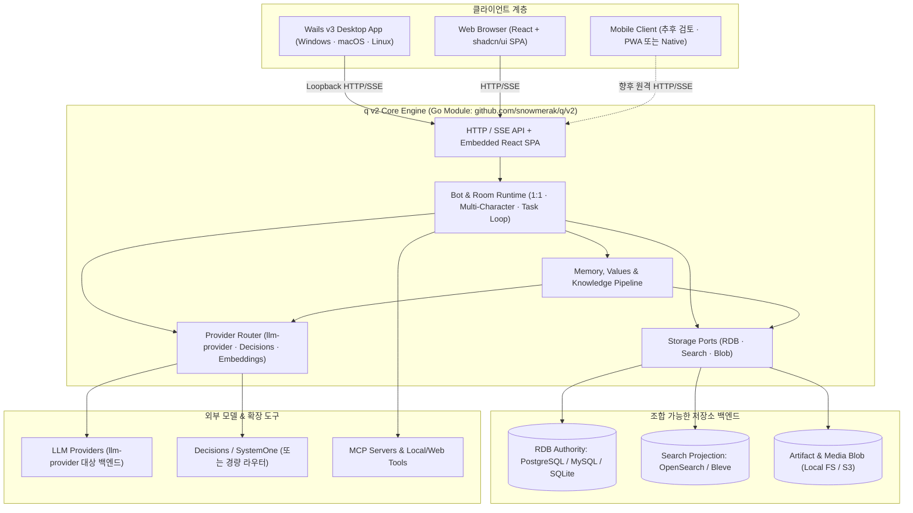
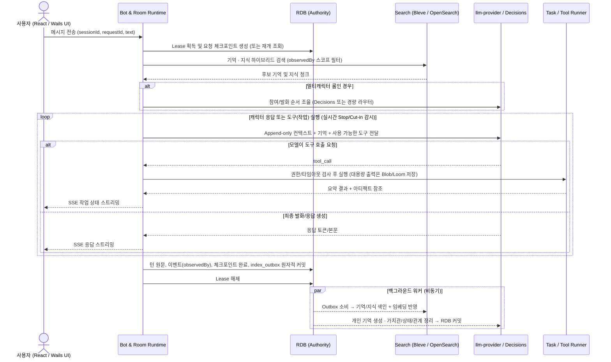
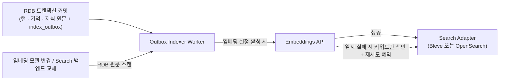

# q v2 프로젝트 청사진 (Blueprint)

- **작성일:** 2026-11-28
- **상태:** 초안 (Draft — 확정 결정 / 제안 설계 / 미결 항목을 구분하여 표기)
- **관련 문서:** [제품 요구사항 정의서 (PRD)](./prd.md)
- **대상 독자:** q v2 백엔드, 저장소, 프런트엔드, 데스크톱 앱 설계 및 구현자
- **갱신 조건:** 시스템 경계, 저장소 권위 및 복구 모델, 주요 실행 흐름, 모듈 구성, 마일스톤 방향이 바뀔 때 갱신한다.

> [!IMPORTANT]
> **현재 상태 안내:** `v2` 브랜치는 기존 v1 코드를 정리한 **문서 선행 단계**이며, 아직 v2 애플리케이션 코드나 테스트는 구현되지 않았습니다. 본 문서에서 **[확정]** 표기는 사용자 합의를 반영한 방향이고, **[제안]** 표기는 구현 전 검증 및 ADR로 확정이 필요한 설계안입니다.

---

## 1. 목적 및 기존 자산 선별 이식 맵

q v2는 기존 세 저장소(**Evernight**, **q v1**, **llm-provider**)의 검증된 구성요소를 **캐릭터챗 중심 + 다중 작업 수행 봇**이라는 단일 정체성에 맞게 재조합합니다.

| 출처 저장소 | 가져올 핵심 자산 (선별 이식) | 가져오지 않을 자산 (v2 제외) | 어댑팅 포인트 |
| --- | --- | --- | --- |
| **Evernight** (`rileyayla/evernight`) | - 캐릭터·페르소나 스냅샷 모델<br>- 1:1(`SimpleChatLoop`) 및 다중 참여자(`PacedLoop`) 턴 조율 개념<br>- `observedBy` 기반 인지 격리 및 실시간 끼어들기/중단(`InterceptHub`)<br>- 장기기억 회상 파이프라인(게이트→플래너→검색→선별) 및 시간 감쇄<br>- 캐릭터 가치관/상태/관계 백그라운드 정리 워커<br>- Lease + Fencing Token + 단계별 체크포인트 복구 패턴 | - SvelteKit 서버/UI 코드 (Go + React로 전환)<br>- 3인칭 연재 소설 강제 집필 포맷<br>- OpenSearch를 원문 권위 저장소로 쓰는 구조 (RDB 권위로 통합 제안) | TypeScript 로직을 Go 도메인/런타임 패키지로 재구현하고, 봇의 도구(작업) 호출과 캐릭터 발화가 같은 턴 상태 머신 위에서 공존하도록 확장 |
| **q v1** (`snowmerak/q` `main`) | - 도구 실행 루프의 안전 경계(타임아웃, 취소, 호출 상관관계, 중단 복구)<br>- 대용량 도구 출력 불변 아티팩트 분리(Loom 패턴)<br>- MCP 클라이언트 / Portable Agent Skills 로딩 패턴<br>- 지식 저장소 청킹·리비전·Outbox 재색인 패턴<br>- `storageconfig` 기반 로컬/원격 저장소 전환 패턴<br>- `desktop/` 별도 Go 모듈 + Wails v3 패키징 경험 | - Git worktree 위임 코디네이터<br>- 이슈/티켓 칸반 보드, Commit 에이전트<br>- LSP, TUI(Bubbletea), ACP SDK 포크<br>- 40여 개 루트 패키지 분산 구조 & Svelte Studio UI | 코딩 워크스페이스(`workspace_root` / Git) 중심 의존성을 제거하고, 봇·룸·지식 단위 스코프로 재정의 |
| **llm-provider** (`snowmerak/llm-provider`) | - 통합 Go LLM 인터페이스 및 OpenAI 호환 게이트웨이<br>- 모델 목록 캐시/hot-reload(`fsnotify`)<br>- 모델 메타데이터·능력(`capabilities`: 도구 호출, 추론 강도 `effort`/`toggle`/`token_budget`, `context_length`)<br>- 프롬프트 캐시 사용량 정규화 및 임베딩 연동 | - 별도 단독 서비스로만 운영해야 하는 제약 (내장 라이브러리 또는 외부 게이트웨이 선택 가능하도록 어댑팅) | q v2 코어에서 Go 패키지로 직접 임베드하거나 로컬/원격 게이트웨이 엔드포인트로 연결; 역할별 모델 라우터와 결합 |

---

## 2. 시스템 컨텍스트 및 런타임 토폴로지

### 2.1 시스템 컨텍스트 다이어그램 **[제안]**



### 2.2 코어 엔진과 데스크톱 셸 분리 원칙 **[제안]**

q v1의 `desktop/` 구조에서 검증된 경계를 계승합니다.

1. **코어 엔진 (`github.com/snowmerak/q/v2`)**: HTTP/SSE API 서버와 빌드된 React SPA 정적 자산을 내장(`embed`)하는 순수 Go 바이너리/모듈입니다. CLI나 로컬 서버, 컨테이너로 단독 실행할 수 있고 Wails/GTK/WebView2 같은 GUI 네이티브 의존성을 갖지 않습니다.
2. **데스크톱 셸 (`desktop/go.mod`)**: Wails v3를 pinned 버전으로 의존하는 별도 Go 모듈입니다. 네이티브 창, 시스템 트레이, 닫기 시 백그라운드 유지, 로그인 자동 실행을 담당하며 번들된 코어 엔진을 관리합니다.
3. **모바일 확장 대비**: 모든 대화 상태, 체크포인트, 기억, 도구 실행은 코어 엔진이 소유합니다. 클라이언트는 API/SSE 소비자에 머물러 추후 모바일 웹(PWA)이나 React Native 앱을 붙이더라도 코어 엔진 구조를 바꾸지 않습니다.

---

## 3. 핵심 도메인과 책임 경계 (Building Blocks) **[제안]**

| 블록 | 소유 책임 | 주요 입력 / 출력 | 의존 방향 |
| --- | --- | --- | --- |
| `domain` | 순수 엔티티·값 객체 (`Character`, `Persona`, `Room`, `Turn`, `Event`, `Memory`, `Value`, `KnowledgeDoc`, `Artifact`) 및 불변식 검증 | 외부 프레임워크·DB에 비종속 | 의존 없음 (최하위 핵심) |
| `runtime` | 1:1 대화 루프, 멀티캐릭터 룸 스케줄러, `observedBy` 인지 격리, 실시간 인터럽트/취소, Append-only 프롬프트 조립·압축, 턴 체크포인트 | 사용자 입력, 룸 상태 → 턴 이벤트, 어시스턴트/캐릭터 응답, 작업 요청 | `domain`, `provider`, `memory`, `task`, `storage` |
| `task` | 대화 중 도구 호출 루프, 권한 검사, 타임아웃·취소, 대용량 출력 불변 아티팩트(Loom 패턴) 저장, MCP·내장 도구 어댑터 | 모델의 tool call → 도구 실행 결과 요약 + 아티팩트 ID | `domain`, `storage` (Blob/RDB) |
| `memory` | 기억 회상(게이트 → 쿼리 플래너 → 하이브리드 검색 → 후보 선별), 개인/룸 기억 생성, 백그라운드 워커(가치관·상태·관계 정리) | 확정 턴 이벤트, 검색 쿼리 → 주입용 기억 세트, 갱신된 가치관/상태 | `domain`, `provider`, `storage` |
| `knowledge` | 사용자·봇 지식 문서 수집, 청킹, 리비전 관리, 하이브리드 검색 | 문서/노트/파일 → 검색 가능한 지식 청크 | `domain`, `provider`, `storage` |
| `provider` | `llm-provider` 통합, 역할별 모델 해석(대화/기억정리/회상플래너/판단/임베딩), 능력(`capabilities`) 노출, Decisions 추상화, 설정 hot-reload | 역할·메시지·스키마·도구 목록 → 스트림/완성 응답, 임베딩 벡터, 판단 결과 | `domain`, `llm-provider` |
| `storage` | RDB 포트(`PostgreSQL`/`MySQL`/`SQLite`), Search 포트(`OpenSearch`/`Bleve`), Blob 포트(로컬 FS/S3) 및 Outbox/Lease 구현 | 도메인 레코드, 색인 문서, 검색 질의 → 영속화 결과, 하이브리드 랭킹 | `domain` |
| `web` & `desktop` | React + TypeScript + shadcn/ui SPA(라이트/다크 테마) 및 Wails v3 네이티브 래퍼 | 코어 HTTP/SSE API → 사용자 인터페이스 및 데스크톱 제어 | 코어 HTTP/SSE 계약만 의존 |

---

## 4. 조합 가능한 저장소 아키텍처 (Data Authority & Recovery View)

### 4.1 권위 저장소(RDB)와 검색 프로젝션(Search)의 분리 **[제안]**

Evernight은 확정 본문·기억의 원문을 OpenSearch `_source`에 두었으나, q v2는 **PostgreSQL / MySQL / SQLite**와 **OpenSearch / Bleve**의 자유로운 조합을 요구합니다. 서로 다른 검색 엔진 간에 원문 내구성과 트랜잭션 일관성을 동일하게 유지하기 위해 다음과 같이 책임을 분리합니다.

- **단일 진실원 (Authority) = RDB (`PostgreSQL` / `MySQL` / `SQLite`)**
  - 캐릭터, 페르소나, 룸, 컨텍스트, 턴 원문, 구조화 이벤트(`observedBy` 포함), 기억 원문, 가치관, 지식 문서 메타/원문, Lease, 체크포인트, Outbox를 단일 RDB 트랜잭션으로 커밋합니다.
- **파생 프로젝션 (Projection) = Search (`OpenSearch` / `Bleve`)**
  - Search 저장소는 전문 검색(BM25)과 벡터 유사도 검색을 가속하는 **파생 인덱스**로 취급합니다.
  - RDB의 `index_outbox` 테이블을 소비해 비동기로 색인하며, Search 백엔드를 교체하거나(`Bleve` ↔ `OpenSearch`) 임베딩 모델을 바꿀 때 RDB 원문으로부터 전체 재색인이 가능합니다.
- **대용량 바이너리/출력 = Blob Store**
  - 이미지, 첨부 파일, 장문 도구 출력(Loom 아티팩트) 본문은 로컬 디스크(또는 S3 호환 저장소)에 불변 저장하고, RDB에는 메타데이터와 해시/참조만 기록합니다.

### 4.2 지원 백엔드 조합 및 기술 특성

| 계층 | 백엔드 | 적합 환경 | 락 / 작업 큐 구현 특성 | 주의사항 및 미결 제약 |
| --- | --- | --- | --- | --- |
| **RDB (Authority)** | **SQLite** | 단일 데스크톱 앱, 제로 설정 로컬 실행 | WAL 모드 + 단일 쓰기 직렬화 + 프로세스 간 OS 파일 락 | 다중 서버 수평 확장 불가. SQL 방언과 JSON 컬럼 처리 추상화 필요 |
| **RDB (Authority)** | **PostgreSQL** | 로컬 컨테이너 또는 서버형 다중 접속/고동시성 | `SELECT ... FOR UPDATE SKIP LOCKED` 기반 작업 큐, Advisory/행 Lease | 스키마 마이그레이션 시 MySQL/SQLite와 공통 SQL 또는 드라이버별 쿼리셋 유지 필요 |
| **RDB (Authority)** | **MySQL** | 기존 MySQL 인프라 연동 및 서버 운용 | MySQL 8+ `SKIP LOCKED` 기반 작업 큐 및 트랜잭션 Lease | `json` 정렬/인덱스/UTF-8(`utf8mb4`) 규칙을 PostgreSQL과 맞추는 어댑터 테스트 필수 |
| **Search (Projection)** | **Bleve** | 외부 프로세스 없는 로컬 임베디드 검색 | Go 프로세스 내 직접 색인 (단일 소유자 락 또는 코어 엔진 단일 프로세스 소유) | **[기술 제약 / ADR 필요]** 기본 순수 Go Bleve 구성은 어휘(BM25) 검색을 담당합니다. 로컬 조합(`RDB + Bleve`)에서도 시맨틱 벡터 검색을 지원하려면 q v1의 HNSW 인덱스(`vectors.hnsw`) 결합 또는 RDB 벡터/FAISS 확장 여부를 별도 ADR로 확정해야 합니다. |
| **Search (Projection)** | **OpenSearch** | 대용량 기억·지식, 서버형 고품질 하이브리드 검색 | HTTP REST API 기반 색인·임베딩·k-NN + BM25 하이브리드 검색 | 외부 OpenSearch 클러스터/컨테이너 필요. 임베딩 차원·리비전별 인덱스 분리 관리 |

### 4.3 동시성, 복구 및 멱등성 계약 **[제안]**

Evernight과 q v1에서 검증된 복구 원칙을 통합합니다.

1. **Lease + Fencing Token**: 룸/대화 세션 실행 시작 시 RDB에서 소유자 토큰과 만료 시각이 담긴 Lease와 단조 증가하는 `fence_generation`을 획득하고 heartbeat로 연장합니다. **긴 LLM/도구 네트워크 호출 동안에는 DB 트랜잭션이나 행 잠금을 점유하지 않습니다.**
2. **단계별 체크포인트 & 멱등 `requestId`**: 사용자 턴 요청은 클라이언트 `requestId`와 입력 지문을 함께 기록합니다. 중간 실패 후 같은 `requestId`로 재시도하면 이미 완료된 모델/도구 단계 결과를 체크포인트에서 재사용하며, 다른 입력이 들어오면 `409 Conflict`로 거절합니다.
3. **Outbox 기반 색인 복구**: 턴이나 지식이 RDB에 커밋되면 같은 트랜잭션에 `index_outbox` 레코드를 남깁니다. Search 장애나 임베딩 서버 일시 중단이 발생해도 대화 커밋을 막지 않으며, 복구 후 Outbox 워커가 지연된 색인을 따라잡습니다.

---

## 5. 주요 실행 흐름 (Major Flows)

### 5.1 턴 실행 흐름 (1:1 · 멀티캐릭터 · 작업 연계 공통 골격) **[제안]**



### 5.2 Outbox 기반 검색 프로젝션 및 재색인 흐름 **[제안]**



---

## 6. 프런트엔드 및 클라이언트 아키텍처 **[확정 + 제안]**

### 6.1 웹 UI 스택 및 디자인 시스템

- **기술 스택 [확정]:** **React**, **TypeScript**, **Vite**, **Tailwind CSS**, **shadcn/ui** 기반 컴포넌트 라이브러리.
- **테마 시스템 [확정]:** shadcn/ui의 시맨틱 CSS 변수 토큰(`background`, `foreground`, `card`, `muted`, `border`, `primary` 등)을 기준으로 **라이트 모드 / 다크 모드 / 시스템 설정 따름**을 초기부터 내장합니다.
- **클라이언트 계층 분리 [제안]:**
  - `web/src/client/`: 프레임워크 비종속 TypeScript HTTP/SSE 클라이언트, 요청 `requestId` 생성기, 스트림 이벤트 파서, 공유 타입.
  - `web/src/features/`: 대화(1:1 및 룸), 작업 진행 카드/아티팩트 드로어, 캐릭터/페르소나 편집기, 지식 저장소 브라우저, 모델/저장소 설정.
  - 코어 클라이언트 계층을 React 컴포넌트와 분리해 두면 추후 모바일(React Native/Expo 또는 PWA) 도입 시 API 계약을 그대로 재사용할 수 있습니다.

### 6.2 데스크톱 앱 (Wails v3) 및 모바일 방향

- **데스크톱 [확정]:** q v1의 경험을 이어 **Wails v3**로 Windows(NSIS + WebView2), macOS(DMG), Linux(DEB/RPM, GTK4 + WebKitGTK 6.0) 패키징을 목표로 합니다. 창 닫기 시 트레이 상주, 로그인 시작, 내장 `q-engine` 수명주기 관리를 지원합니다. 도입 시점에 Wails v3의 구체 버전을 `desktop/go.mod`에 고정합니다.
- **모바일 [미결 — 추후 검토]:** 1차 구현에서는 모바일 전용 빌드를 만들지 않되, (1) 반응형 레이아웃으로 작은 뷰포트 대응을 열어두고, (2) 코어 엔진이 loopback 외 신뢰 네트워크/인증 프록시 뒤에서도 동작할 수 있는 API 경계를 유지합니다.

---

## 7. 제안 프로젝트 구성 (Proposed Directory Layout) **[제안]**

사용자가 아직 프로젝트 구성을 확정하지 않았으므로, q v1의 루트 패키지 과밀(~40개 디렉터리)을 피하고 도메인 응집도를 높인 초기 트리를 **제안 초안**으로 제시합니다.

```text
q/                              # Go module: github.com/snowmerak/q/v2
├── go.mod
├── Taskfile.yml                # 빌드·테스트·프런트엔드·패키징 작업 정의 (예정)
├── cmd/
│   └── q/                      # 코어 엔진 및 CLI 진입점 (서버 실행, 재색인 등)
├── internal/
│   ├── app/                    # 의존성 조립, 설정 로더/hot-reload, 수명주기 관리
│   ├── domain/                 # Character, Persona, Room, Turn, Memory, Value, Knowledge
│   ├── runtime/                # 1:1 루프, 멀티캐릭터 룸 스케줄러, observedBy, 인터럽트, 압축
│   ├── task/                   # 도구 호출 루프, 권한, Loom 아티팩트, MCP/내장 도구
│   ├── memory/                 # 기억 회상(게이트·플래너·선별), 기억/가치관/상태 워커
│   ├── knowledge/              # 지식 문서 수집, 청킹, 하이브리드 검색 서비스
│   ├── provider/               # llm-provider 연동, 역할별 라우팅, Decisions 클라이언트
│   ├── storage/                # RDB/Search/Blob 포트 인터페이스 및 공통 계약 테스트
│   │   ├── rdb/                # sqlite, postgres, mysql 어댑터 및 마이그레이션
│   │   ├── search/             # bleve(로컬 검색), opensearch 어댑터
│   │   └── blob/               # localfs, s3 어댑터
│   └── server/                 # HTTP/SSE API 핸들러 및 Embedded SPA 서빙
├── web/                        # React + TypeScript + Vite + Tailwind + shadcn/ui
├── desktop/                    # 별도 Go 모듈 (desktop/go.mod) — Wails v3 셸 및 패키징
└── docs/
    ├── prd.md                  # 제품 요구사항 정의서
    ├── blueprint.md            # 본 프로젝트 청사진
    └── adr/                    # 아키텍처 결정 기록 (예정)
```

---

## 8. 단계별 마일스톤, 리스크 및 후속 ADR **[제안]**

### 8.1 제안 마일스톤

| 마일스톤 | 목표 범위 | 완료 기준(초안) |
| --- | --- | --- |
| **M0. 기반 정렬** | `v2` 브랜치 정리, PRD/Blueprint 확정, 핵심 ADR 작성 | 미결 질문 중 저장소 벡터 전략·룸 프로토콜·디렉터리 구성 합의 |
| **M1. 코어 골격 & 최소 저장소** | `domain`, `storage` 포트 + `SQLite` / `Bleve` 어댑터, `llm-provider` 연동, `cmd/q` HTTP/SSE 골격 | 계약 테스트 통과, 로컬 단일 프로세스로 LLM 호출·영속화 동작 |
| **M2. 1:1 캐릭터 봇 + 기본 UI** | 캐릭터/페르소나 CRUD, 1:1 대화 루프, 기억 회상/가치관 기초, React + shadcn/ui(라이트/다크) 대화 화면 | 1:1 대화, 테마 전환, 실패 요청 재시도 검증 |
| **M3. 작업 실행 & 지식 저장소** | `task` 도구 루프 + Loom 아티팩트 + MCP 연동, `knowledge` 수집·검색 및 UI 연결 | 대화 중 도구 호출·진행 표시·지식 검색 반영 검증 |
| **M4. 멀티캐릭터 룸 & 확장 저장소** | 멀티캐릭터 스케줄러·`observedBy`·실시간 인터럽트, `PostgreSQL` / `MySQL` / `OpenSearch` 어댑터 완성 | 6종 저장소 조합 계약 테스트 및 룸 시나리오 검증 |
| **M5. Wails v3 데스크톱 & 다음 단계** | `desktop/` Wails v3 셸/트레이/패키징, 모바일 확장 방안 재검토 | 데스크톱 빌드 및 패키징 스모크 통과 |

### 8.2 주요 기술 리스크

| 리스크 | 영향 | 완화 방향 |
| --- | --- | --- |
| **Bleve 단독 사용 시 시맨틱(벡터) 검색 부재** | `RDB + Bleve` 조합에서 의미 검색/하이브리드 검색 품질이 `OpenSearch`와 크게 달라질 수 있음 | Bleve(BM25) + 임베디드 HNSW(q v1 패턴) 조합 또는 RDB 벡터 확장을 ADR에서 조기 확정 |
| **RDB 3종(`SQLite`/`PostgreSQL`/`MySQL`) 동시 지원 비용** | SQL 방언, JSON 연산, 마이그레이션, 작업 큐(`SKIP LOCKED` vs SQLite 단일 락) 분기가 복잡해질 수 있음 | 공통 저장소 계약 테스트(Contract Test Suite)를 먼저 구축하고, 최소 SQL 집합(SQLC 또는 드라이버별 얇은 쿼리 구현) 유지 |
| **캐릭터 페르소나 유지 vs 도구 호출 정합성** | 강한 역할극 프롬프트가 모델의 정확한 tool-call JSON/인자 생성을 방해하거나, 반대로 작업 응답 시 캐릭터 톤이 깨질 수 있음 | 내부 작업/판단 지침과 캐릭터 페르소나 영역 분리, 모델 `capabilities.tool_calling` 검증 |
| **멀티캐릭터 룸의 지연·비용·인터럽트 경합** | 캐릭터 수 증가 시 참여 판단·응답·기억 생성 호출이 급증하고, 사용자 끼어들기 시 상태 오염 위험 | 룸당 활성 참여자·턴 예산 상한, 경량 판단 모델 분리, Lease + `fence_generation` + `InterceptHub` 원자적 중단 |
| **Wails v3 플랫폼별 WebView/빌드 의존성** | Linux(GTK4/WebKitGTK 6.0), Windows(WebView2), macOS 서명/공증 등 빌드 환경 편차 | 코어 엔진과 `desktop/` 모듈을 분리 유지해 웹/서버 개발이 데스크톱 툴체인에 막히지 않도록 격리 |

### 8.3 후속 작성할 ADR 후보 (`docs/adr/`)

1. **`ADR-0001`: RDB 단일 권위 + Search 파생 프로젝션 및 로컬(`Bleve`) 벡터 검색 전략**
2. **`ADR-0002`: 멀티캐릭터 룸 턴 조율 방식(Decisions vs 경량 LLM 라우터)과 응답 포맷**
3. **`ADR-0003`: 봇 도구 실행 권한 모델, 샌드박스 경계 및 아티팩트(Loom) 계약**
4. **`ADR-0004`: 프로젝트 디렉터리 구성 및 Go/Web/Desktop 모듈 경계 확정**
