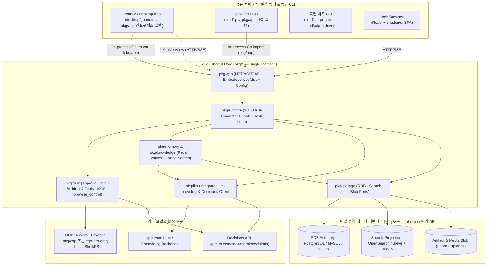
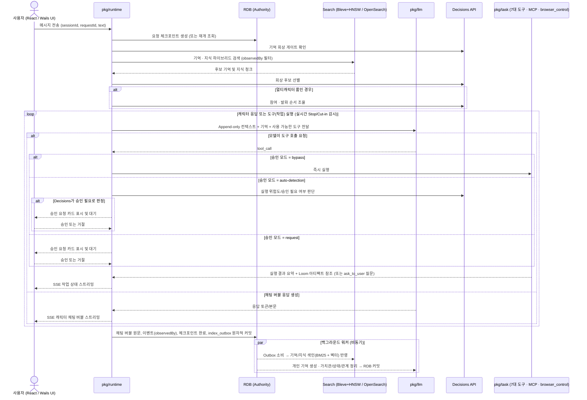
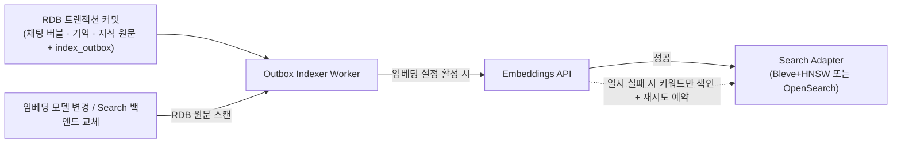

# q v2 프로젝트 청사진 (Blueprint)

- **작성일:** 2026-11-28
- **상태:** 1차 구현 및 검증 완료 (M0~M5 완료)
- **관련 문서:** [제품 요구사항 정의서 (PRD)](./prd.md) · [아키텍처 결정 기록 (ADR)](./adr/README.md) · [구현 스펙 (`docs/specs/`)](./specs/milestones.md)
- **대상 독자:** q v2 백엔드, 저장소, 프런트엔드, 데스크톱 앱 설계 및 구현자
- **갱신 조건:** 시스템 경계, 저장소 권위 및 복구 모델, 주요 실행 흐름, 모듈 구성, 마일스톤 방향이 바뀔 때 갱신한다.

> [!IMPORTANT]
> **현재 상태 안내:** `v2` 브랜치는 M0~M5(코어 통합, 1:1·그룹 룸 런타임, 7대 내장 도구·승인 게이트·지식 저장소, 6종 저장소 조합 검증, Wails v3 데스크톱 셸·트레이·자동 시작·패키징 매니페스트) 구현 및 테스트 검증을 마친 기준선입니다. 본 문서에서 **[확정]** 표기는 사용자 합의 및 구현 완료 기준선이며, 일부 OS별 최종 설치 파일(`makensis`/DMG/`nfpm` 실행)은 대상 OS 패키징 도구 체인에서 수행합니다.

---

## 1. 목적 및 기존 자산 선별 이식 맵

q v2는 기존 저장소(**Evernight**, **q v1**, **llm-provider**, **cdp-q-driver**)의 검증된 구성요소를 **단일 인스턴스 기반의 캐릭터챗 + 다중 작업 수행 봇**이라는 정체성에 맞게 재조합합니다. 기존 데이터는 이관하지 않고 **클린 스타트(신규 시작)**를 전제로 합니다.

| 출처 저장소 | 가져올 핵심 자산 (선별 이식 / 코드 통합) | 가져오지 않을 자산 (v2 제외 확정) | 어댑팅 포인트 |
| --- | --- | --- | --- |
| **Evernight** (`rileyayla/evernight`) | - 캐릭터·페르소나 스냅샷 모델<br>- 1:1(`SimpleChatLoop`) 및 다중 참여자(`PacedLoop`) 턴 조율 개념<br>- **Decisions**(`github.com/snowmerak/decisions`) 기반 이산 판단 패턴<br>- `observedBy` 기반 인지 격리 및 실시간 끼어들기/중단(`InterceptHub`)<br>- 장기기억 회상 파이프라인(게이트→플래너→검색→선별) 및 시간 감쇄<br>- 캐릭터 가치관/상태/관계 백그라운드 정리 워커<br>- 단계별 체크포인트·멱등 `requestId` 복구 패턴 | - SvelteKit 서버/UI 코드 (Go + React로 전환)<br>- **3인칭 연재 소설(`prose`) 재집필 파이프라인 및 문체 프리셋**<br>- OpenSearch를 원문 권위 저장소로 쓰는 구조 (RDB 권위로 통합)<br>- 다중 서버용 분산 Lease 경합 전제<br>- 기존 Evernight 데이터 마이그레이션 | 3인칭 산문 집필을 제거하고 **채팅 버블 중심** 대화 루프로 단순화하며, 도구(작업) 호출 및 승인 게이트를 같은 턴 상태 머신 위에서 처리 |
| **q v1** (`snowmerak/q` `main`) | - **내장 도구 7개 영역** 패턴: 파일·디렉터리(`read_file`, `edit_file`, `write_file` 등), 셸(`run_command`, `cmd_status`, `wait`), 아카이브 조회(`search_archive`, `get_archive_record`), **Loom**(`loom_inspect`, `loom_read`, `loom_eval`), **Agent Skills**(`search_skills`, `get_skill`), **외부 MCP & `browser_control` config**, **`ask_to_user` 및 서브에이전트 위임**(`task_start`, `task_complete`, `delegate_*`)<br>- **Bleve(BM25) + HNSW(벡터)** 임베디드 하이브리드 검색 패턴<br>- 지식 저장소 청킹·리비전·Outbox 재색인 패턴<br>- `storageconfig` 패턴 및 `desktop/` Wails v3 패키징 경험 | - **IDE/Git 전용 도구:** LSP(`lsp_*` 7종), Git worktree 위임 코디네이터, PR/변경 리뷰(`change_request_read`, `review_task`), 이슈/티켓 칸반(`ticket_question`), Commit 에이전트<br>- TUI(Bubbletea), ACP SDK 포크<br>- **다중 프로세스 동시 실행·리더 선출·테이크오버(`workspace-memory`/`library`)**<br>- 루트 ~40개 패키지 분산 구조 & Svelte Studio UI<br>- 프로젝트 폴더별 `.q/` 분산 저장 & 기존 데이터 이관 | 다중 프로세스 락·프록시 구조를 제거해 **단일 인스턴스** 인프로세스 소유 모델과 **전역 단일 데이터 디렉터리**로 단순화하고, `pkg/` 아래 계층화 |
| **llm-provider** (`snowmerak/llm-provider`) | - 통합 Go LLM 인터페이스, OpenAI 호환 게이트웨이, 모델 목록 캐시/`fsnotify` hot-reload<br>- 모델 메타데이터·능력(`capabilities`: 도구 호출, 추론 강도, `context_length`), 프롬프트 캐시 정규화, 임베딩 | — | **레포 내 `pkg/llm` + `cmd/llm-provider`로 직접 코드 통합.** Q 코어가 라이브러리로 임베드하는 동시에 외부 게이트웨이·독립 CLI·공개 Go 패키지로도 사용 가능하게 유지 |
| **cdp-q-driver** (`snowmerak/cdp-q-driver`) | - Chrome/Chromium CDP 브라우저 제어 라이브러리 및 CLI | — | **레포 내 `pkg/cdp` + `cmd/cdp-q-driver`로 직접 코드 통합.** Q 코어가 직접/CLI로 호출하는 동시에 독립 CLI·공개 Go 패키지로 배포 가능하게 유지 |

---

## 2. 시스템 컨텍스트 및 런타임 토폴로지

### 2.1 시스템 컨텍스트 다이어그램 **[확정 + 제안]**



### 2.2 실행 모델 및 코어 공유 원칙

1. **단일 인스턴스(Single-instance) 전제 [확정]**:
   - q v2 코어 엔진은 **하나의 프로세스만 떠서 실행되는 것**을 전제합니다.
   - 기존 q v1의 다중 프로세스 간 리더 선출, HTTP 팔로워 프록시, `library.lock` / `workspace-memory.lock` 기반 다중 소유자 테이크오버는 구현하지 않습니다.
   - 동일 전역 데이터 디렉터리에 두 프로세스가 동시에 붙는 사고를 방지하는 **단순 싱글 인스턴스 기동 가드(lock)**만 둡니다.
2. **Server CLI(`cmd/q`)와 Wails v3(`desktop/`)의 동일 코어 공유 [확정]**:
   - `pkg/app`이 코어 엔진 초기화, 단일 인스턴스 가드, HTTP/SSE 서버, 임베드된 React SPA 서빙을 모두 소유합니다.
   - `cmd/q`와 `desktop/`(Wails v3)은 **별도 자식 프로세스 통신 없이 동일한 `pkg/app`을 인프로세스로 직접 구동**합니다.
   - `desktop/`만 별도 `desktop/go.mod`로 분리해 Wails v3 네이티브 의존성(WebView2/WKWebView/GTK4+WebKitGTK)이 루트 Go 모듈과 `cmd/q`, `cmd/llm-provider`, `cmd/cdp-q-driver` 빌드에 유입되지 않도록 격리합니다.
3. **전역 단일 데이터 디렉터리 + 클린 스타트 [확정]**:
   - 로컬 설정(`config`), `SQLite` DB, `Bleve + HNSW` 인덱스, `blobs`(Loom 아티팩트/미디어)를 전역 단일 데이터 디렉터리(예: `~/.q/` 또는 OS 앱 데이터 경로) 한곳에 보관하며, `--data-dir` 플래그로 경로를 재정의할 수 있습니다.
   - Evernight 및 Q v1의 기존 데이터는 이관하지 않고 신규 스키마로 시작합니다.
4. **Desktop & Web 집중 [확정]**:
   - 모바일 대응은 범위에서 제외하고, 데스크톱 앱(Wails v3)과 웹 브라우저 UI 완성도에 집중합니다.

---

## 3. 핵심 도메인과 공개 패키지 경계 (Building Blocks) **[확정 + 제안]**

외부 Go 프로젝트에서도 import할 수 있도록 루트 디렉터리에 패키지를 나열하지 않고 **`pkg/` 아래 도메인/서브시스템 단위로 계층화**합니다.

| 공개 패키지 | 소유 책임 | 주요 입력 / 출력 | 의존 방향 |
| --- | --- | --- | --- |
| `pkg/domain` | 순수 엔티티·값 객체 (`Character`, `Persona`, `Room`, `MessageBubble`, `Turn`, `Event`, `Memory`, `Value`, `KnowledgeDoc`, `Artifact`, `ApprovalPolicy`) 및 불변식 검증 | 외부 프레임워크·DB에 비종속 | 의존 없음 (최하위 핵심) |
| `pkg/runtime` | 1:1 채팅 버블 루프, 멀티캐릭터 룸 스케줄러(Decisions 연동), `observedBy` 인지 격리, 실시간 인터럽트/취소, Append-only 프롬프트 조립·압축, 턴 체크포인트 | 사용자 입력, 룸 상태 → 턴 이벤트, 캐릭터 채팅 버블 응답, 작업 요청 | `pkg/domain`, `pkg/llm`, `pkg/memory`, `pkg/task`, `pkg/storage` |
| `pkg/task` | 도구 호출 루프, **3단계 승인 게이트(`bypass` / `auto-detection` / `request`)**, **1차 내장 도구 7개 영역**(파일·디렉터리, 셸/커맨드, 아카이브/지식, **Loom** 아티팩트, **Agent Skills**, **MCP & `browser_control`**(`pkg/cdp`/`ego-browser`), **`ask_to_user` & 서브에이전트 위임**) | 모델의 tool call → 승인 판정/대기 → 도구 실행 결과 요약 + Loom 아티팩트 ID | `pkg/domain`, `pkg/cdp`, `pkg/storage`, `pkg/memory`, `pkg/knowledge` |
| `pkg/memory` | 기억 회상(Decisions 게이트 → 쿼리 플래너 → 하이브리드 검색 → Decisions 선별), 개인/룸 기억 생성, 백그라운드 워커(가치관·상태·관계 정리) | 확정 턴 이벤트, 검색 쿼리 → 주입용 기억 세트, 갱신된 가치관/상태 | `pkg/domain`, `pkg/llm`, `pkg/storage` |
| `pkg/knowledge` | 사용자·봇 지식 문서 수집, 청킹, 리비전 관리, 하이브리드 검색 | 문서/노트/파일 → 검색 가능한 지식 청크 | `pkg/domain`, `pkg/llm`, `pkg/storage` |
| `pkg/llm` | **통합된 `llm-provider` 코어**, 역할별 모델 라우팅, **`decisions` 클라이언트 통합**, 모델 `capabilities` 노출, 설정 hot-reload | 역할·메시지·스키마·도구 목록 → 스트림/완성 응답, 임베딩 벡터, Decisions 판정 | `pkg/domain`, `decisions` |
| `pkg/cdp` | **통합된 `cdp-q-driver` 코어** (CDP 세션·페이지·스크립트 제어 및 Q 내장/독립 CLI 공유 진입점) | 브라우저 제어 명령 → DOM/스냅샷/실행 결과 | 외부 Go 표준·CDP 라이브러리만 의존 |
| `pkg/storage` | RDB 포트(`PostgreSQL`/`MySQL`/`SQLite`), Search 포트(`OpenSearch`/`Bleve + HNSW`), Blob 포트(로컬 FS/S3) 및 Outbox 구현 | 도메인 레코드, 색인 문서/벡터, 검색 질의 → 영속화 결과, 하이브리드 랭킹 | `pkg/domain` |
| `pkg/app` | 의존성 조립, 전역 데이터 경로(`--data-dir`), 싱글 인스턴스 가드, HTTP/SSE 서버, Embedded `web/dist` 서빙 (`cmd/q`와 `desktop/`이 공통 import) | 설정/플래그 → 실행 가능한 엔진 인스턴스 | `pkg/*` |

---

## 4. 조합 가능한 저장소 아키텍처 (Data Authority & Recovery View)

### 4.1 권위 저장소(RDB)와 검색 프로젝션(Search)의 분리 **[제안]**

Evernight은 확정 본문·기억의 원문을 OpenSearch `_source`에 두었으나, q v2는 **PostgreSQL / MySQL / SQLite**와 **OpenSearch / Bleve + HNSW**의 자유로운 조합을 요구합니다. 백엔드 조합과 무관하게 원문 내구성과 트랜잭션 일관성을 동일하게 유지하기 위해 다음과 같이 책임을 분리합니다.

- **단일 진실원 (Authority) = RDB (`PostgreSQL` / `MySQL` / `SQLite`)**
  - 캐릭터, 페르소나, 룸, 컨텍스트, 턴/채팅 버블 원문, 구조화 이벤트(`observedBy` 포함), 기억 원문, 가치관, 지식 문서 메타/원문, 체크포인트, Outbox를 단일 RDB 트랜잭션으로 커밋합니다.
- **파생 프로젝션 (Projection) = Search (`OpenSearch` / `Bleve + HNSW`)**
  - Search 저장소는 어휘 검색(BM25)과 시맨틱 벡터 유사도 검색을 결합한 하이브리드 검색을 담당하는 **파생 인덱스**로 취급합니다.
  - RDB의 `index_outbox` 테이블을 소비해 비동기로 색인하며, Search 백엔드를 교체하거나(`Bleve + HNSW` ↔ `OpenSearch`) 임베딩 모델/차원을 바꿀 때 RDB 원문으로부터 전체 재색인이 가능합니다.
- **대용량 바이너리/출력 = Blob Store**
  - 이미지, 첨부 파일, 장문 도구 출력(Loom 아티팩트) 본문은 전역 데이터 디렉터리 내 로컬 디스크(또는 S3 호환 저장소)에 불변 저장하고, RDB에는 메타데이터와 해시/참조만 기록합니다.

### 4.2 지원 백엔드 조합 및 기술 특성

| 계층 | 백엔드 | 적합 환경 | 단일 인스턴스 내 동작 특성 | 주의사항 및 설계 포인트 |
| --- | --- | --- | --- | --- |
| **RDB (Authority)** | **SQLite** | 단일 데스크톱 앱, 제로 설정 로컬 실행 | WAL 모드 + 단일 프로세스 내 쓰기 직렬화 | 외부 DB 없이 동작. SQL 방언과 JSON 컬럼 처리 추상화 필요 |
| **RDB (Authority)** | **PostgreSQL** | 로컬 컨테이너 또는 기존 PostgreSQL 서버 연동 | 풀 기반 트랜잭션 + 행 단위 상태 업데이트 | 스키마 마이그레이션 시 MySQL/SQLite와 공통 SQL 또는 드라이버별 쿼리셋 유지 필요 |
| **RDB (Authority)** | **MySQL** | 기존 MySQL 인프라 연동 | MySQL 8+ 트랜잭션 + `utf8mb4` JSON 저장 | `json` 정렬/인덱스/UTF-8 규칙을 PostgreSQL과 맞추는 어댑터 테스트 필수 |
| **Search (Projection)** | **Bleve + HNSW** | 외부 검색 서버 없는 로컬 임베디드 하이브리드 검색 | Go 코어 프로세스가 Bleve(BM25)와 HNSW(벡터) 파일 핸들을 단독 소유 (단일 인스턴스 전제이므로 멀티프로세스 락 경합 없음) | 임베딩 모델/차원 변경 시 HNSW 인덱스 세대 교체·재색인 및 정상 종료/체크포인트 영속화 설계 필요 |
| **Search (Projection)** | **OpenSearch** | 대용량 기억·지식, 서버형 하이브리드 검색 | HTTP REST API 기반 BM25 + k-NN 하이브리드 검색 | 외부 OpenSearch 클러스터/컨테이너 필요. 임베딩 차원·리비전별 인덱스 분리 관리 |

### 4.3 동시성, 복구 및 멱등성 계약 **[제안]**

단일 인스턴스 전제를 적용함으로써 다중 프로세스 분산 락을 제거하고 복구 모델을 단순화합니다.

1. **인프로세스 룸/세션 직렬화 + 비동기 중단**: 단일 코어 엔진 내부에서 세션/룸별 실행 락과 취소(`InterceptHub`)를 관리합니다. **긴 LLM/도구 네트워크 호출이나 승인/질문 대기 동안에는 RDB 트랜잭션이나 행 잠금을 점유하지 않습니다.**
2. **단계별 체크포인트 & 멱등 `requestId`**: 사용자 턴 요청은 클라이언트 `requestId`와 입력 지문을 RDB에 기록합니다. 앱 비정상 종료·재시작 후 같은 `requestId`로 재시도하면 이미 완료된 모델/도구/승인 단계 결과를 체크포인트에서 재사용하며, 다른 입력이 들어오면 `409 Conflict`로 거절합니다.
3. **Outbox 기반 색인 복구**: 턴이나 지식이 RDB에 커밋되면 같은 트랜잭션에 `index_outbox` 레코드를 남깁니다. Search나 임베딩 서버의 일시 장애가 발생해도 대화 커밋을 막지 않으며, 복구 후 Outbox 워커가 지연된 색인을 따라잡습니다.

---

## 5. 주요 실행 흐름 (Major Flows)

### 5.1 턴 실행 및 도구 승인 게이트 흐름 (1:1 · 멀티캐릭터 룸 공통 골격) **[제안]**



### 5.2 Outbox 기반 검색 프로젝션 및 재색인 흐름 **[제안]**



---

## 6. 프런트엔드 및 클라이언트 아키텍처 **[확정 + 제안]**

### 6.1 웹 UI 스택 및 빌드/임베드 정책

- **기술 스택 [확정]:** **React**, **TypeScript**, **Vite**, **Tailwind CSS**, **shadcn/ui** 기반 컴포넌트 라이브러리.
- **테마 시스템 [확정]:** shadcn/ui의 시맨틱 CSS 변수 토큰(`background`, `foreground`, `card`, `muted`, `border`, `primary` 등)을 기준으로 **라이트 모드 / 다크 모드 / 시스템 설정 따름**을 초기부터 내장합니다.
- **빌드 산출물(`web/dist`) 정책 [확정]:** `web/dist`는 `.gitignore`에 두어 Git 이력에 커밋하지 않습니다. `task build` 및 릴리스 빌드 과정에서 React 앱을 빌드한 뒤 Go `embed`로 `pkg/app`에 내장합니다(개발 중에는 Vite dev server가 `/api`를 코어 엔진으로 프록시).
- **UI 핵심 화면 [확정 + 제안]:**
  - 1:1 및 멀티캐릭터 룸 모두 **캐릭터별 채팅 버블** 타임라인을 기본으로 합니다.
  - 대화 흐름 안에 **승인 게이트 요청 카드(승인/거절)**, **`ask_to_user` 질의 카드(선택지 + 자유 입력)**, 실행 중 작업/서브에이전트 상태 카드, **Loom 아티팩트 드로어**를 통합합니다.
  - `web/src/client/`(프레임워크 비종속 TypeScript HTTP/SSE 클라이언트·공유 타입)와 `web/src/features/`(대화, 작업/승인/Loom 뷰, 캐릭터/페르소나, 지식/스킬, 설정)로 계층을 나눕니다.

### 6.2 데스크톱 앱 (Wails v3) 집중 방향

- **데스크톱 [확정]:** 별도 자식 엔진 프로세스 없이 **`desktop/`(Wails v3)이 `pkg/app`을 인프로세스로 직접 실행**합니다. Windows(NSIS + WebView2), macOS(DMG), Linux(DEB/RPM, GTK4 + WebKitGTK 6.0) 패키징과 창 닫기 시 트레이 상주, 로그인 시작을 지원합니다. 도입 시점에 Wails v3의 구체 버전을 `desktop/go.mod`에 고정합니다.
- **대상 범위 한정 [확정]:** 모바일 앱/모바일 웹 대응은 범위에서 제외하고, 데스크톱 앱과 데스크톱 웹 브라우저 UI 경험에 집중합니다.

---

## 7. 프로젝트 구성 **[확정 — 세부 파일 배치는 구현 시 미세 조정]**

공개 라이브러리 중심(`pkg/`) 계층화, `llm-provider`/`cdp-q-driver` 코드 통합 및 독립 CLI 제공, `cmd/q`와 `desktop/`의 `pkg/app` 공유 원칙을 반영한 확정 구조입니다.

```text
q/                              # Go module: github.com/snowmerak/q/v2
├── go.mod                      # 루트 단일 모듈 (cmd/*, pkg/*, internal/* 포함)
├── .gitignore                  # web/dist, bin, .q 등 제외
├── Taskfile.yml                # 빌드·테스트·프런트엔드·독립 CLI·데스크톱 패키징
├── cmd/
│   ├── q/                      # 메인 서버/CLI (pkg/app 인프로세스 실행)
│   ├── llm-provider/           # 독립 배포용 LLM Gateway CLI (pkg/llm 기반)
│   └── cdp-q-driver/           # 독립 배포용 CDP 브라우저 CLI (pkg/cdp 기반)
├── pkg/                        # 외부 import 가능한 공개 Go 패키지 계층
│   ├── app/                    # 코어 엔진 조립, 전역 --data-dir, 싱글 인스턴스 가드, HTTP/SSE + Embedded web/dist
│   ├── domain/                 # Character, Persona, Room, MessageBubble, Memory, Value, Knowledge
│   ├── runtime/                # 1:1 · 멀티캐릭터 버블 루프, Decisions 조율, observedBy, 인터럽트
│   ├── task/                   # 7대 도구 영역(파일·셸·아카이브·Loom·Skills·MCP/browser_control·위임/ask_to_user) & 승인 게이트
│   ├── memory/                 # 기억 회상, 기억/가치관/상태·관계 백그라운드 워커
│   ├── knowledge/              # 지식 문서 수집, 청킹, 하이브리드 검색
│   ├── storage/                # RDB / Search / Blob 포트 인터페이스 및 계약 테스트
│   │   ├── rdb/                # sqlite, postgres, mysql 어댑터
│   │   ├── search/             # bleve+hnsw(임베디드), opensearch 어댑터
│   │   └── blob/               # localfs, s3 어댑터
│   ├── llm/                    # 통합된 llm-provider 공개 라이브러리 + Decisions 클라이언트
│   └── cdp/                    # 통합된 cdp-q-driver 공개 라이브러리
├── internal/                   # 외부 비공개 최소 내부 유틸리티
├── web/                        # React + TypeScript + Vite + Tailwind + shadcn/ui (dist/는 미커밋)
├── desktop/                    # 별도 Go 모듈 (desktop/go.mod) — Wails v3 셸 (pkg/app 직접 import)
│   ├── assets/                 # 데스크톱 아이콘 (icon.png)
│   ├── *.syso                  # Windows 아이콘/매니페스트/버전 리소스 (amd64, arm64)
│   └── packaging/              # .ico/.icns, Windows NSIS / Linux nfpm(DEB/RPM) / macOS Info.plist 매니페스트
└── docs/
    ├── prd.md                  # 제품 요구사항 정의서
    ├── blueprint.md            # 본 프로젝트 청사진
    ├── adr/                    # 아키텍처 결정 기록 (README.md, 0001~0004)
    └── specs/                  # 구현 계약 스펙 (config-and-storage, api-and-events, runtime-and-tools, milestones)
```

> [!NOTE]
> **Go 모듈 경계 확정 (`ADR-0004` 옵션 B):** `pkg/llm`과 `pkg/cdp`를 포함해 코어 전체는 단일 루트 `go.mod`(`github.com/snowmerak/q/v2`)로 관리하고, Wails v3 네이티브 GUI 의존성이 있는 `desktop/`만 별도 `desktop/go.mod`로 분리합니다. 단, `pkg/llm`과 `pkg/cdp`는 상위 코어 패키지를 절대 역참조하지 않도록 유지해 독립 CLI 바이너리의 경량성을 보장합니다.

---

## 8. 단계별 마일스톤, 리스크 및 후속 ADR

### 8.1 구현 마일스톤 (현황 반영)

| 마일스톤 | 목표 범위 | 완료 기준 및 검증 상태 |
| --- | --- | --- |
| **M0. 기반 정렬** | `v2` 브랜치 정리, PRD/Blueprint 확정, 핵심 ADR 작성 | **완료** (`ADR-0001`~`ADR-0004` 합의·작성) |
| **M1. 코어 골격 & 통합 패키지 & 최소 저장소** | `pkg/llm` + `cmd/llm-provider`, `pkg/cdp` + `cmd/cdp-q-driver` 코드 이식, `pkg/domain`, `pkg/storage` 포트 + `SQLite` / `Bleve + HNSW`, `pkg/app` + `cmd/q` 골격 | **완료 및 검증** (독립 CLI 2종·`cmd/q` 빌드, 저장소 계약 테스트, 역참조 차단 통과) |
| **M2. 1:1 캐릭터 봇 + 기본 UI** | 캐릭터/페르소나 CRUD, 1:1 대화 루프, 기억 회상/가치관 기초, React + shadcn/ui(라이트/다크) 채팅 버블 화면, `web/dist` 빌드 임베드 | **완료 및 검증** (`pnpm typecheck/test/build`, SSE/재시도 테스트, 5개 라이브 프로바이더 세션 검증 통과) |
| **M3. 7대 도구 · 승인 게이트 · 지식/스킬/위임** | `pkg/task` 도구 루프(파일·셸·아카이브/지식·Loom·Skills·MCP/`browser_control`·`ask_to_user`/서브에이전트) + 3단계 승인 게이트, `pkg/knowledge` 수집·검색 | **완료 및 검증** (7대 도구, 3모드 승인 게이트, 브라우저 드라이버 전환, 지식/도구 UI 통과) |
| **M4. 멀티캐릭터 룸 & 확장 저장소** | Decisions 기반 멀티캐릭터 채팅 버블 루프·`observedBy`·실시간 인터럽트, `PostgreSQL` / `MySQL` / `OpenSearch` / `S3` 어댑터 완성 | **완료 및 검증** (그룹 런타임·UI, Docker PostgreSQL 18 / MySQL 8.4 / OpenSearch 3.9.0 기준 6종 조합 테스트 통과) |
| **M5. Wails v3 데스크톱 앱 & 패키징** | `desktop/` Wails v3 셸(`pkg/app` 인프로세스 공유)·트레이·로그인 자동 시작·OS별 패키징 매니페스트(`desktop/packaging/`, `Taskfile.yml`) | **완료 및 검증** (`desktop/` 테스트·빌드 및 `task package:windows` NSIS 인스톨러 산출 통과; macOS DMG / Linux DEB·RPM 패키지는 해당 OS 도구 체인에서 실행) |

### 8.2 주요 기술 리스크

| 리스크 | 영향 | 완화 방향 |
| --- | --- | --- |
| **파일·셸 내장 도구 도입에 따른 로컬 실행 안전 경계** | 봇이 로컬 파일 수정(`write_file`/`edit_file`/`remove_path`)이나 셸 명령(`run_command`)을 실행하므로 의도치 않은 시스템 변경 위험 존재 | 승인 게이트 기본값을 `auto-detection` 또는 `request`로 두고, 작업 루트/허용 경로·셸 타임아웃·출력 상한을 `ADR-0003`에 명시 |
| **공개 패키지의 전이 의존성 노출** | 단일 루트 `go.mod` 채택(`ADR-0004`)으로 외부 Go 프로젝트가 `pkg/llm`·`pkg/cdp`만 import해도 MVS 그래프에 루트 의존성이 노출될 수 있음 | `pkg/llm`, `pkg/cdp`가 상위 코어(`pkg/app`, `pkg/storage` 등)를 역참조하지 않도록 정적 검사(`go list -deps`)로 강제해 바이너리 링킹 경량성 유지 |
| **HNSW 영속화·재색인 및 임베딩 차원 변경 관리** | 로컬 `Bleve + HNSW` 조합에서 비정상 종료 시 Bleve와 HNSW 간 상태 불일치나 임베딩 모델 변경 시 차원 충돌 위험 | `index_outbox` 커서와 HNSW 세대 디렉터리 분리, 시작 시 정합성 검증 및 RDB 원문 기반 재색인 제공 |
| **승인 게이트 `auto-detection` 판정 오류** | Decisions가 위험 도구를 통과(미탐)시키거나 무해한 도구를 매번 차단(과차단)해 UX 저하 | 도구 메타데이터(읽기/쓰기/셸/외부 부수효과 분류)를 Decisions 입력에 명시하고, 고위험 도구는 강제 `request` 정책 지정 가능하게 설계 |
| **RDB 3종(`SQLite`/`PostgreSQL`/`MySQL`) 동시 지원 비용** | SQL 방언, JSON 연산, 마이그레이션 차이로 유지보수 비용 증가 | 단일 인스턴스 전제로 분산 락 SQL을 제거하고, 공통 저장소 계약 테스트(Contract Test Suite)와 단순한 쿼리 계층 유지 |
| **멀티캐릭터 룸 및 서브에이전트 위임 비용·경합** | 캐릭터 수와 위임 도구가 늘어날수록 모델 호출이 증가하고 사용자 끼어들기 시 상태 오염 위험 | 룸당 활성 참여자·위임 깊이 상한, 경량 판단 모델 분리, 인프로세스 락 + 체크포인트 + `InterceptHub` 원자적 중단 |

### 8.3 아키텍처 결정 기록 ([`docs/adr/`](./adr/README.md)) 및 구현 스펙 (`docs/specs/`)

**ADR:**
1. **[`ADR-0001`](./adr/0001-storage-authority-and-hybrid-search.md):** RDB 단일 권위 + `Bleve + HNSW` / `OpenSearch` 파생 프로젝션 및 Outbox 재색인 계약 *(확정 · 세부 스키마 제안)*
2. **[`ADR-0002`](./adr/0002-chat-bubble-room-and-decisions-protocol.md):** 채팅 버블 기반 멀티캐릭터 룸 + Decisions 조율 및 `observedBy` 격리 프로토콜 *(확정 · 세부 파라미터 제안)*
3. **[`ADR-0003`](./adr/0003-tools-approval-gate-and-browser-control.md):** 1차 내장 도구 7개 영역, 3단계 승인 게이트 및 `browser_control` 계약 *(확정 · 세부 가드 제안)*
4. **[`ADR-0004`](./adr/0004-module-layout-and-independent-distribution.md):** 공개 `pkg/` 계층, 공유 코어 및 `llm`/`cdp` 독립 배포 모듈 경계 *(확정 — 단일 루트 `go.mod` + `desktop/go.mod` 분리)*

**구현 계약 스펙:**
- [설정(`config.json`) · RDB 스키마 · `pkg/storage` 계약](./specs/config-and-storage.md)
- [HTTP API · SSE 이벤트 · 웹 UI 계약](./specs/api-and-events.md)
- [런타임 상태 머신 · Decisions · 7대 도구 · 원본 매핑](./specs/runtime-and-tools.md)
- [Codex 마일스톤 실행 가이드 및 완료 기준 (DoD)](./specs/milestones.md)
