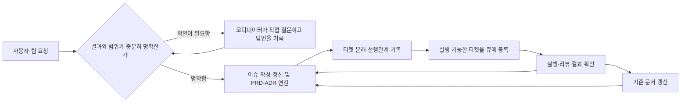
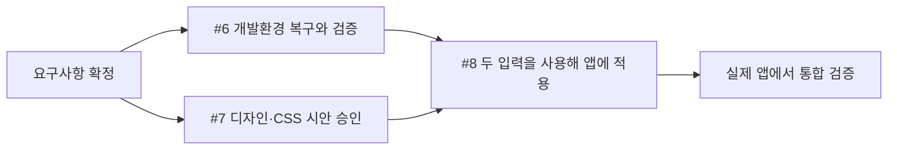

# 소프트웨어 팀과 조직의 이슈·티켓·위키 운영 연구

조사 기준일은 2026년 11월 23일이다. 소프트웨어 개발, 오픈소스 협업, 조직 내 비동기 업무, 지원·장애 대응에서 요청이 실행 과제로 바뀌고 결과가 지식으로 남는 과정을 비교했다. 방법론 원문, 제품 공식 문서, 조직이 공개한 운영 사례와 실증 연구를 참고했다. Q 소스와 AIRI의 이슈·티켓 이력을 대조하고, 사람 사이의 업무 관리 원칙을 AI 에이전트 협업에 적용하는 방법도 조사했다.

## 요약

- **코디네이터의 첫 책임은 사용자 인터뷰다.** 애매한 요청에서 사용자가 겪는 상황과 원하는 결과를 확인한다. 해석에 따라 범위·권한·완료 기준이 달라질 때는 직접 묻고, 답변을 이슈와 작업 계획에 이어 붙인다.
- **이슈는 해결할 문제, 선택한 방향, 결과를 연결한다.** 티켓은 담당자가 제출하고 리뷰받을 수 있는 실행 단위다. 위키는 다음 사람이 재사용할 수 있도록 검증된 절차·정책·결정의 현재판을 제공한다.
- **소속, 선행관계, 우선순위를 각각 관리한다.** 이슈로 목표를 묶고, 선행 결과가 필요한 티켓만 차단한다. 준비된 작업끼리의 수행 순서는 우선순위와 가용량으로 정한다.
- **발행 전에 실행 조건을 확인한다.** 담당 후보, 입력 산출물, 접근 권한, 작업 공간, 검증 환경을 확인하면 사용자 개입 없이 진행할 부분을 찾을 수 있다. 실제 검증에 사용자 입력이 필요하면 그 단계만 기다리게 한다.
- **요구사항과 결정도 산출물로 남긴다.** PRD에는 합의한 제품 요구사항을, ADR에는 중요한 설계 결정의 대안과 근거를 기록한다. 티켓에는 완료 증거를 남기고, 반복해서 사용할 현재 절차는 위키나 저장소 문서에 유지한다.
- **AI 에이전트는 승인된 산출물을 주고받으며 협업한다.** 독립 작업은 병렬로 실행하고, 여러 결과를 함께 쓰는 티켓은 필요한 선행 항목이 모두 완료되면 시작한다. Q의 `depends_on`은 이미 이 연결을 지원한다.

## 1. 조직에서 사용하는 업무 기록

이슈와 티켓은 제품에 따라 겹쳐 쓰인다. GitHub는 같은 이슈 객체에 상·하위 관계를 만들고, Jira는 에픽과 스토리·태스크·버그, 하위 작업을 구성한다. 서비스 데스크의 티켓은 고객 접수 건이나 권한 요청을 뜻하기도 한다. 이 문서의 구분은 Q에서 각 기록이 답해야 할 질문을 기준으로 했다. [GitHub 하위 이슈][github-sub-issues] · [Jira 업무 유형][jira-types] · [Jira Service Management 업무 분류][jsm-categories]

| 기록 | 답하는 질문 | 보존할 정보 | 책임 |
| --- | --- | --- | --- |
| 요청 | 누가 어떤 결과를 원하나 | 원문 맥락, 영향, 기대 결과, 권한이나 기한처럼 중요한 제약 | 접수 담당자 |
| 이슈 | 무엇을 해결하고 어떤 결과를 약속했나 | 문제와 목표, 범위, 결정과 이유, 결과 기준, 연결 티켓과 현재 요약 | 이슈 책임자 |
| PRD | 누가 어떤 상황에서 어떤 제품 동작을 필요로 하나 | 사용자와 문제, 목표, 범위와 제외 범위, 요구사항, 성공·수용 기준, 미결 사항 | 요구사항 책임자와 결정권자 |
| 티켓 | 누가 무엇을 제출하고 어떻게 확인하나 | 입력, 산출물, 완료 기준, 선행 조건, 담당자 또는 역할, 상태와 제출 근거 | 실행 담당자와 리뷰어 |
| 위키·핸드북 | 지금 어떤 방법이나 정책을 따라야 하나 | 적용 대상, 현재 절차·정책·정의, 검증 상태, 소유 팀, 관련 결정과 출처 | 문서 소유자 |
| ADR | 어떤 아키텍처 선택을 왜 채택했나 | 당시 맥락, 대안, 선택과 근거, 영향, 결정 상태, 대체 관계 | 기술 결정권자 |
| 회고·장애 사후 분석 | 무엇이 일어났고 어떻게 개선할까 | 영향과 시간 순서, 기여 조건, 교훈과 후속 행동 | 회고 책임자 |

워크스페이스 하나가 모든 일을 같은 절차로 다룰 필요는 없다. 작은 변경은 기존 이슈에 티켓 하나를 붙이는 것으로 충분하다. 여러 팀의 계획과 결정이 이어지는 일에는 책임자가 유지하는 이슈가 필요하다. 지원 요청은 개별 접수 기록으로 끝날 수 있고, 같은 증상이 반복되면 공통 원인을 조사하는 문제 이슈와 예방 티켓으로 연결할 수 있다. [Jira Service Management 업무 분류][jsm-categories] · [GitLab 대규모 작업의 DRI][gitlab-engineering-dri]

### 대표 운영 방식

| 환경 | 실제 운영 패턴 | 가져올 원칙 |
| --- | --- | --- |
| 오픈소스·저장소 협업 | GitHub Issues의 하위 이슈와 차단 링크를 두고 Projects에서 보드·표·로드맵을 구성한다. 변경을 담은 PR을 해당 이슈에 연결한다. | 코드 참조와 작업 이력을 연결한다. 배포·사용자 통지 같은 별도 완료 조건은 이슈의 종료 판단에 포함한다. [GitHub Projects][github-projects] · [이슈 의존성][github-dependencies] · [PR 연결][github-pr-link] |
| 제품 개발 | Scrum의 Product Owner는 백로그 정렬에 책임이 있고, 팀은 백로그 항목을 더 작고 명확하게 계속 다듬는다. Basecamp의 Shape Up은 작업에 쓸 수 있는 시간 범위를 먼저 잡고 그 안에서 의미 있는 범위를 조정한다. | 접수 시 사용자가 원하는 결과와 감당할 작업 크기를 확인한다. 큰 변동을 일으킬 미확정 사항부터 조사한다. [Scrum Guide 2020][scrum] · [Shape Up의 범위 설정][shape-up] |
| 연속 실행·내부 서비스 | Kanban은 시작·종료 지점, 상태 전이 정책, 진행 중 작업 수 제어를 명시한다. 서비스 데스크는 일반 지원, 장애, 원인 조사, 변경, 사후 검토를 업무 성격에 따라 다룬다. | 준비된 업무가 빈 자리를 채우도록 하고, 긴급 장애와 평소의 개선 요청에는 각자 알맞은 처리 기준을 둔다. [Kanban Guide 2025][kanban] · [서비스 업무 분류][jsm-categories] |
| 팀 간 비동기 운영 | GitLab은 큰 목표에 DRI(직접 책임자)를 지정하고, 이슈 본문을 최신 상태로 유지한다. 비동기 토론이나 회의에서 결정되면 근거와 다음 행동을 읽을 수 있는 위치에 남긴다. | 일을 끝까지 조율하는 사람과 실제 실행자를 표시한다. 인계받은 사람이 채팅 전체를 복기하지 않아도 되게 한다. [GitLab 제품 개발 흐름][gitlab-flow] · [GitLab 팀 의사결정][gitlab-decisions] |
| 장애 대응·재발 방지 | Google SRE는 사후 분석에 영향, 시간 순서, 기여 조건과 개선책을 기록한다. 후속 행동에는 소유자, 우선순위, 추적 번호와 검증 가능한 종료 조건을 둔다. | 복구가 끝난 시점과 재발 방지 작업의 완료 시점을 각각 기록한다. 이후 대응에 쓰일 절차는 런북에서 유지한다. [Google SRE 사후 분석][sre-postmortem] |

예를 들어 사내 신규 입사자 온보딩이라면, 이슈는 첫날에 필요한 접근과 안내라는 결과를 정의한다. 장비 준비와 문서 전달은 각각 진행할 수 있고, 특정 시스템 접근만 승인에 의존한다. 반복되는 설정 방법은 온보딩 위키에 두고 개인별 승인 내역과 상태는 접근이 제한된 요청 기록에 둔다. 소프트웨어 티켓과 같은 분해 원리를 쓰면서 권한과 증거 종류는 조직 업무에 맞춘 예다.

## 2. 접수에서 백그라운드 실행까지



### 사용자 인터뷰와 요청 정제

1. **요청을 유형에 맞춰 정리한다.** 개선은 사용자가 얻을 결과와 범위, 버그는 기대 동작·실제 동작·재현 순서·영향 버전을 남긴다. 지원 요청은 대상 서비스, 원하는 조치, 승인 필요 여부를 기록한다. 사용자가 알 수 있는 정보부터 받고 스택 트레이스 등 전문 자료는 팀이 보강한다. 세 오픈소스 프로젝트를 대상으로 한 Bettenburg 등의 연구에서 재현 단계와 스택 트레이스가 유용하게 평가됐다. 조사 대상과 시대가 한정된 결과다. [What Makes a Good Bug Report?][bug-report]
2. **이미 알려진 답을 먼저 확인한다.** 기존 대화, 이슈, 도구로 확인한 사실, 위키를 읽어 중복 질문을 줄인다. 알려진 절차로 해소되는 요청에는 검증된 위키 문서를 연결한다. 공통 이슈가 있으면 재현 환경이나 추가 요구를 그 이슈에 기록한다. [KCS의 검색·재사용 원리][kcs-why]
3. **작업을 바꾸는 질문은 사용자에게 직접 묻는다.** 먼저 실제로 불편했던 장면과 기대한 결과를 확인한다. 범위, 사용자 경험, 필수 제약, 권한이나 완료 검증을 바꾸는 모호함부터 짚는다. 선택지가 이미 드러났다면 답마다 작업 범위가 어떻게 달라지는지 짧게 설명한다. 저장소와 로그로 답할 수 있는 기술적 질문은 코디네이터가 조사하거나 조사 티켓에 맡긴다. [GOV.UK 사용자 요구 조사][user-needs] · [GitLab 문제 검증][gitlab-problem-validation]
4. **답을 요구사항으로 정리한다.** 사용자 답변에서 확인된 내용, 코디네이터가 적용한 가정, 미결 질문을 구분한다. 답변을 받기 전에는 그 답에 의존하는 구현의 발행을 보류한다. 범위가 명확하거나 되돌리기 쉬운 세부 가정만 남은 요청은 이슈에 근거를 써서 바로 진행한다. 다른 팀의 결정이 필요하면 결정권자와 필요한 답, 그 전에 진행할 수 있는 일을 함께 남긴다. [GitLab 팀 의사결정][gitlab-decisions]

이슈 본문 상단에는 인터뷰에서 확인한 문제와 목표, 확정 범위, 중요한 결정, 다음 행동을 유지한다. 댓글은 논의와 근거를 시간 순서로 보존한다. 결과를 바꾸는 결정이 댓글에서 내려졌다면 본문 요약과 관련 PRD·ADR 링크도 갱신한다. 이슈 상태를 검토할 책임자는 이 작업을 다른 사람에게 맡길 수 있다. [GitLab 제품 개발 흐름][gitlab-flow]

### 분해와 정렬

티켓 한 건은 담당자 한 명이나 한 팀이 검증 가능한 결과를 제출할 수 있는 크기로 잡는다. 예를 들어 UI와 API를 따로 배정하기 전에 실제로 독립 검증할 결과가 있는지 확인한다. 같은 사용 흐름에 속하며 늘 함께 바뀌는 작업은 하나로 묶을 수 있다. 기술 선택을 먼저 조사해야 구현 범위가 정해진다면 질문, 산출물 위치, 결정을 내릴 기준이 담긴 조사 티켓부터 발행한다. [Scrum의 백로그 정제][scrum] · [Shape Up의 범위 설정][shape-up]

| 구분 | 표현 | 예시 |
| --- | --- | --- |
| 소속 | 같은 목표에 기여하는 항목을 상위 이슈에 묶는다 | 개발환경 복구, 디자인 검토, UI 적용이 모두 AIRI 작업에 속한다 |
| 실행 선행관계 | 후속 작업에 필요한 입력을 제공하는 티켓을 연결한다 | UI 적용은 승인된 CSS가 필요하다 |
| 관련성 | 참고가 되는 결정, 유사 버그, 변경을 교차 링크한다 | 다른 앱의 WebView2 검증 절차는 참고할 수 있다 |
| 우선순위 | 실행 가능한 작업 중 착수 순서를 정한다 | 배포를 가로막는 빌드 복구부터 빈 실행 슬롯에 넣는다 |
| 시점·일정 | 시작 가능한 시점, 목표일, 승인 창, 반복 주기를 기록한다 | 실제 외부 연동 확인은 인증을 준비한 뒤 진행한다 |

선행 조건이 필요한 작업만 그래프에 연결한다. 요구사항이 명확하면 후속 티켓도 현재 발행하고 의존성으로 대기시킬 수 있다. 선행 조사에서 적용 여부나 작업 범위가 달라지면 조사 결과가 나온 뒤 후속 계획을 정제한다. 취소된 선행 작업이 필요한 산출물을 여전히 제공해야 한다면 대체 티켓을 연결한다. 개별 이슈의 영향도와 팀이 언제 처리할지 정하는 우선순위를 따로 남겨두면 재정렬 이유도 설명하기 쉽다. [GitHub 이슈 의존성][github-dependencies] · [Jira 의존성][jira-dependencies] · [GitLab 팀 의사결정][gitlab-decisions]

### 배정과 비동기 인계

- **배정 전 확인.** 담당자의 역량과 가용성, 읽기·쓰기 범위, 필요한 환경, 리뷰 독립성, 실행 승인과 외부 접근을 맞춘다. 팀 간 인계에서는 요청을 보낸 책임자와 수행할 팀, 의존하는 다음 작업을 함께 기록한다. [GitLab 대규모 작업의 DRI][gitlab-engineering-dri]
- **인계 본문.** 제목, 한 문단의 목표, 범위와 제외 범위, 현재 입력의 링크 또는 리비전, 관찰 가능한 완료 기준, 예상 산출물 위치를 준다. 승인된 설계와 구현 HEAD처럼 버전이 중요한 입력은 고정된 증거를 링크한다. 적용 범위가 바뀌면 요약과 연결도 갱신한다.
- **큐와 가용량.** 준비된 작업부터 가용 슬롯에 넣고, 진행 중 작업이 쌓이면 기존 작업의 차단과 리뷰 대기를 먼저 본다. 티켓 생성, 배정, 실행, 제출, 리뷰, 통합은 별도 상태로 보여준다. 차단되면 필요한 행동, 응답할 사람, 영향을 받는 후속 작업을 남긴다. [Kanban Guide 2025][kanban]
- **재시도와 대체.** 상태가 불명확하면 먼저 실행 이력, 저장된 결과, 제출 커밋 또는 외부 승인 기록을 확인한다. 같은 실행을 재개하는 경우 기존 입력과 작업 공간을 이어 쓴다. 대체 티켓이 필요하면 기존 결과와 검증 증거를 연결하고 후속 의존성을 새 티켓으로 옮긴다. [Q 하위 티켓 리뷰와 복구](nested-ticket-review-plan.md)

### 리뷰, 종료, 지표

티켓의 수용 기준은 **해당 작업의 약속**이다. 공통 완료 기준은 **팀이 산출물을 받아들이는 품질 기준**이다. 예를 들어 티켓의 수용 기준은 깨끗한 체크아웃에서 네이티브 창이 열리는 것이고, 팀의 공통 기준은 변경에 맞는 테스트와 리뷰 근거가 제출되는 것이다. 이슈 책임자는 구현과 리뷰가 끝난 뒤에도 배포, 사용자 통지, 남은 검증 등 이슈가 약속한 결과를 별도로 확인한다. 이슈를 닫을 때 해결, 중복, 보류·취소 같은 사유와 후속 링크를 남긴다. [Scrum 완료 기준][scrum] · [GitHub PR 연결][github-pr-link] · [GitLab 커뮤니케이션][gitlab-communication]

운영 개선은 큐 병목을 찾는 데 집중한다. Kanban이 제시하는 진행 중 작업 수, 처리량, 작업 나이, 사이클 타임을 쓰려면 먼저 팀의 시작·종료 지점을 통일한다. Q에는 배정 대기 시간, 리뷰 대기 시간, 차단 이유와 대체 발행 횟수가 추가로 유용하다. 예를 들어 긴 리뷰 대기와 긴 배정 대기는 다음 개선 대상이 다르다. 이 수치는 팀 업무 흐름을 점검하는 신호로 해석하고 개인 성과표에 그대로 옮기는 일은 피한다. 외부 조건을 기다린 시간과 실제 실행 시간을 구분하면 추정에도 도움이 된다. [Kanban Guide 2025][kanban]

## 3. 이슈와 함께 운영하는 위키

### PRD, ADR과 설계 산출물에서 남길 것

- **PRD는 인터뷰에서 확인한 제품 요구사항을 유지한다.** 대상 사용자와 상황, 원하는 결과, 범위와 제외 범위, 사용자 흐름, 기능·비기능 요구사항, 수용 기준, 미결 항목을 필요한 깊이만큼 기록한다. 사용자에게 확인된 내용과 제안을 표시한다. 여러 티켓이나 팀이 같은 요구사항에 맞춰야 할 때 별도 문서로 두고, 작은 변경은 이슈의 짧은 요구사항 명세로 남길 수 있다. [Atlassian PRD 예시][prd-template] · [GitLab 문제 검증][gitlab-problem-validation]
- **ADR은 결과에 오래 영향을 주는 기술 선택을 기록한다.** 예를 들어 저장 방식, 퍼블릭 API, 작업 실행 경계에 영향을 주는 선택에는 맥락, 실질적인 대안, 결정과 근거, 영향, 결정 상태를 기록한다. 제안과 수락이 구분되도록 결정권자의 근거를 연결한다. 방향이 바뀌면 새 ADR을 만들어 이전 ADR과 대체 관계를 남긴다. [Nygard의 ADR 원문][adr]
- **설계안, 조사 보고서, 운영 절차도 쓰일 때를 기준으로 보존한다.** 설계안은 구현에 필요한 인터페이스와 동작의 구체안을 준다. 조사 보고서는 무엇을 확인했고 어떤 한계가 있었는지 남긴다. 런북은 지금 실행할 절차를 유지한다. 산출물이 후속 티켓의 입력이면 이슈와 티켓에 문서 위치와 적용할 리비전을 함께 적는다. [Diátaxis][diataxis] · [GitLab 핸드북 운영][gitlab-handbook]

예를 들어 데스크톱 앱 요청에서는 PRD가 사용자가 달성해야 할 리뷰 흐름과 초기 지원 OS를 정리한다. ADR이 리뷰 메모를 어디에 저장할지 선택한 이유와 영향을 보존한다. 설계안은 화면과 동작을 명세하고, 이슈는 이 문서들과 시안·구현·검증 티켓을 연결한다. 검증한 실행 방법은 위키나 저장소의 기준 문서에서 갱신한다.

### 무엇을 위키에 둘까

위키의 기본 단위는 반복해서 찾아 읽을 질문이나 절차 하나다. Diátaxis의 구분을 적용하면 첫 실습을 위한 튜토리얼, 특정 목표를 달성하는 방법 안내, 정확한 설정·명령·계약을 조회하는 레퍼런스, 이유와 원리를 설명하는 문서를 독자의 목적에 맞춰 쓸 수 있다. 조직 운영에는 담당·승인 정책과 온보딩 안내, 서비스 지원에는 증상·적용 환경·해결책을 담은 문서, 개발에는 빌드나 배포 런북과 ADR이 자주 필요하다. ADR은 결정 당시의 맥락과 결정·결과를 기록하고 새 결정이 이전 결정을 대체하면 양쪽을 연결한다. [Diátaxis][diataxis] · [KCS 문서 구조][kcs-structure] · [Nygard의 ADR 원문][adr]

| 남길 내용 | 기준 위치 | 연결 방식 |
| --- | --- | --- |
| 이 요청에서 왜 범위를 바꿨는지 | 이슈의 최신 요약과 결정 댓글 | 영향받는 티켓과 새 결정을 링크 |
| 검증 명령의 당시 결과와 제출본 | 티켓의 결과·리뷰 기록 | 커밋·테스트 결과·문서 리비전으로 연결 |
| 사용자와 확인한 제품 범위 및 수용 기준 | PRD 또는 작은 변경의 이슈 본문 | 영향을 받는 티켓이 해당 요구사항을 가리키게 함 |
| 누구나 반복할 현재 빌드·지원 절차 | 저장소 문서나 팀 위키의 한 기준 페이지 | 이슈에서 절차를 링크하고, 문서에서 검증 근거를 링크 |
| 서비스 장애의 당일 조치와 후속 과제 | 사건 기록과 사후 분석 | 후속 티켓과 갱신한 런북 링크 |
| 팀의 장기 설계 결정 | ADR 또는 정책 페이지 | 당시 이슈·대안·대체 결정의 링크 |

KCS에서는 일을 해결하는 중에 문서를 찾고, 없으면 캡처하며, 다시 쓸 때 수정하거나 담당자에게 표시한다. 건별 연락처나 접근 자격 증명은 필요한 기록에 제한해서 두고, 위키에는 재사용에 필요한 환경과 결과만 남긴다. Jira와 Confluence는 티켓과 페이지를 링크하고, 위키 안에서 원본 티켓 조회를 표시하는 예를 제공한다. 위키에 매일 상태를 복사해 두는 비용을 줄이려면 이 원리를 적용해 상태는 원본에서 가져오고 위키에는 맥락과 절차를 유지한다. [KCS 문서 구조][kcs-structure] · [KCS 실행과 개선][kcs-why] · [Jira와 Confluence 연동][jira-confluence]

### 찾기 쉽고 유지 가능한 문서

1. **적용 범위와 권위를 표시한다.** 문서에 주제와 대상 독자, 소유 팀, 확인된 환경·버전, 마지막 검증 시점, 출처를 남긴다. 자신도 확인하기 어려운 절차는 초안 또는 검증 필요 상태로 표시한다. 내부 전용과 외부 공개 범위를 따로 결정한다. [KCS 문서 상태][kcs-state]
2. **검색과 이력을 함께 유지한다.** 사람이 찾을 용어와 실제 오류 메시지, 제품·플랫폼 태그, 관련 문서 링크를 넣는다. 페이지 주소와 리비전을 구분해 현재판과 과거 증거를 모두 조회 가능하게 한다. 제목이나 위치가 바뀌면 기존 참조에서 새 기준 문서로 이동할 수 있게 한다. [MediaWiki 페이지 이력][wiki-history] · [MediaWiki 리다이렉트][wiki-redirect]
3. **사용할 때 고치고 위험도에 따라 점검한다.** 절차를 재사용하며 달라진 점을 최신판에 반영한다. 운영 런북처럼 잘못된 내용의 비용이 큰 페이지는 변경과 함께 담당자가 확인한다. 소유자가 떠났거나 검토 시점이 지난 문서는 팀이 재배정하고, 중복·대체된 페이지는 대체 링크를 남겨 보관한다. 접근 범위가 다른 공간으로 옮길 때는 원본 및 연결된 자료의 공개 범위를 확인한다. [GitLab 핸드북 운영][gitlab-handbook] · [Confluence 소유권][confluence-owner] · [Confluence 콘텐츠 정리][confluence-content]
4. **게시 권한과 문서의 신뢰 상태를 구분한다.** 초안을 공유할 독자, 검증할 담당자, 정책을 승인할 사람을 정한다. 이슈에 붙은 로그·스크린샷·요약을 공개 위키로 옮길 때 요청자 정보, 제한된 고객 데이터, 자격 증명을 남기지 않도록 검토하고, 독자가 볼 수 있는 증거를 연결한다. [KCS 문서 상태][kcs-state] · [KCS 문서 구조][kcs-structure]

저장소의 코드·버전 변화에 맞춰 같이 리뷰해야 하는 문서는 저장소 Markdown이 편하다. 예를 들어 빌드 방법과 API 계약을 코드 변경과 같은 PR에서 검토할 수 있다. 여러 팀이 자주 수정하는 온보딩·운영 문서는 문서 공간에서 공동 편집하고 소유권을 관리하는 방식이 편하다. 각각의 주제에 기준 위치 하나를 정해 다른 곳에서는 연결해 보여준다. [GitLab 핸드북 운영][gitlab-handbook] · [Jira와 Confluence 연동][jira-confluence]

## 4. AIRI 사례에서 보인 작업 흐름

Q Studio의 AIRI 코디네이터 세션과 이슈·티켓을 대조했다. 이 사례는 동일 Q 프로젝트에서 관찰한 실행 이력이다.

| 관찰한 흐름 | 운영상 의미 |
| --- | --- |
| 설계 → 구현 → 테스트 → 리뷰 순서가 의존성으로 연결됐다. 구현 #2가 반복된 리스 만료 뒤 #5로 대체됐고, #3은 #5를 기다리도록 연결을 바꿨다. | 대체 작업을 끼워 넣을 때 이전 작업의 증거와 연결을 점검해야 한다. 실행 실패는 작업 계획을 바꿔야 하는지 판단하는 별도의 신호다. |
| #3에 오프라인 회귀와 실제 GitHub 연동 검증이 함께 들어갔다. 오프라인 작업은 로컬에 반영됐으며 외부 환경·권한을 요구하는 검증이 남았다. | 결과와 전제 조건이 다른 검증을 나누면, 준비된 작업이 진행되고 남은 검증이 티켓으로 드러난다. |
| #4 읽기 전용 리뷰에 맞는 활성 후보가 처음에 없었다. 조사 역할로 변경한 뒤에는 ACP 실행 중에 진행 기록을 보기 어려웠다. | 발행 전에는 프로필 이름에 더해 실제 역할, 변경 권한과 실행 백엔드를 확인할 필요가 있다. |
| #6 개발환경 복구와 #7 CSS 시안은 독립적으로 실행됐다. #7은 수정·재검토를 거쳐 승인됐다. 이후 사용자 요청으로 #8 적용이 발행됐고 #6·#7에 의존했다. | 연구 요청은 승인된 시안으로 종료할 수 있다. 적용까지 요청됐다면 적용 범위가 충분히 정해졌을 때 후속 티켓도 의존성과 함께 발행할 수 있다. |

이슈에 Rev 2 시안과 승인 댓글을 남겨 #8 워커가 정확한 리비전을 가져갈 수 있었다. 이후 유지할 지식의 예는 실제로 검증한 `wails3 dev` 재현 절차다. 반대로 특정 UI 시안의 검토와 수정 이력은 그 이슈에 두고 적용에 사용한 버전으로 연결하는 편이 적합하다. 이 구분을 쓰면 이슈에서 결정의 맥락을 찾고 문서에서 현재 절차를 바로 실행할 수 있다.

## 5. Q 코디네이터에 적용할 제안

### 기존 계약

- Q Library에는 이슈·티켓, 본문·댓글 리비전, 관련 이슈 링크와 프로젝트별 검색이 있다. 이슈와 티켓의 원문을 읽어 결과를 기록할 수 있다. 위키 운영의 출발점은 검색 가능한 기준 이슈와 저장소 문서를 연결하는 것이다. [Library의 이슈·검색 계약](library.md#issues-tickets-and-source-reads)
- `ticket_create`는 일반 티켓을 자동 배정 큐에 넣고, 백그라운드 엔진이 Q 호스트 실행 중에 시작할 수 있는 티켓을 가져온다. `depends_on`에는 같은 프로젝트와 병합 범위 안의 선행 티켓을 여러 개 지정할 수 있다. 하위 티켓은 같은 부모 작업 트리의 형제 티켓에 의존할 수 있다. 모든 선행 티켓이 `done`이면 후속 작업이 배정 대상에 들어간다. `report`는 리뷰 수락 뒤, `git`은 리뷰 수락과 병합 성공 뒤에 `done`이 된다. [티켓 의존성](ticket-dependencies.md) · [스케줄러](../coordinator/engine.go#L100)
- 코디네이터는 요청을 접수하고 작업을 분해하며, Decisions는 후보를 선택한다. `workspace_members`는 가입 정보를 반환하고 실제 역할, 프로필의 변경 권한, ACP 연결은 배정 때 해석된다. Integrator는 최상위 결과 리뷰·병합을 맡고, 하위 티켓은 부모 워커가 지정된 리뷰 턴에서 검토한다. [코디네이터 역할](../coordinator/manager.go#L35) · [배정 후보 계산](../app/coordinator.go#L74) · [멤버 조회](../internal/workitemtools/coordinator.go#L84) · [Library 리뷰 계약](library.md#coordinator-integrator-and-mr-review)

### 요청 한 건을 처리하는 계약

코디네이터는 사용자와 대화하는 자리에서 인터뷰를 맡는다. 조사 워커는 자료와 기술적 선택지를 제공하고, 사용자만 정할 수 있는 목표·범위·권한은 코디네이터가 사용자에게 확인한다. 그 답을 기준으로 적절한 이슈를 작성하고, 작업 흐름을 설계한 뒤 티켓을 발행한다.

| 단계 | 코디네이터의 행동 | 남는 결과 |
| --- | --- | --- |
| 1. 사용자 인터뷰 | `search_work`와 기존 대화·문서로 확인할 수 있는 내용을 먼저 파악한다. 중요한 해석이 남으면 코디네이터가 구체적으로 질문한다. | 확인된 사용자 상황과 목표, 범위, 가정과 미결 질문 |
| 2. 이슈와 문서 정리 | 확인한 요청을 기존 이슈에 반영하거나 새 이슈를 만든다. 여러 작업이 공유할 요구사항은 PRD에 적고, 중요한 기술 선택은 결정 상태가 표시된 ADR로 연결한다. | 목표와 완료 기준을 담은 이슈, 관련 문서와 적용 리비전 |
| 3. 작업 흐름 설계 | 산출물, 입력, 테스트를 기준으로 티켓을 나눈다. 병렬로 진행할 티켓과 선행 결과에 의존할 티켓을 정하고 담당 후보·저장소·외부 승인을 확인한다. | 실행 가능한 계획과 사용자 입력을 기다리는 항목 |
| 4. 백그라운드 실행에 넘김 | 준비된 티켓과 그 티켓에 의존하는 후속 티켓을 순서대로 발행한다. 쓰기 작업마다 `request_id`를 정하고 같은 쓰기를 재시도할 때 다시 쓴다. | 발행 ID, 연결 이슈와 선행관계, 큐 등록 여부 |
| 5. 사용자에게 결과 반환 | 실행 시작, 큐 대기, 선행 대기, 사용자 입력 필요를 제품 상태에 맞춰 알린다. 선행 결과로 범위가 정해지는 건은 이슈에 후속 발행 조건을 남긴다. | 발행한 티켓, 남은 결정, 관련 문서를 확인할 수 있는 요약 |
| 6. 마무리 | 승인된 결과와 남은 검증을 이슈 본문에 반영한다. 요구사항이나 결정이 바뀌면 관련 문서와 영향받는 티켓을 함께 갱신한다. 재사용할 지식은 기준 문서에 반영한다. | 이슈 종료 근거와 최신 문서 링크 |

프롬프트가 우선 가르쳐야 할 판단은 **언제 직접 묻고, 어떤 답이면 작업을 시작할 수 있는가**다. 이후에 기존 이슈 재사용, 문서로 남길 요구와 결정, 티켓 품질, 선행관계, 백그라운드 발행과 상태 보고를 안내한다. 첫 티켓 생성 직후에도 엔진이 착수할 수 있으므로, 코디네이터가 먼저 계획의 범위와 의존성을 점검한다. 발행 도중 멈추면 생성된 티켓을 이슈에서 확인하고 같은 요청 키로 남은 작업을 이어 간다. [Library의 리비전·재시도 계약](library.md#issues-tickets-and-source-reads) · [발행 도구](../internal/workitemtools/tools.go#L115)

**도구에 필요한 보강**은 배정 직전 호스트가 아는 정보를 코디네이터에게 보여주는 것이다. 프로젝트에서 해당 모드로 실행 가능한지, 후보의 프로필 ID와 역할, 수정 가능 여부, 연결된 실행 대상과 가용 이유를 표시한다. 후보가 없으면 준비된 다른 티켓을 발행하고 해당 작업의 차단 이유를 이슈에 남긴다. `reviewer`처럼 역할 하나에 시니어 개발자와 코드 리뷰어가 함께 속할 때는 특히 중요한 정보다. 실제 적격 판정은 배정 코드에서 계속 검증한다. [배정 후보 계산](../app/coordinator.go#L74) · [Decisions 선택](../coordinator/assignment.go#L34)

**재계획은 발행과 별도 단계로 다룬다.** 이미 발행한 작업의 선행 조건 해소와 리뷰 전달은 엔진이 처리한다. 새 설계 결과를 바탕으로 미발행 후속 티켓을 만들거나, 후보 없음·실행 만료를 보고 코디네이터가 스스로 판단하게 하려면 해당 상태를 코디네이터 역할에도 전달하는 경로가 필요하다. 이때 관찰한 상태와 허용된 처리 범위를 주고, 취소된 작업을 재시도하거나 외부 권한을 쓰는 결정은 원래 요청의 범위를 따른다. [엔진의 리뷰 배달](../coordinator/engine.go#L199) · [Library 리뷰 인박스](library.md#coordinator-integrator-and-mr-review)

**위키는 기준 문서 한 개부터 운영한다.** 현재 절차는 저장소 문서 또는 팀의 기준 이슈 본문을 고쳐 유지하고, 진행 중 이슈와 티켓에서는 링크한다. 댓글에는 발견·검토·정정 이력을 남긴다. 페이지별 소유권, 독자별 공개 범위, 갱신 상태, 개정 비교를 별도로 관리해야 할 사용 사례가 확인되면 그 요구를 독립 위키 기능의 설계 기준으로 삼는다. [GitLab 핸드북 운영][gitlab-handbook] · [KCS 문서 상태][kcs-state]

### 동작을 확인할 사례

| 요청 | 확인할 결과 |
| --- | --- |
| “AIRI를 Wails 앱답게 만들어줘” | 코디네이터가 개발환경·네이티브 창·UI 디자인 중 불편한 상황과 원하는 결과를 직접 확인한다. 사용자가 개발환경 복구만 원하면 그 범위의 이슈와 티켓을 만들고, 디자인 적용까지 원하면 요구사항과 선행관계를 함께 설계한다. |
| “개발환경 복구하고 UI도 조사해서 적용해줘” | 이슈 한 건, 독립적인 복구·조사 티켓, 산출물이 필요한 적용 티켓이 생긴다. 적용 범위가 명확할 때 두 선행 티켓을 연결해 같은 요청에서 발행한다. |
| “UI 시안만 만들어줘” | 조사 산출물과 리뷰 조건이 분명한 티켓이 발행되고, 구현이 필요한 결정은 이슈에 제안으로 남는다. |
| “로컬 검증과 외부 연동 확인까지 해줘” | 로컬 검증은 독립 티켓으로 진행하고, 외부 확인의 권한·환경 조건과 필요한 사용자 행동이 드러난다. |
| “지난번에 해결했던 장애가 또 나” | 기존 이슈와 현재 런북을 찾아 관찰 내용을 연결한다. 공통 원인에 대한 개선 작업과 현 건의 복구 이력을 각각 유지한다. |
| “승인된 설정으로 기존 절차 문서 갱신해줘” | 원래 결정과 검증 근거를 연결하고 기존 기준 문서를 갱신한다. 작업 결과에는 문서 위치와 적용 범위가 남는다. |

## 6. AI 에이전트끼리 협업할 때 적용할 원칙

Anthropic의 에이전트 설계 가이드는 정해진 순서가 있는 실행, 독립 작업의 병렬화, 요청에 맞춰 일을 동적으로 나누는 코디네이터와 워커, 결과를 평가해 수정 피드백을 주는 흐름을 각각 설명한다. 실제 조사 제품 사례에서는 워커별로 구체적인 목표와 산출물 형식, 사용할 자료·도구, 작업 경계를 주어 중복 조사와 공백을 줄였다. Microsoft Agent Framework도 여러 실행 경로를 열고 산출물을 합치는 fan-out·fan-in과 체크포인트 복구를 제공한다. 이 자료는 Q에 적용할 설계 패턴과 구현 사례다. [Anthropic 에이전트 설계][agent-patterns] · [Anthropic 다중 에이전트 조사 사례][agent-research] · [Microsoft 병렬 실행][agent-fan-in] · [Microsoft 체크포인트][agent-checkpoints]

Cemri 등의 NeurIPS 연구는 여러 에이전트 시스템의 실행 기록에서 시스템 설계, 에이전트 간 조율, 작업 검증의 실패를 분류했다. Q에서 이에 대응하려면 워커의 능력에 더해 **받은 요청이 구체적인가, 다른 워커가 제출한 증거를 정확히 받았는가, 누가 완료를 확인했는가**를 검증해야 한다. 연구의 벤치마크 결과는 Q 자체의 성능 측정과 구분한다. [Why Do Multi-Agent LLM Systems Fail?][mast]

| 사람 팀의 관행 | AI 협업에 적용할 규칙 |
| --- | --- |
| 사용자 인터뷰와 이슈 책임자 | 코디네이터가 사용자와 목표·범위·권한을 확정하고 PRD와 이슈를 갱신한다. 워커는 조사한 사실과 결정이 필요한 질문을 이슈에 남기며, 사용자 답변이 필요한 선택은 코디네이터가 다시 확인한다. |
| 담당자의 업무 인수인계 | 워커가 읽을 이슈, PRD·ADR의 해당 범위, 정확한 입력 리비전, 변경 범위, 완료 기준을 티켓에 준다. 필요한 맥락을 티켓에서 다시 읽을 수 있어야 Native·ACP 세션이 바뀌어도 인계가 가능하다. |
| 병렬 작업과 통합 | 독립적인 조사나 변경 범위를 병렬 실행한다. 서로 다른 결과가 모두 필요한 작업에는 다중 선행관계를 설정한다. 같은 파일이나 인터페이스를 바꾸는 일이면 수정 경계를 조정하거나 결과가 필요한 순서로 선행관계를 둔다. 병합 충돌은 근거와 함께 처리한다. |
| 리뷰와 완료 판정 | 워커는 결과와 증거를 제출하고, Integrator나 지정된 부모 워커가 수용 기준에 따라 판단한다. 호스트가 실행·리뷰·병합 상태를 기록한다. 후속 워커의 착수 조건은 기록된 상태로 검사한다. |
| 비동기 보고와 위키 | 진행 상태는 큐·시도·리뷰 기록에서 조회한다. 반복해서 쓸 발견은 검토 후 PRD·ADR·위키의 기준 문서에 반영한다. 다른 워커는 관련 페이지와 승인된 증거를 가져와 쓴다. |
| 재시도와 자원 배분 | 준비된 티켓을 가용 슬롯에 배정한다. 차단이나 실행 만료가 나면 남아 있는 산출물, 작업 트리, 마지막 시도의 상태를 확인한다. 이미 수행했을 수 있는 쓰기를 무턱대고 반복하는 대신, 확인한 결과를 근거로 재개·대체를 결정한다. |

### 하나의 티켓이 여러 결과를 기다리는 경우

AIRI의 개발환경 복구와 디자인 시안을 병렬로 진행하고, 실제 적용 워커가 둘 다 사용하는 흐름이 좋은 예다. 이때 적용 티켓은 두 산출물의 소비자다. 티켓에 **왜 두 입력이 각각 필요한지와 가져올 결과**를 적고 `depends_on` 배열에 두 ID를 넣는다.



예시 티켓에서 ID 자리에는 실제 발행된 티켓 ID를 넣는다.

```json
{
  "title": "승인된 디자인을 AIRI 앱에 적용",
  "content": "개발환경 복구 티켓의 병합 커밋과 실행 절차를 확인한다. 디자인 티켓에서 승인된 CSS 리비전을 읽어 적용하고 실제 WebView2 창에서 검증한다.",
  "execution_mode": "git",
  "depends_on": ["<개발환경 복구 티켓 ID>", "<디자인 시안 티켓 ID>"]
}
```

Q는 `depends_on`에 **최대 64개의 직접 선행 티켓**을 받을 수 있다. 두 건 이상이면 모두 `done`일 때만 배정할 수 있다. 한 건이 승인되고 다른 건이 리뷰 중이면 `waiting_on`에 남은 ID가 표시된다. 실패·취소·거절·실행 결과 미상도 해당 선행 조건을 계속 막는다. 대기 중인 후속 티켓은 워커 슬롯을 차지하지 않는다. 순환이나 다른 부모 작업 트리의 의존성은 거절된다. [Q 선행 티켓 계약](ticket-dependencies.md) · [선행관계 검증](../workitems/dependencies.go#L36)

**선행 조건 충족과 산출물 인계는 각자 확인한다.** 현재 엔진은 후속 워커 프롬프트에 완료된 선행 티켓 ID를 넣고 결과와 원문을 읽으라고 안내한다. 코디네이터는 티켓 본문에서 각 선행 티켓이 제공하는 입력을 명시한다. 사용해야 할 문서 리비전이나 승인된 Git 커밋을 이미 알고 있으면 함께 적는다. 실행 중 필요한 참조를 찾으면 승인된 attempt와 결과를 확인해 사용한다. 두 보고서가 상충하면 통합 워커가 근거와 미결 사항을 남기고, 사용자 범위나 기존 ADR을 바꾸는 결정은 코디네이터에게 올린다. [Q 워커 프롬프트](../coordinator/engine.go#L346) · [Library 원문 리비전](library.md#issues-tickets-and-source-reads)

여러 경로 중 하나의 결과만 필요하거나 결과에 따라 다음 작업이 달라지는 경우에는, 선택 조건을 이슈에 기록하고 필요한 입력이 정해진 뒤 후속 티켓을 발행한다. 현재 `depends_on` 배열의 의미는 모든 선행 작업의 완료다. 부모 워커가 자식 결과를 리뷰한다는 관계는 별도로 유지된다. 프로젝트 브랜치에 반영된 변경을 소비하려면 그 변경을 최종 병합하는 최상위 티켓을 선행으로 지정한다. [Q 선행 티켓 계약](ticket-dependencies.md) · [하위 티켓의 리뷰와 병합](nested-ticket-review-plan.md)

### 확인한 동작과 추가 검증

- **현재 확인한 코드 경로.** 기존 Go 테스트에서 설계 뒤 두 작업이 병렬로 배정 가능한 상태가 되고, 첫 번째 수락 뒤에는 통합 티켓이 계속 대기하며, 두 번째 수락까지 끝나면 통합 티켓이 큐에 들어가는 것을 확인했다. 실패·취소 후 차단, 동시 변경에서 순환 거절, 대기 티켓 다수가 준비된 작업을 숨기지 않는 테스트도 통과했다. [선행 티켓 테스트](../workitems/dependencies_test.go#L64)
- **통합 검증으로 확인할 동작.** 서로 다른 워커가 만든 승인된 설계와 병합 커밋을 후속 워커가 모두 사용했는지 확인한다. 재시작이나 수정 요청 뒤에도 같은 티켓 관계를 유지하고, 오래된 제출본을 읽거나 후속 실행을 중복 시작하는지 점검한다. Q의 테스트 결과, 사람이 정한 검증 기준, 모델의 자체 보고를 별도로 비교한다.

자료에는 방법론의 규범, 제품이 제공하는 기능, 개별 조직의 실제 운영 규칙이 섞여 있다. 운영 사례는 채택할 수 있는 관행을 보여주며 Q에서의 효과는 별도 검증이 필요하다. 같은 AIRI 요청을 다시 실행해 인터뷰 결과가 이슈와 PRD에 반영되는지, 의존성 정확도와 배정 차단 사전 발견, 승인된 산출물 재사용 여부를 관찰할 수 있다.

## 7. 코디네이터 시스템 프롬프트

코디네이터의 실제 지침은 [시스템 프롬프트 원문](../coordinator/coordinator_prompt.txt)에 있다. 영어로 작성한 역할 지침은 사용자의 언어로 질문하고 답하도록 한다. 인터뷰, 이슈·문서 작성, 워크플로우 설계, 백그라운드 발행에 현재 Q Library 도구를 사용한다. [역할 지침](../coordinator/manager.go) · [Library 공통 지침](../internal/librarymcp/server.go#L14)

### 적용 후 확인할 동작

- **사용자에게 묻는 타이밍.** 모호한 요청에서 질문을 먼저 하고 답변을 받아 이슈를 작성한다. 답변을 이미 포함한 요청에서는 같은 질문을 반복하지 않고 이슈와 티켓을 발행한다.
- **동시에 시작할 작업과 기다릴 작업.** AIRI 예제에서 독립 두 건은 먼저 발행한다. 적용까지 요청받았고 적용 범위가 정해졌으면 적용 티켓에 두 ID를 넣는다. 설계 결과가 범위를 바꿀 수 있으면 결정 조건을 이슈에 남긴다.
- **실제 배정 확인.** 가입 명단으로 확인할 수 있는 사실과 호스트의 배정 결과를 구분한다. 읽기 전용 리뷰 후보나 특정 ACP 실행 대상이 확인되지 않으면 그 제약을 드러내고 나머지 작업을 진행한다.
- **역할 지침 전달.** Native는 코디네이터 시스템 컨텍스트에, ACP는 대화 시작 또는 역할 지침 버전 갱신 시 같은 지침을 받는다. 재개 테스트는 이전 버전 세션에 갱신된 지침을 한 번 전달하는지 확인한다. [Native 주입](../app/session_host.go#L580) · [ACP 주입과 재개](../app/session_acp.go#L142)

### 더미 프로젝트 검증

Native 코디네이터의 GLM-5.3-Flash에 “이 프로젝트의 결과 화면 좀 제대로 정리해줘”라고 요청했다. 화면이 무엇을 가리키는지 묻는 질문이 먼저 나왔으며, 답변 전 이슈와 티켓은 모두 0건이었다. 결과 카드의 정보 우선순위와 키보드 접근성을 각각 검토한 뒤 `result-guide.md`에 반영해 달라고 답하자 이슈 하나와 티켓 세 개가 저장됐다. 세 티켓 모두 `linked_issue_id`와 `acceptance`를 포함했다.

실제 스케줄러에서 두 `report` 티켓의 `running` 상태가 겹쳤다. `git` 티켓은 두 티켓 ID를 `depends_on`과 `waiting_on`에 모두 유지하며 배정 대기했다. 이 시나리오는 테스트용 배정기와 대기 상태를 유지하는 워커로 실행했다. 두 선행 보고서가 모두 승인된 뒤 후속 티켓이 배정 가능한 상태로 넘어가는 동작은 별도의 저장소 테스트에서 확인했다. [선행 티켓 테스트](../workitems/dependencies_test.go#L64)

[github-sub-issues]: https://docs.github.com/en/issues/tracking-your-work-with-issues/using-issues/adding-sub-issues
[github-dependencies]: https://docs.github.com/en/issues/tracking-your-work-with-issues/using-issues/creating-issue-dependencies
[github-projects]: https://docs.github.com/en/issues/planning-and-tracking-with-projects/learning-about-projects/about-projects
[github-pr-link]: https://docs.github.com/en/issues/tracking-your-work-with-issues/using-issues/linking-a-pull-request-to-an-issue
[jira-types]: https://support.atlassian.com/jira-cloud-administration/docs/what-are-issue-types/
[jira-dependencies]: https://support.atlassian.com/jira-software-cloud/docs/create-or-remove-dependencies-on-your-timeline/
[jsm-categories]: https://support.atlassian.com/jira-service-management-cloud/docs/what-are-ticket-categories/
[jira-confluence]: https://support.atlassian.com/jira-service-management-cloud/docs/integrate-jira-cloud-with-confluence/
[confluence-content]: https://support.atlassian.com/confluence-cloud/docs/manage-your-content-tree/
[confluence-owner]: https://support.atlassian.com/confluence-cloud/docs/transfer-ownership-of-your-content-item/
[scrum]: https://scrumguides.org/scrum-guide.html
[kanban]: https://kanbanguides.org/the-kanban-guide/2025.5/
[shape-up]: https://basecamp.com/shapeup/1.2-chapter-03
[gitlab-flow]: https://handbook.gitlab.com/handbook/product-development/how-we-work/product-development-flow/
[gitlab-engineering-dri]: https://handbook.gitlab.com/handbook/engineering/development/growth/engineering_dri/
[gitlab-decisions]: https://handbook.gitlab.com/handbook/engineering/infrastructure-platforms/tenant-scale/cells-infrastructure/process/
[gitlab-communication]: https://handbook.gitlab.com/handbook/communication/
[gitlab-handbook]: https://handbook.gitlab.com/handbook/about/handbook-usage/
[sre-postmortem]: https://sre.google/workbook/postmortem-culture/
[bug-report]: https://thomas-zimmermann.com/publications/files/bettenburg-fse-2008.pdf
[kcs-why]: https://library.serviceinnovation.org/KCS/KCS_v6/KCS_v6_Practices_Guide/095
[kcs-structure]: https://library.serviceinnovation.org/KCS/KCS_v6/KCS_v6_Practices_Guide/030/040/010/020
[kcs-state]: https://library.serviceinnovation.org/KCS/KCS_v6/KCS_v6_Practices_Guide/030/040/010/030
[diataxis]: https://diataxis.fr/
[adr]: https://cognitect.com/blog/2011/11/15/documenting-architecture-decisions
[wiki-history]: https://www.mediawiki.org/wiki/Help:History
[wiki-redirect]: https://www.mediawiki.org/wiki/Help:Redirects
[user-needs]: https://www.gov.uk/service-manual/user-research/start-by-learning-user-needs
[gitlab-problem-validation]: https://handbook.gitlab.com/handbook/upstream-studios/experience-research/problem-validation-and-methods/
[prd-template]: https://www.atlassian.com/software/confluence/templates/product-requirements
[agent-patterns]: https://www.anthropic.com/research/building-effective-agents
[agent-research]: https://www.anthropic.com/research/multi-agent-research-system
[agent-fan-in]: https://learn.microsoft.com/en-us/dotnet/api/microsoft.agents.ai.workflows?view=agent-framework-dotnet-latest
[agent-checkpoints]: https://learn.microsoft.com/en-us/agent-framework/workflows/checkpoints
[mast]: https://proceedings.neurips.cc/paper_files/paper/2025/hash/b1041e52d3be19f0a9bc491657488e4a-Abstract-Datasets_and_Benchmarks_Track.html
