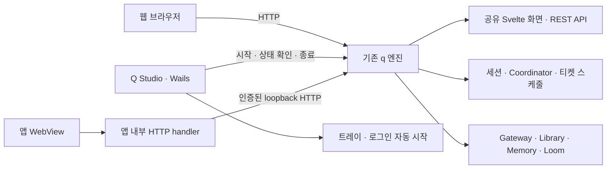

# Q Studio 데스크탑 배포 연구

조사일: 2026-11-17 (Asia/Seoul)

기준 코드: `d76442d53095695a603aa25c45c0331e2f4383e4`

상태: 코드와 공식 문서를 검토한 권고안. 데스크탑 구현·패키징·실기기 검증은 수행하지 않았다.

후속 구현과 현재 검증 범위는 [Q Studio desktop](studio-desktop.md)이 소유한다.
아래 내용은 위 기준 커밋에서 작성한 연구 기록이다.

## 권고

**기존 `q` 웹 배포를 유지하고, Wails v3 기반 `Q Studio` 앱이 같은 릴리스의 `q` 실행 파일을 함께 배포·관리하는 구성을 권한다.**
웹 UI와 업무 실행은 현재 Go/Svelte 구현을 공유한다. 데스크탑 앱은 창, 트레이, 로그인 자동 시작, 엔진 프로세스 관리와 OS 통합을 담당한다.

사용자가 확인한 자동 시작 범위는 **사용자 로그인 후 창 없이 백그라운드 실행**이다.
따라서 초기 버전은 사용자 권한의 트레이 앱으로 구현한다. 로그인 이전 실행을 위한 Windows Service, LaunchDaemon, 시스템 단위 systemd 서비스는 필요하지 않다.

| 설치·실행 경로 | 권고하는 사용자 경험 |
| --- | --- |
| 기존 `go install .../cmd/q@latest` → `q studio` | 지금처럼 HTTP 서버를 띄우고 브라우저로 작업 |
| `Q Studio` 설치 프로그램 → 앱 실행 | 앱 창으로 같은 Studio 화면 제공 |
| 앱 창 닫기 | 백그라운드 실행 설정이 켜져 있으면 트레이와 엔진 유지 |
| 로그인 자동 시작 | 저장한 설정에 따라 트레이만 시작하고 엔진 실행 |
| 백그라운드 예약 작업 | 기존 Coordinator와 티켓 스케줄러가 실행 |
| 트레이의 완전 종료 | 앱이 소유한 엔진을 정상 종료하고 트레이 종료 |

## 현재 프로젝트에서 재사용할 수 있는 것

### 웹 설치와 화면 배포

[README](../README.md)의 기본 설치 경로는 `go install github.com/snowmerak/q/cmd/q@latest`다.
[Taskfile](../Taskfile.yml)의 기본 설치·빌드도 `q`, `q-mcp` 명령을 대상으로 한다.

[assets.go](../studio/assets.go)는 `studio/frontend/dist`를 `go:embed`로 포함한다.
따라서 일반 사용자는 Studio 화면을 쓰기 위해 Node.js나 프런트엔드 개발 서버를 실행할 필요가 없다.
[package.json](../studio/frontend/package.json)의 화면 스택은 Svelte 5, TypeScript, Vite다.

### HTTP 서버와 실행 수명

[studio.go](../cmd/q/studio.go)의 `runStudioAt`이 진단 로그, Studio 런타임, HTTP listener,
별도 Gateway listener, 브라우저 열기, 종료를 조립한다.
기본 바인딩은 `127.0.0.1:0`이며 `--no-open`은 브라우저 열기만 생략한다.
현재 명령을 백그라운드 서비스로 등록하거나 터미널에서 분리하는 옵션은 아니다.

[handler.go](../studio/handler.go)의 `studio.NewServer(ctx)`와 `Close()`는 이미
HTTP handler와 런타임 수명의 경계를 제공한다. 다만 이 객체를 생성하는 것만으로
CLI가 시작하는 별도 Gateway listener까지 모두 조립되지는 않는다.

[runs.go](../studio/runs.go)에서 실행은 서버 측 context와 goroutine이 소유한다.
[run-monitor.ts](../studio/frontend/src/sessions/run-monitor.ts)는 HTTP long polling으로
진행 상황을 조회한다. 현재 `wait_ms`는 25초이고 서버의 상한은 30초다.
브라우저 연결이 실행의 소유자는 아니므로, 앱 창을 숨기는 동작과 엔진 종료를 분리할 수 있다.

### 백그라운드 자동 작업

[티켓 스케줄 문서](ticket-schedules.md)와 [Coordinator 초기화](../app/coordinator.go)를 확인했다.
기존 Coordinator가 예약된 티켓을 확인하고 실행하며 브라우저 탭이 닫혀 있어도 동작한다.
[sessions.go](../studio/sessions.go)가 workspace resolver를 연결하면
[SessionHost](../app/session_host.go)가 Coordinator를 시작한다.

따라서 앱에 JavaScript timer나 별도의 OS 예약 작업을 추가할 필요가 없다.
**로그인 자동 시작은 Q 엔진을 켜는 역할이고, 업무 예약은 기존 티켓 스케줄러가 담당한다.**
기존 정책상 놓친 반복 주기는 최근 회차로 합쳐지며, 미해결 실행이 있으면 후속 회차를 만들지 않는다.
절전·오프라인·미로그인 동안의 정시 실행을 데스크탑 앱이 보장하는 것은 아니다.

### 엔진을 별도 프로세스로 유지해야 하는 구체적인 이유

현재 다음 기능은 `os.Executable()`로 현재 실행 파일을 찾아 다시 실행한다.

| 코드 | 다시 실행하는 기능 |
| --- | --- |
| [providerhost/supervisor.go](../providerhost/supervisor.go) | 내부 Gateway 자식 명령 |
| [loom/worker.go](../loom/worker.go) | `__loom_worker` |
| [app/acp_library.go](../app/acp_library.go) | `library mcp` |
| [browsercontrol/preference.go](../browsercontrol/preference.go) | 기본 CDP CLI 경로 |

이 명령들은 [cmd/q/main.go](../cmd/q/main.go)의 dispatch를 전제로 한다.
Wails 앱 안에서 바로 `studio.NewServer()`를 호출하면 현재 실행 파일이 GUI 실행 파일로 바뀐다.
GUI 진입점에 같은 headless dispatch를 구현하거나 실행 경로 주입 구조를 추가하지 않으면
이 기능들이 깨질 수 있다. 특히 stdio를 사용하는 자식 명령은 GUI 실행 파일의 표준 입출력 처리도 검증해야 한다.

반면 앱이 기존 `q` 실행 파일을 실행하면 이 경로를 보존할 수 있다.
이는 막연한 프로세스 격리 선호가 아니라 현재 코드의 실행 계약에 따른 권고다.

## 데스크탑 프레임워크 비교

| 후보 | Q에 적용했을 때의 이점 | 추가 비용·제약 | 판단 |
| --- | --- | --- | --- |
| Wails v3 | Go로 창·트레이·엔진 관리를 작성, Svelte 재사용, OS WebView 사용 | OS별 WebView 검증, 네이티브 패키징과 자식 프로세스 관리 필요 | 우선 권고 |
| Tauri v2 | 기존 웹 화면 재사용, sidecar·트레이·autostart 제공 | 현재 Go/TypeScript 외에 Rust와 Cargo, OS·아키텍처별 sidecar 패키징 관리 | Rust 도입에 명확한 이유가 있을 때 대안 |
| Electron | Chromium 기반 화면 일관성, 풍부한 데스크탑 API | Chromium·Node.js 런타임 배포·업데이트, Go 엔진 관리도 여전히 필요 | WebView 호환성이 실제 장애가 될 때 대안 |

Wails는 공식적으로 시스템 트레이, 로그인 자동 시작과 single instance 기능을 제공한다.
HTTP handler도 asset handler로 사용할 수 있어 기존 REST 화면을 유지하기 좋다.
이 기능 지원을 근거로 한 적합성 판단이며 Q의 실제 앱 크기나 메모리를 측정한 결과는 아니다.
[트레이](https://v3.wails.io/features/menus/systray/),
[Autostart](https://v3.wails.io/features/autostart/basics/),
[Single instance](https://v3.wails.io/guides/single-instance/),
[HTTP handler 통합](https://v3.wails.io/guides/gin-routing/).

조사 시점 공식 GitHub 릴리스에는 `v3.1.0` 정식 릴리스와 `v3.2.0` nightly가 확인된다.
일부 FAQ·설치·상태 문서는 여전히 `v3.0.0` 기준이다.
초기 검증은 **`v3.1.0`을 명시적으로 고정**해서 진행하고 필요한 API가 해당 태그에 있는지 확인한다.
`@latest`나 nightly에 제품 빌드를 의존시키지 않는다.
v3.1의 macOS/Linux CGO-free backend는 공식 발표에서도 experimental이므로 초기 배포의 필수 전제로 삼지 않는다.
[v3.1.0 릴리스](https://github.com/wailsapp/wails/releases/tag/v3.1.0),
[공식 상태 문서](https://v3.wails.io/status/),
[v3.1 발표](https://v3.wails.io/blog/wails-v3-1-released/).

Tauri도 요구 기능을 충족한다. Q에서 Wails를 먼저 고르는 이유는 Go 기반의 OS 통합과
프로세스 관리 코드를 유지할 수 있기 때문이다. Tauri가 Go 엔진을 실행할 수 없어서 제외하는 것은 아니다.
[Tauri sidecar](https://v2.tauri.app/develop/sidecar/),
[트레이](https://v2.tauri.app/learn/system-tray/),
[Autostart](https://v2.tauri.app/plugin/autostart/).

Electron은 Chromium과 Node.js를 함께 배포한다. OS별 WebView 차이를 줄이는 이점이 있지만,
현재 조사만으로 Q에 그 비용이 필요하다는 근거는 없다.
[Electron 소개](https://www.electronjs.org/docs/latest/),
[로그인 항목 API](https://www.electronjs.org/docs/latest/api/app#appsetloginitemsettingssettings).

## 권고하는 프로세스와 통신 구조

위 그림은 진입점과 소유권을 나타낸다. Gateway·Library·Memory·Loom은 현재 구현에 따라
여러 프로세스나 goroutine으로 실행되며, 새 서비스로 다시 나누자는 의미는 아니다.

### 화면과 업무 API는 공유

데스크탑의 Wails asset handler가 소유한 엔진의 HTTP 화면과 API를 proxy하는 구성을 우선 검증한다.
`/api/v1/...` 상대 경로와 기존 Svelte routing을 유지할 수 있다.
Wails 내부 runtime 경로는 proxy에서 제외하고, 데스크탑 전용 API도 별도 namespace로 둔다.
Gin 도입은 필요하지 않으며 표준 `http.Handler`와 reverse proxy면 충분하다.

이 통합 방식은 공식 handler 확장 지점에서 도출한 설계안이다.
Q의 CSP, Wails runtime 주입, HTML 응답 변환과 `Content-Length`, Composer iframe,
25초 long polling을 실제 WebView에서 검증해야 최종 확정할 수 있다.
엔진의 페이지·API와 앱이 제공하는 경로를 같은 WebView origin으로 유지하면
모든 fetch를 별도 desktop RPC로 바꾸거나 전역 CORS를 열 필요가 없다.

첫 버전의 설정은 트레이 메뉴만으로도 제공할 수 있다. 이후 Svelte 설정 화면에 추가한다면
얇은 desktop capability adapter만 연결하고, 세션·파일·모델 API는 HTTP를 계속 사용한다.
일반 웹에서 네이티브 런타임이 없더라도 화면이 정상 동작해야 한다.

### 앱과 엔진의 소유권

사용자와 정규화한 설정 디렉터리를 기준으로 엔진을 식별한다.
Wails single instance는 GUI 중복 실행만 처리하므로, `q studio`와의 동시 실행은 별도의
엔진 lock·발견·호환성 계약으로 처리한다. 현재의 서비스별 lock을 Studio 전체 중복 방지로 간주하지 않는다.

| 실행 상황 | 권고 동작 |
| --- | --- |
| 기존 엔진 없음 → `q studio` | 현재처럼 서버를 소유하고 브라우저를 열며, 터미널 종료 시 정상 종료 |
| 기존 엔진 없음 → Q Studio | 함께 설치한 `q`를 숨김 실행하고 앱이 소유 |
| Q Studio를 다시 실행 | 기존 앱 창 표시·포커스, 엔진 추가 생성 없음 |
| 앱 엔진 실행 중 → `q studio` | 호환되는 엔진의 웹 화면을 열고 기존 엔진 유지 |
| CLI 엔진 실행 중 → Q Studio | 호환되는 엔진에 연결; 외부 소유 엔진을 종료할 권한은 갖지 않음 |
| 연결한 CLI 엔진이 종료됨 | 연결 끊김 표시; lock 해제 확인 후 앱 소유 엔진으로 재연결 가능 |
| 엔진 버전·설정 디렉터리 불일치 | 원인과 소유자 표시; 같은 데이터에 두 엔진을 강제로 실행하지 않음 |

이 발견·연결 기능은 현재 구현에 추가할 부분이다. 명시적 `--host`·`--port` 요청은
기존 설정을 우선하고, 조건에 맞지 않는 엔진으로 조용히 연결하지 않는다.
서버 소유권과 UI 연결 수명은 분리하며 외부 엔진을 앱 종료나 업데이트 때문에 죽이지 않는다.

엔진 시작은 임의의 `PATH`에 있는 `q` 대신 설치 패키지 안의 절대 경로를 사용한다.
준비 완료·버전·endpoint는 로그 문자열을 정규식으로 읽는 대신 구조화된 IPC로 전달한다.
현재 `/api/v1/status`는 API 버전과 고정 `ready: true`를 제공하므로, 이것만으로
모델 공급자·Gateway·Coordinator의 기능별 준비 상태를 판단하지 않는다.

앱이 소유한 엔진에는 부모 연결과 정상 종료 프로토콜을 둔다.
부모 연결 유실 때는 정해진 정리 절차로 종료해 다음 앱 실행과 충돌하는 고아 프로세스를 막는다.
엔진 재시작은 제한된 backoff로 수행하고, 실행 중이던 외부 부작용을 자동 재전송하지 않는다.
앱 전체 비정상 종료 뒤의 무중단 작업이나 OS 수준 자동 재시작은 이 구성만으로 보장되지 않는다.

## 창 닫기와 로그인 자동 시작

초기 기본값 권고는 창 닫기 후 백그라운드 유지 켜짐, 로그인 자동 시작 꺼짐이다.
로그인 자동 시작을 켰을 때의 기본 실행 형태는 창 없이 트레이만 시작하는 것이다.
설치 완료와 첫 실행에서 이 동작을 짧게 안내하고 설정으로 변경할 수 있게 한다.

| 설정 | 의미 |
| --- | --- |
| 창을 닫아도 계속 실행 | 닫기 이벤트에서 창만 숨기고 엔진·스케줄러 유지 |
| 로그인 시 자동 실행 | OS의 사용자 로그인 항목 등록·해제 |
| 자동 실행 시 창 숨기기 | 자동 시작 인자로 `--background` 같은 앱 전용 모드 전달 |

숨김 시작에서는 가능한 한 WebView 생성을 지연하고 트레이·엔진부터 시작한다.
트레이의 `Q Studio 열기`와 수동 재실행은 창을 표시한다.
자동 시작 호출이 중복돼도 기존 앱 창을 갑자기 표시하지 않게 호출 목적을 구분한다.
Wails는 창 닫기 이벤트 취소와 창 관리 API를 제공한다.
[창 닫기 hook](https://v3.wails.io/features/windows/basics/#closing).

트레이에는 `열기`, `브라우저에서 열기`, 실행 상태·작업 수, 설정과 `완전 종료`를 제공한다.
완전 종료는 창 닫기와 구분하고 앱 소유 작업의 정리·중단 상태를 기록한다.
로그아웃·OS 종료 역시 수명이 끝나는 경계다. 종료 제한 시간을 두고 강제 종료된 작업은
다음 실행 때 중단 상태로 보여준다. 현재 Studio 일반 run 복구도 `interrupted`로 기록하며,
앱을 다시 켰다는 이유만으로 진행 중이던 모든 작업을 자동 재실행하지 않는다.

Wails 공식 Autostart 문서의 플랫폼별 메커니즘은 다음과 같다.

| OS | 사용자 로그인 자동 시작 | 제품에서 확인할 부분 |
| --- | --- | --- |
| Windows | 사용자 `HKCU ... Run` 등록 | 앱·엔진·자식 명령 콘솔 숨김, OS에서 사용자가 해제한 상태 반영 |
| macOS | 패키징된 앱의 SMAppService 또는 지원 조건에 따른 LaunchAgent | 서명된 앱, 메뉴 막대·Dock 동작, 로그인 항목 상태 |
| Linux | XDG autostart `.desktop` | 배포판의 WebKit/GTK, GNOME·KDE·Wayland의 트레이 지원 |

등록 방식과 인자 지원은 [Autostart 공식 문서](https://v3.wails.io/features/autostart/basics/)에 따른다.
설정 화면은 저장한 희망 값과 실제 OS 등록·활성 상태를 구분한다.
앱 시작 때마다 자동 등록을 강제해 사용자가 OS 설정에서 해제한 선택을 되돌리지 않는다.
Linux의 일부 환경에는 트레이가 없으므로 창 재실행 경로를 보장하고 숨김 시작을 무조건 적용하지 않는다.
[트레이 플랫폼 제약](https://v3.wails.io/features/menus/systray/).

## 설치·데이터·업데이트

데스크탑은 별도 `desktop/go.mod`를 둔 하위 모듈을 우선 권한다.
Go HTTP/IPC로 엔진에 연결하므로 데스크탑 shell이 Q의 업무 패키지를 직접 import할 필요도 없다.
Wails와 네이티브 빌드 의존성이 기존 루트 모듈의 일반 설치에 들어오지 않게 유지할 수 있다.
`go.work` 편입 여부와 무관하게 `GOWORK=off` 상태의 기존 설치 검증을 보존한다.

기존 `task install`, `task build`는 유지하고 desktop 전용 build/package 명령을 추가한다.
하위 모듈은 루트 `go test ./...`에 자동 포함되지 않으므로 데스크탑 검증을 따로 연결한다.
[현재 배포 검사](../scripts/modulecheck/main.go)는 중첩 모듈을 구분하고 Go module archive 설치를 확인한다.

데스크탑 설치 파일은 shell과 같은 소스 릴리스에서 빌드한 `q` 엔진을 묶는다.
Windows는 사용자별 NSIS installer, macOS는 서명·notarization한 `.app`/DMG,
Linux는 선택한 지원 배포판에 맞는 패키지를 우선 검토한다.
사용자는 Go·Node.js·Wails 개발 도구 없이 앱을 설치할 수 있어야 하며,
Windows WebView2 누락 시 설치 프로그램이 처리해야 한다.
[Windows 패키징](https://v3.wails.io/guides/build/windows/),
[macOS 패키징](https://v3.wails.io/guides/build/macos/),
[Linux 패키징](https://v3.wails.io/guides/build/linux/).

Wails v3.1 계열 Linux 배포는 GTK4/WebKitGTK 6.0 기준을 우선 검토한다.
공식 문서는 GTK3 legacy 경로를 v3.0.x까지로 설명하므로 오래된 배포판 지원을 별도 확인해야 한다.
실제 대상 OS·아키텍처 목록은 아직 정해지지 않았으며, Windows를 첫 실증 대상으로 권한다.
[플랫폼 요구사항](https://v3.wails.io/quick-start/installation/).

업무 데이터·공급자 설정은 현재 [DefaultStore](../config/config.go)의 `~/.q`와 workspace 데이터를 공유한다.
앱 창 위치 같은 shell 설정만 별도 app config로 두고, 제거 시 업무 데이터를 기본 삭제하지 않는다.
앱이 소유한 로그인 등록은 제거·설치 경로 변경 때 함께 정리한다.

터미널에서 설정한 환경 변수가 로그인 앱에 그대로 전달된다고 가정하지 않는다.
Git, ACP, MCP, 외부 브라우저 도구의 실행 파일과 공급자 환경 변수 진단이 필요하다.
앱 설치 디렉터리를 workspace나 작업 디렉터리로 쓰지 않도록 절대 경로 계약을 유지한다.

자동 업데이트는 사용자의 이번 요구사항인 자동 실행과 별개다.
후속으로 넣을 때 shell·엔진·UI를 하나의 릴리스로 갱신하고, 실행 중 작업과 외부 소유 엔진을 고려한다.
특히 Windows에서 실행 중 엔진 파일을 덮어쓰지 않도록 종료·교체·복구 절차가 필요하다.
현재 설치된 CLI의 `q`를 앱 업데이트가 덮어쓰는 방식은 피한다.

## 상시 실행 때문에 추가해야 할 연결 보호

현재 README는 Studio HTTP 인증이 없으며 프로세스 권한으로 파일·프로세스·Git을 다룬다고 명시한다.
상시 실행하는 데스크탑 소유 엔진은 loopback 바인딩과 실행별 인증을 기본으로 둔다.
임의의 포트라는 사실만으로 접근이 보호되지는 않는다.

shell→엔진 proxy는 비밀을 JS에 전달하지 않고 인증 정보를 붙인다.
브라우저에서 열기는 로컬 owner IPC가 발급한 일회성 교환 코드를 통해 브라우저 세션을 만들고
정상 URL로 이동시키는 방식을 검토한다. 장기 토큰을 URL이나 일반 로그에 남기지 않는다.
엔진 발견 정보와 제어 채널에는 사용자별 접근 권한을 적용하고, PID나 포트 파일만으로 소유권을 믿지 않는다.
Host·Origin 검증과 변경 요청 보호를 함께 설계하며 전역 CORS 허용으로 우회하지 않는다.

일반 웹 배포의 기존 명시적 네트워크 바인딩 기능은 보존하되, 그 서버에 데스크탑 제어 API를 노출하지 않는다.
Composer의 생성 HTML은 현재 iframe sandbox와 CSP로 격리되어 있으므로,
WebView로 옮긴 뒤에도 그 프레임이 네이티브 bridge를 호출하지 못하는지 확인한다.
[Composer 격리](../studio/composer_artifacts.go),
[현재 iframe](../studio/frontend/src/ComposerArtifacts.svelte),
[현재 HTTP 보안 헤더](../studio/handler.go).

## 구현 순서와 판정 기준

1. **Windows에서 최소 통합 실증:** 고정 Wails 버전, 패키지 내부 `q` 실행,
   구조화된 준비 완료, 같은 화면의 HTTP proxy, long polling, Composer preview,
   기존 자식 명령과 외부 도구 실행을 검증한다.
2. **상주 수명 구현:** 트레이, 닫기→숨김, 숨김 시작, 중복 실행,
   로그인 등록·해제, 정상 종료와 엔진 충돌 처리를 넣는다.
3. **웹·앱 공존 계약:** 사용자별 엔진 발견·lock·버전 확인,
   CLI 소유 엔진 연결, 브라우저 열기 인증과 설정·데이터 공유를 마무리한다.
4. **설치 배포:** 개발 환경이 없는 사용자 계정에서 설치·로그아웃/로그인·업그레이드·제거를 확인한다.
   Windows 실증 후 macOS/Linux의 지원 범위를 확정하고 같은 시나리오를 수행한다.

완료 판정에는 다음 관찰 결과가 필요하다. 아래는 실행한 테스트 목록이 아니라 향후 acceptance다.

- 기존 Go 설치만 한 환경에서 WebView 개발 패키지 없이 `q studio` 웹 사용이 가능하다.
- 설치된 Q Studio가 터미널 창 없이 열리고 창을 닫아도 예약된 티켓이 실행된다.
- 자동 시작을 켜고 다시 로그인하면 앱 창·브라우저 없이 트레이와 엔진이 올라온다.
- 앱을 다시 열거나 웹과 함께 써도 엔진·Gateway가 중복 생성되지 않는다.
- 앱 엔진과 CLI 엔진의 종료 권한이 구분되며, 버전 충돌을 데이터 중복 실행으로 해결하지 않는다.
- 완전 종료·로그아웃·엔진 충돌 후 작업 상태와 복구 정책이 일관된다.
- Gateway child, Loom worker, ACP Library MCP와 CDP가 설치 패키지 내부 실행 경로로 작동한다.
- 생성 HTML preview에서 네이티브 권한을 사용할 수 없고, 일반 웹은 데스크탑 런타임 없이 동작한다.

현재 확인한 증거는 소스와 공식 문서다. 프레임워크를 설치하거나 코드를 구현하지 않았고,
메모리·설치 크기·부팅 시간·OS별 실제 동작을 측정하지 않았다.
권고를 바꿀 수 있는 주요 조건은 목표 Linux 배포판, OS WebView의 실제 화면 호환성,
고정 Wails 태그에서 proxy·CSP·프레임 격리가 동작하는지 여부다.
