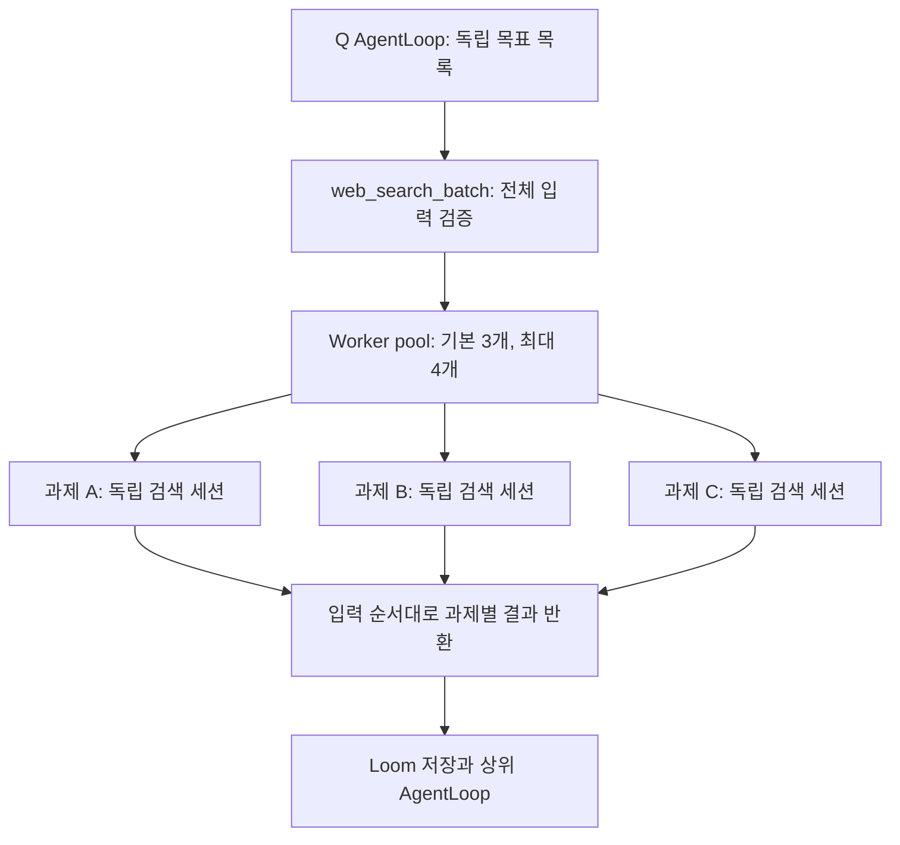

# 병렬 웹 검색 도구

`web_search_batch`는 기존 검색 흐름을 독립 과제별로 병렬 실행한다.
한 과제 안의 단계는 순서대로 수행하며, 서로 다른 과제 사이에서만 병렬화한다.



각 과제는 기존과 같이 Go HTTP/Rod 관찰 → Gemma System One 행동 선택 →
실행·재관찰을 반복한다. 새 검색어·요구사항 분해가 필요할 때만 호출한 에이전트의
기존 생성 모델을 쓰고, 완료 근거 검사는 설정된 완료 System One 모델로 처리한다.
아래 과거 실행에서는 Gemma 탐색·Qwen 완료 모델을 사용했다.
작업자는 기존 `Search` 메서드를 호출하며 새 범용 AgentLoop를 만들지 않는다.

## 입력

```json
{
  "tasks": [
    {"id": "go", "search": {"goal": "Go 공식 문서에서 CancelFunc 동작 조사", "allowed_domains": ["go.dev", "pkg.go.dev"]}},
    {"id": "sqlite", "search": {"goal": "SQLite 공식 문서에서 WAL 제약 조사", "allowed_domains": ["sqlite.org"]}},
    {"id": "python", "search": {"goal": "Python 공식 문서에서 asyncio.timeout 조사", "allowed_domains": ["docs.python.org"]}}
  ],
  "concurrency": 3,
  "model_concurrency": 1
}
```

1–8개 과제, 중복 없는 ASCII ID(영문·숫자·점·밑줄·하이픈, 최대 64바이트),
동시 검색 루프 수 1–4를 받는다. 생략 시 기본값은 3이다.
모델 요청 동시 수는 `model_concurrency`로 따로 지정하며 기본 1, 최대 4다.
실제 모델 동시 수는 검색 루프 수보다 커지지 않는다. HTTP·브라우저·각 루프의 상태는
병렬로 진행하고, built-in 엔진의 탐색·출처·완료·생성형 계획 요청은 공유 모델 슬롯을
사용한다. 외부 모델 서버가 충분히 처리할 때만 모델 동시 수를 늘린다.
`search`에는 기존 `web_search`의 모든 인자를 쓸 수 있다. 과제 목록은 상위 호출자가
만든다. 도구는 목표를 임의로 추가하거나 서로 다른 과제의 근거를 합치지 않는다.

## 결과와 부분 실패

`results`는 완료 순서와 무관하게 입력 순서이며 각 항목에 다음을 반환한다.

- `id`, `status`: complete / incomplete / error / cancelled.
- `started`: 대기 중 취소됐는지 실제로 실행을 시작했는지 구분.
- `elapsed_seconds`: 실행을 시작한 후 종료·정리까지의 시간. 대기열 시간 제외.
- `result`: 기존 검색 결과 전체. 근거·미해결 요구사항·행동·모델·호출 횟수 포함.
- `error`: 서비스 오류·취소의 안정적인 코드와 제한된 진단 메시지.

배치의 `elapsed_seconds`는 대기열과 모든 작업자의 정리를 포함한 전체 경과 시간이다.
`overview`에는 모든 과제의 ID·상태·시작 여부·시간·근거/미해결/오류 개수를 먼저
배치한다. 큰 결과가 Loom 참조와 4,096자 미리보기로 바뀌어도 다른 과제의 상태가
첫 과제의 긴 본문 뒤에 숨지 않도록 했다. 최대 길이 ID 8개와 큰 근거를 넣은
실제 MCP 테스트에서 모든 과제의 요약과 저장된 전체 근거를 확인했다.
호출 횟수도 별도로 합산한다. 과제 시간 합계를 직렬 실행 시간이나 속도 개선 배수로
해석하지 않는다. 모든 과제가 complete일 때만 배치도 complete다.
한 과제의 오류는 다른 과제를 취소하지 않으며 수집된 부분 근거를 보존한다.

## 자원과 시간

각 과제의 브라우저·쿠키·DOM 참조·이력·근거·요구사항은 독립적이다.
검색 세션을 공유하지 않으므로 하나의 브라우저 mutex로 전체 배치가 직렬화되지 않는다.
과제마다 종료 시 세션을 닫는다. 별도의 백그라운드 작업을 남기지 않고 모든 과제를
기다리는 동기 도구다. 재시작 복구나 작업 ID 기반 상태 조회는 이번 계약에 포함하지 않는다.

배치의 탐색·출처 판단과 완료 검사 모두 기본 최대 30분, 배치 전체 최대 35분이다.
단일 검색의 탐색·출처 판단 기본값은 기존 1분을 유지한다. 개별 과제의
`search.decision_timeout_seconds`로 탐색·출처 판단을 최대 1800초까지 지정할 수 있다.
배치 기한에는 대기 시간이 포함된다.
대기 과제는 시작 시 남아 있는 기한만 사용할 수 있다. 취소 시 새 과제를 시작하지 않고,
시작한 검색에 취소를 전달한 뒤 정리가 끝날 때까지 기다린다. 호출자 기한이 더 짧으면
그 기한을 따른다. 호출자 자체가 취소되면 MCP 부분 응답을 전달하지 못할 수 있다.
로컬 모델 슬롯 대기는 배치 기한에 포함되며 native 요청 기한은 슬롯을 얻은 후
시작한다. 일반 `websearch.Engine`은 슬롯을 자동 적용한다. 별도 injected 서비스는
`websearch.AcquireModelSlot(ctx)`를 모델 요청 하나의 범위에 적용할 수 있다.

동시 실행 수 제한은 한 배치에 적용된다. 다른 배치/단일 호출을 함께 실행하면 별도의
제한을 갖는다. 클라이언트의 검색 병렬화와 OEV 서버의 실제 추론 병렬성은 별개이며,
모델 서버가 요청을 내부에서 직렬 처리할 수 있다.
모델 동시 수 1/2와 검색 루프 수 2를 따로 지정한 테스트에서 검색 세션의 동시 시작과
native 요청의 실제 동시 수 제한을 각각 확인했다.

## 검증

채널로 제어한 테스트에서 두 검색이 동시에 진입하고 세 번째는 슬롯이 비어야 시작하는
동작을 확인했다. 완료 순서가 바뀌어도 결과가 입력 순서대로 반환됐고, 과제별 검색 엔진
세션·근거가 섞이지 않았으며 모든 세션이 닫혔다. 취소·대기열 중단·부분 결과·독립 실패를
확인했다. 실제 MCP 호출과 Loom 저장, 외부 `package app_test`의 공개 AgentLoop
광고·배치 실행·결과 수신도 확인했다.

실제 세 과제 입력은 `docs/experiments/web-search-batch-input.json`에 있다.

```text
go run ./scripts/websearchsmoke -tool web_search_batch -input docs/experiments/web-search-batch-input.json -output docs/experiments/web-search-batch-result.json
```

이 입력은 검색 결과 선택과 검색 엔진 차단 변수를 분리하기 위해 각각의 공식 문서에서
시작한다. 일반 검색 엔진부터의 탐색 성능을 검증하는 입력은 아니다.

전체 Go 테스트, vet, 빌드, 변경 패키지 lint, govulncheck, 모듈 아카이브 설치 검사는
통과했다. 현재 환경은 `CGO_ENABLED=0`이므로 race detector 실행은 하지 않았다.

## 실제 OEV 배치에서 발견한 제한

첫 세 과제 실행은 292.29초에 미완료로 반환됐다. Go 273.11초, SQLite 292.29초,
Python 252.47초였으며 세 과제 모두 근거 5개를 확보했다. 그러나 Gemma의 다음
행동 선택 요청이 기존 60초 기한을 초과해 `decision_error`로 끝났다. Qwen 완료
검사와 생성형 호출은 모두 0회였다. 원본은 `web-search-batch-result.json`이다.

이를 바탕으로 배치에서는 탐색·출처 요청의 기본 기한도 30분으로 바꿨다.
단일 검색의 기본 60초와 명시적 과제별 제한은 유지하고, HTTP 클라이언트도
30분 5초까지 지원한다. 테스트에서 배치의 실제 native 호출 deadline이 30분이고
명시적 과제 제한은 보존됨을 확인했다. 모델 서버의 내부 스케줄링·대기열이 원인인지는
서버 측 로그로 확인하지 않았으므로 단정하지 않는다.

검색어 작성·요구사항 분해의 생성형 호출은 기존 90초 제한을 유지한다.
배치 단위 35분 기한과 호출자 취소는 모든 단계에 적용된다.

탐색 기한을 늘린 두 번째 실행은 배치 1487.40초(24분 47초), Go 1295.95초
(21분 36초)로 반환됐다. 생성형 호출은 0회였으며 완료 검사 단계는 세 과제에서
실행됐다. 그러나 결과가 커져 receipt가 preview-only로 바뀌었는데 스모크 드라이버가
임시 Loom 저장소를 삭제하면서 전체 원문을 내보내지 못했다. 따라서 이 기록으로
세 과제의 개별 완료 상태를 확정하지 않는다. 남아 있는 receipt는
`web-search-batch-v2-result.json`이다.

검색 루프와 모델 요청의 동시 수를 분리하고 모델 요청 기본값을 1로 잡았다.
이는 과제별 상태·HTTP·브라우저의 병렬성을 유지하면서 단일 추론 서버로 보내는
겹친 요청을 제한하는 정책이다. 서버 내부 원인을 확정하거나 속도 개선을 입증한
것은 아니다. 충분한 처리 용량이 있으면 `model_concurrency`를 2–4로 늘릴 수 있다.

스모크 드라이버도 `-output` 사용 시 `<output>.artifact.json`으로 전체 captured
payload를 저장하도록 수정했다. 100KB 원문을 내보낸 뒤 내용이 잘리지 않았음을
테스트로 확인했다. 큰 결과에서도 과제별 상태·시간·근거를 검토할 수 있다.

## 최종 기본 설정의 실제 세 과제 실행

검색 루프 3개·모델 요청 슬롯 1개로 실제 MCP 도구를 실행했고, 세 과제가 모두
완료 검사에 통과했다. 원문 근거에서 Go의 자원 정리/비대기, SQLite의 같은 호스트
제약과 read-only WAL의 조건, Python의 TimeoutError/컨텍스트 밖 처리/재설정 설명을
직접 확인했다. 각 과제는 원문 근거 8개를 모았고 오류·미해결 항목은 없었다.

| 과제 | 결과 | 검색 시작 후 경과 시간 |
|---|---|---:|
| Go | complete | 658.23초, 10분 58초 |
| SQLite | complete | 762.58초, 12분 43초 |
| Python | complete | 561.71초, 9분 22초 |

배치 전체 경과 시간은 **762.58초(12분 43초)**다. 과제별 시간은 병렬 실행 중의
로컬 모델 슬롯 대기도 포함하므로 세 시간을 합쳐 직렬 실행 시간으로 해석하지 않는다.
전체 native 호출은 30회(Gemma 27회, Qwen 완료 검사 3회), 생성형 호출은 0회다.
이 실행은 루프 병렬성과 현재 모델 정책으로 세 과제가 완료된 사례를 확인한다.
앞선 실행과 캐시·서버 부하·문서 상태를 통제하지 않았으므로 모델 슬롯 제한만으로
얼마나 빨라졌는지 확정하는 비교는 아니다.

- 모델에 전달된 일반 receipt: `docs/experiments/web-search-batch-v3-result.json`
- 원문 captured payload: `docs/experiments/web-search-batch-v3-result.json.artifact.json`
- 실제 입력: `docs/experiments/web-search-batch-input.json`

미리보기에서도 모든 과제의 상태·시간·근거 수·오류 수가 보였고, 별도 artifact 파일에서
전체 근거와 모델·행동·호출 횟수를 읽을 수 있음을 확인했다.
