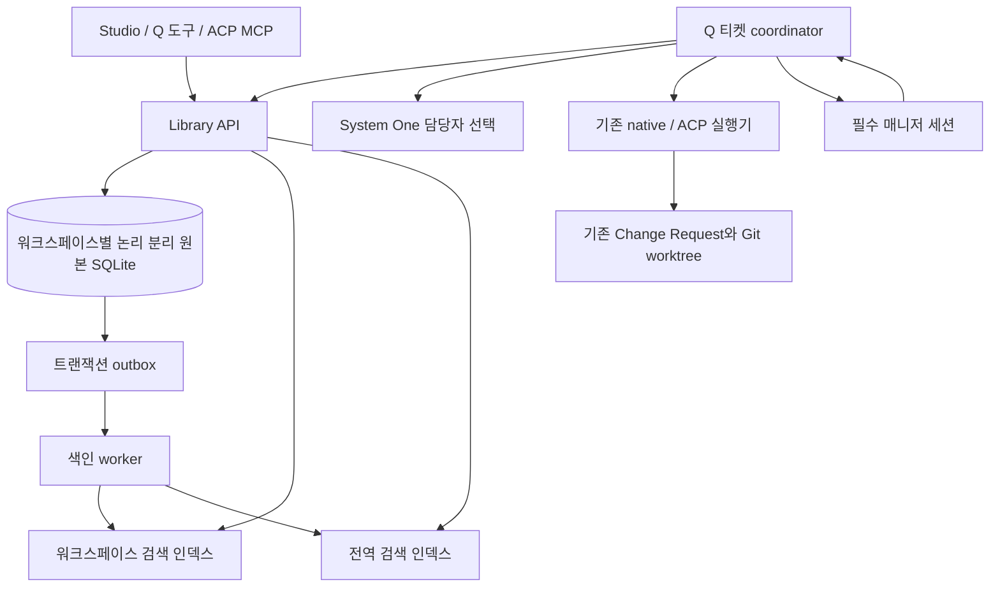

# 워크스페이스 Issue · Ticket · Manager 계획

- 상태: `feature/coordinator`에서 P0–P7의 저장·검색·실행·매니저·ACP 경로를 구현했다. 검증 근거와 운영 범위는 12.1절에 기록한다.
- 작성일: 2026-10-29, Asia/Seoul
- 조사 기준: `82ac75405ba920ec3d04625c22fc0c67ae87c48f`
- 대상: Q Library, Studio 프로젝트, 검색, 티켓 실행, 기존 delegation/Change Request, native/ACP 세션
- 문서의 권한: 사용자 확정 사항과 구현 제안을 구분한다. 아래 API·테이블·경로는 12.1절에서 구현을 확인한 항목 외에는 제안이다.

## 1. 이번 대화에서 확정된 방향

| 항목 | 확정 사항 |
| --- | --- |
| 워크스페이스 | **현재 Studio 프로젝트 하나**가 논리적 작업 공간이다. 여러 디렉터리를 포함할 수 있다. |
| 원본 저장 | **Library 한곳에 원본을 저장하고 `workspace_id`로 논리 분리**한다. 프로젝트 디렉터리에 이슈·티켓 원본 DB를 분산하지 않는다. |
| 검색 | 현재 워크스페이스 검색과 전체 검색을 제공한다. 자연어 질의, 기존 텍스트 검색과 semantic/hybrid 검색을 유지한다. |
| 지식 관리 | 이슈 본문과 댓글이 문서·배운 점·결정을 보관한다. 기존 proposition 기반 지식 기능은 제거 대상이다. |
| 학습 도구 | **`learn`과 `request_learning`을 제거**한다. 다른 이름으로 자동 학습 큐를 다시 만들거나 이슈 쓰기로 몰래 변환하지 않는다. |
| Librarian | 자동 심사·중복 병합·기각을 하는 Librarian 작업을 제거한다. 검색 인덱싱을 대체 작업으로 삼는다. |
| 이슈 | 스레드다. 본문과 댓글을 각각 ID로 읽고, 스레드와 긴 본문을 페이지로 읽을 수 있어야 한다. |
| 티켓 | 보드 칼럼은 **해야 할 것 / 진행 중 / 완료** 세 개로 고정한다. 검색과 개별 읽기를 지원한다. |
| 배정 | 메인 루프와 UI 등에서 등록할 수 있다. 희망 담당자가 있을 수도 없을 수도 있다. 실제 실행 전에는 System One이 해당 워크스페이스에 합류한 에이전트 중 적합한 대상을 검사한다. |
| 결과 검토 | 기존 내부 MR 흐름을 활용한다. 매니저 세션에서 검토·반영·피드백 후 재실행한다. |
| 매니저 | 워크스페이스마다 정확히 하나를 필수로 둔다. clear 가능, 삭제 불가. native API와 ACP 모두 지원한다. |
| 기존 에이전트 설정 | builtin/custom profile, 모델, ACP connection, 도구·delegation 권한을 재사용한다. 합류 목록과 티켓 실행 상태를 별도로 추가한다. |

핵심 구조는 **Library의 워크스페이스 지식·작업 원본 + 재구축 가능한 검색 인덱스 + 기존 Q 실행기**다.
이슈·티켓 저장 성공에 System One, embedding, 에이전트 실행 또는 매니저의 모델 응답을 요구하지 않는다.

## 2. 변경 전 구현 조사

| 영역 | 현재 코드에서 확인한 동작 | 이번 요구에 대한 차이 |
| --- | --- | --- |
| Library | 전역 Skills/propositions, 영속 proposition 큐, HTTP client/leader, 단일 파일 소유권을 제공한다. | 이슈·티켓·프로젝트 소속 지식·작업 원본은 없다. |
| Workspace Memory | canonical filesystem root별 archive와 Bleve/HNSW를 단일 서비스가 소유한다. | 여기의 `WorkspaceID`는 프로젝트 전체를 뜻하는 새 `workspace_id`와 다르다. |
| 검색 | `sessionstore`가 BM25, HNSW, RRF hybrid, 필터와 offset 검색을 제공한다. | 프로젝트 소속 필드, 스레드 전체 페이지, 대규모 이슈 원본 조회 API가 필요하다. |
| Studio 프로젝트 | 전역 `studio-projects.json`에 프로젝트 UUID와 복수 root를 저장한다. | 새로운 Library workspace와 프로젝트 카탈로그의 이중 원본을 만들면 안 된다. |
| System One | `choice`/`score` 등이 있고, 현재 Q에서는 skill/archive 후보 평가에 사용한다. | 워크스페이스 합류 목록·실행 예약·티켓 담당자 선택은 아직 없다. |
| delegation | canonical agent ID, 권한 필터, 자식 세션, durable bookmark, inner runner와 ACP 외부 실행이 있다. | 현재 `delegate`는 부모 도구 호출에 연결된다. 티켓을 지속 실행하는 작업 큐는 아니다. |
| 내부 MR | 실제 이름은 `change.Request` / Change Request다. base/head commit을 고정하고 worktree를 검토·병합한다. | 조회·병합 도구는 현재 **직접 위임한 자식**만 허용한다. 프로젝트 매니저가 다른 실행의 MR을 바로 읽을 수는 없다. |
| 피드백 | inner child는 저장된 대화로 후속 실행하고 open Change Request의 새 head를 제출할 수 있다. | 외부 ACP child의 후속 제어·복구는 inner와 동등하지 않다. |
| ACP 세션 | 일반 Sessions는 같은 remote session을 유지/재개하고 모델·effort 선택을 저장한다. Library MCP는 조회와 학습 요청을 제공한다. | 이슈·티켓·매니저 MR 도구가 없고, Q의 native delegation 도구도 자동 제공하지 않는다. |
| 세션 수명 | 일반 세션 clear/delete, catalog unregister, chat 삭제가 별도 경로다. | 매니저 불삭제 불변조건이 없으며 clear가 실행 소유권까지 해제하지 않게 해야 한다. |

특히 현재 `search_archive`의 최대 32개 후보 창은 전체 이슈 댓글 페이지의 구현으로 사용할 수 없다.
현재 HNSW 검색도 전역 후보를 뽑은 뒤 필터를 적용하는 경로가 있으므로, `workspace_id` 필드만 추가하면
작은 워크스페이스의 semantic recall이 부족해질 수 있다.

## 3. Library의 책임과 저장 구조

### 3.1 원본의 소유자

Library가 프로젝트 단위 workspace의 원본을 소유한다. 기존 Studio 프로젝트 UUID를 `workspace_id`로 유지한다.
Studio는 Library의 카탈로그를 조회하는 UI/API가 되고, `studio-projects.json`은 전환 후 쓰기 원본에서 퇴역한다.
여러 프로젝트 디렉터리는 `workspace_roots`로 같은 ID에 연결한다. 이름·경로 변경으로 workspace ID를 바꾸지 않는다.
실행이나 미처리 MR이 참조하는 root를 변경할 때는 새 배정을 중지하고 기존 참조를 보존한다.
root 목록 순서가 바뀌었다는 이유로 실행 checkout이나 merge 대상을 다른 디렉터리로 바꾸지 않는다.

기존 개인 채팅은 그대로 둔다. 개인 채팅의 임시 디렉터리를 새 업무 workspace로 자동 등록하거나 매니저를 하나씩 만들지 않는다.
프로젝트에 속하지 않은 세션에서 이슈·티켓을 쓰려면 대상 workspace를 명시적으로 선택한다.
여기서 말하는 프로젝트 매니저 세션은 기존 `builtin/manager` 서브에이전트 정의와 별개다.

제안 경로:

```text
<config-dir>/library/
  workspace-knowledge.sqlite          # 원본: workspace, issue, ticket, attempt, review, inbox, outbox
  workitems-index/
    global/                          # 전체 검색 projection
    workspaces/<workspace-id>/        # 현재 workspace 검색 projection
  ...                                # 기존 Skills 저장/인덱스

<config-dir>/workspaces/<workspace-id>/
  .q/sessions/<manager-session-id>/   # 기존 세션 파일 형식의 매니저 대화/모델/ACP checkpoint
  .q/sessions/<execution-session-id>/ # 티켓 실행 세션과 기존 자식 세션 트리
```

DB와 인덱스의 단일 writer는 기존 Library leader다. Studio·MCP·SessionHost가 DB를 직접 열지 않는다.
SQLite는 이미 사용하는 `modernc.org/sqlite`를 재사용한다. 별도 DB 서버나 메시지 브로커는 이 단계에 추가하지 않는다.

세션 대화 원본은 기존 `workspace.Store` / SessionHost가 계속 소유한다. Library에는 세션 참조와 업무 상태를 저장한다.
원본 중앙화 결정은 이슈·티켓·지식·업무 메타데이터에 관한 것이며, 대화 파일을 새 DB에 중복 저장하는 결정이 아니다.

### 3.2 기존 컴포넌트와의 경계

| 소유자 | 소유할 데이터와 동작 |
| --- | --- |
| `library` + 새 도메인 패키지 `workitems` | workspace/root/member, issue/post, ticket/event, assignment/attempt, review/inbox, 변경 revision과 outbox |
| Library 검색 worker | workspace/global 검색 projection, embedding 생성·갱신, 재색인 상태 |
| `app.SessionHost` + 티켓 coordinator | 실행 프로세스, 기존 runner 호출, lease 갱신, 매니저 턴 전달, 실제 Git 작업 |
| `workspace` / 기존 session catalog | 대화·모델 선택·ACP checkpoint·자식 대화 파일과 기존 잠금 |
| `gitwork` / `change` | Git worktree, 고정 base/head 검증, diff, merge, 정리 |
| `workspacememory` | 기존 디렉터리별 대화·작업 아카이브. 이슈·티켓 원본을 복제해 별도 authority로 만들지 않는다. |
| 기존 subagent 설정 | 프로필, 모델, ACP command, 허용 도구와 delegation 관계 |

Library는 에이전트 실행기를 직접 import하거나 Git 명령을 실행하지 않는다.
도메인 패키지는 Studio나 특정 모델에 의존하지 않는다. 기존 agent loop를 대체하는 새 모델 루프를 만들지 않는다.



### 3.3 전역 서비스 중단 시의 계약

원본을 중앙에 두므로 Library가 중단되면 새 이슈·티켓 쓰기와 업무 상태 변경은 실패한다.
로컬에 별도 쓰기 원본을 만들어 성공처럼 응답하지 않는다. 이미 저장된 작업과 실행 상태는 재시작 후 복구한다.
System One·embedding 중단은 원본 저장을 막지 않는다. 관련 작업에만 `배정 대기`·`색인 지연`을 표시한다.

## 4. 원본 모델과 ID

아래는 테이블 경계 제안이다. 세부 컬럼은 첫 구현 명세에서 확정한다.

| 원본 | 주요 식별자·데이터 | 불변조건 |
| --- | --- | --- |
| workspace | 기존 project UUID, 이름, active/archived, manager 참조 | workspace마다 매니저 참조 하나, 프로젝트와 같은 ID |
| workspace_root | root ID, workspace ID, canonical path, 실행 가능 여부 | 같은 실제 디렉터리를 중복 소속으로 등록하지 않음 |
| workspace_member | member ID, agent canonical ID, 정의 출처 root, 합류/중지 상태 | 프로필 자체를 복사·수정하지 않음 |
| issue | issue ID, workspace ID, 표시 번호, 제목, 상태, labels, body post ID, revision | 본문을 댓글과 다른 중복 필드에 저장하지 않음 |
| issue_post | post ID, issue ID, kind(body/reply), thread seq, 내용, author, refs, revision | 본문·댓글 모두 독립 ID, 내용 수정 시 revision 증가 |
| ticket | ticket ID, workspace ID, 표시 번호, 설명, 수용 기준, 칼럼, 실행 모드, 희망 담당자, 연결 issue | 칼럼은 todo/in_progress/done만 허용 |
| ticket_post/event | post/event ID, ticket ID, seq, 댓글·피드백·상태 변경·근거 | 사용자 설명과 durable 결과를 별도 조회·검색 가능 |
| assignment / attempt | assignment/attempt ID, ticket revision, member snapshot, 설정 revision, lease generation, 세션 참조 | 같은 ticket에 활성 attempt 하나, 작업 부작용 전에 저장 |
| review item | review ID, ticket/attempt, 종류(git/report), 기존 change ID와 고정 commit, review revision | 검토한 head와 실제 반영 head가 일치 |
| manager inbox | event ID, workspace ID, 원인 ticket/review ID, 처리 상태와 operation ID | 매니저가 바빠도 이벤트 유실·중복 실행 방지 |
| outbox / index receipt | 변경 seq, entity ID/revision, upsert/delete, projection별 적용 위치 | 원본 커밋과 동일 트랜잭션으로 이벤트 저장 |

표시 번호 `#123`은 UI용이다. API와 도구는 전역 충돌 없는 opaque ID를 사용한다.
검색 결과는 workspace ID, entity/post ID, 부모 issue/ticket ID, source revision을 반드시 포함한다.
검색 점수나 snippet을 원본 또는 현재 실행 상태로 취급하지 않는다.

## 5. 이슈: 문서와 지식의 저장 단위

1. 이슈 제목·상태·labels는 issue에, 본문은 독립 body post에 저장한다.
2. 답글은 각각 post ID와 issue 내 단조 증가 seq를 가진다. 필요하면 `reply_to_post_id`를 둔다.
3. 본문·답글을 별도로 수정하고 revision 이력을 남긴다. 삭제는 tombstone으로 처리해 참조와 페이지 순서를 보존한다.
4. 스레드 목록은 seq 기반 keyset cursor와 읽기 상한 seq를 사용한다. 새 댓글이 생겨도 기존 페이지가 반복되거나 건너뛰지 않는다.
5. 긴 본문은 post ID + 고정 revision + content cursor로 나누어 읽는다. 페이지 사이 내용이 바뀌면 재조회가 필요하다고 알린다.
6. 검색은 본문·댓글을 각각 hit로 반환한다. 하나의 긴 이슈에 여러 관련 댓글이 있으면 각각 읽을 수 있게 한다.
7. UI는 이슈 단위로 묶어 보여줄 수 있지만, 원래 hit의 post ID와 revision을 숨기지 않는다.
8. 배운 점은 기존 이슈에 댓글로 추가하거나 새 지식 이슈를 만든다. 관련 ticket/MR, 검증 근거와 출처를 연결한다.

`issue_create`/`issue_reply`의 성공은 DB 원본 저장 성공이다. 검색 색인 완료를 기다리지 않는다.
쓰기 후 상세 화면은 DB에서 즉시 읽으며, 검색은 적용 중인 revision/색인 상태를 알린다.

## 6. 검색과 전역 인덱싱

### 6.1 검색 범위

- `scope=workspace`: 지정한 Studio 프로젝트에 속한 모든 root의 이슈·티켓을 검색한다.
- `scope=all`: Library에 등록된 전체 프로젝트를 검색한다. 결과에 프로젝트 이름/ID를 표시한다.
- entity kind, issue/ticket 상태, labels, 작성자, 날짜 등은 명시적 필터로 처리한다.
- 로컬 검색 결과가 부족하다는 이유로 자동으로 전체 검색으로 확장하지 않는다.
- 기본 에이전트 도구는 현재 workspace에 고정한다. 전체 검색은 별도 명시 옵션으로 요청한다.

### 6.2 인덱스 배치 제안

모든 인덱스를 Library의 사용자 전역 디렉터리에 둔다.
기존 Bleve/HNSW/RRF 구현을 재사용해 **프로젝트별 projection과 전체 projection을 함께 유지**한다.
원본은 SQLite 하나이며, 인덱스 내부의 record 파일도 재구축 가능한 복사본이다.

이 배치는 현재 HNSW의 전역 top-k 후 필터 방식으로 작은 프로젝트의 결과가 사라지는 문제를 피한다.
현재 프로젝트 검색은 그 프로젝트의 ANN graph를 사용하고, 전체 검색은 전역 graph를 사용한다.
각 프로젝트 검색 결과의 BM25 점수를 단순히 합쳐 전체 순위를 만들지 않는다.
비용은 인덱스 저장 공간과 갱신량 증가다. 비활성 프로젝트 handle은 단일 소유권을 유지하며 닫을 수 있게 한다.

텍스트 필터에는 명시적 `workspace_id`, entity kind, parent ID 필드가 필요하다.
기존 `Scope="global"`나 임의 tag에 workspace ID를 끼워 넣지 않는다.
긴 post는 chunk로 색인하되, 조회 대상은 chunk가 아니라 원본 post ID와 내용 위치다.
issue 제목/labels 변경처럼 자식 검색 문맥을 바꾸는 수정도 해당 post projection을 갱신한다.

### 6.3 검색 품질과 페이지 계약

- `lexical`, `semantic`, `hybrid` 모드를 제공한다. 텍스트 검색은 embedding 없이 가능하다.
- semantic 전용 요청에서 embedding이 없으면 명시적인 상태를 반환한다. hybrid의 텍스트 fallback은 응답에 표시한다.
- 기존 자연어 질의와 선택적인 System One 후보 평가를 유지할 수 있지만, Librarian의 저장 심사와 결합하지 않는다.
- 검색 cursor는 query/filter/scope와 index generation에 묶는다. 재색인으로 순위 snapshot이 무효화되면 cursor를 갱신한다.
- ANN 후보 창의 수를 전체 일치 건수처럼 표시하지 않는다. `total`의 정확/하한/알 수 없음 의미를 구분한다.
- 스레드 전체 읽기와 보드 목록은 SQLite 원본의 keyset pagination을 사용한다. 검색 후보 수 제한을 적용하지 않는다.

### 6.4 원본과 인덱스의 일치

원본 변경과 outbox를 한 SQL 트랜잭션으로 커밋한다. 색인 worker는 커밋된 seq를 읽어 workspace/global 양쪽에 적용한다.
각 projection의 적용 위치를 별도로 기록하므로 한쪽만 성공한 뒤 종료되어도 나머지를 재시도한다.
entity revision보다 오래된 이벤트·embedding 결과는 적용하지 않는다. 삭제 tombstone도 revision을 가져야 한다.
chunk 수가 줄어들면 이전 chunk를 제거한다. worker 재시작과 반복 전달은 같은 문서를 중복 생성하지 않는다.

본문 저장, BM25 적용, embedding/HNSW 적용 상태를 구분한다. embedding 요청은 개수와 bytes/tokens 모두 제한한다.
model·차원·분석기·문서 schema 변경은 새 index generation을 만들고 원본으로 재색인한 뒤 전환한다.
전체 index 삭제/재생성이 issue/ticket 원본을 삭제해서는 안 된다.

## 7. 티켓과 System One 배정

### 7.1 보드 상태와 실행 상태

| 보드 칼럼 | 실행 상세 상태 예 | 이동 조건 |
| --- | --- | --- |
| 해야 할 것 | queued, assignment_waiting | 발행 즉시 배정 대기·배정 실패/후보 없음 |
| 진행 중 | starting, running, blocked, unknown, awaiting_review, changes_requested | 실행 예약이 확정된 뒤부터 매니저의 수용 전까지 |
| 완료 | accepted, merged | 매니저가 결과를 수용했고 필요한 MR 반영이 완료됨 |

실패·검토 대기를 네 번째 칼럼으로 만들지 않는다. badge와 상세 상태로 표시한다.
에이전트가 답변을 반환했거나 `task_complete(succeeded)`를 호출했다는 이유만으로 완료로 이동하지 않는다.
수동으로 완료하는 UI도 매니저 수용과 같은 검증·이력 경로를 사용한다.

UI와 메인 루프·ACP 모두 같은 `ticket_create`를 사용한다. 티켓 발행과 `queued` 배정 접수는 하나의 원본 트랜잭션으로 처리한다.
별도 Start 동작 없이 coordinator가 2초마다 배정 대상을 확인한다. 담당자 지정은 선택이며 System One 검사는 필수다.
발행 응답은 ticket ID와 queued 상태를 반환하며 모델 실행·검토 완료를 기다리지 않는다. 기존 실행 상태가 비어 있는 미시작 티켓도 자동 접수한다. 사용자가 중지했거나 결과 불명인 작업은 자동 재실행하지 않는다.

### 7.2 합류 목록은 기존 프로필의 참조

workspace member는 `builtin/*`, `global/*`, `workspace/*`의 기존 정의를 참조한다.
여러 디렉터리에 같은 `workspace/<name>` 프로필이 있을 수 있으므로 **정의가 나온 root ID도 함께 식별**한다.
System One은 모호한 이름 대신 member ID를 선택한다. workspace profile을 다른 root의 동명 profile로 대체하지 않는다.

첫 제안은 workspace profile의 실행 root를 해당 정의 root로 제한하고, global/builtin은 허용된 프로젝트 root를 사용한다.
다른 root에서의 실행 허용은 합류 설정에서 명시적으로 관리한다. 기존 profile schema나 delegation grant를 바꾸지 않는다.
현재 root에서 직접 호출할 수 없는 builtin junior developer 같은 대상은 기존 senior 경로를 유지한다.

### 7.3 실행 전 배정 절차

1. Library에서 ticket revision, 희망 담당자, 대상 root, 합류 목록 revision을 읽는다.
2. 호스트가 disabled/탈퇴, 모델·ACP 연결 불가, 도구·delegation 권한 부족, root 범위 불일치, 수용 능력 부족 후보를 제외한다.
3. 남은 후보의 설명·역할·허용 범위·기존 부하를 bounded metadata로 System One에 전달한다.
4. `task_assignment` 역할의 score/choice로 적합성을 검사한다. 적합한 대상 없음도 정상 결과로 허용한다.
5. 반환한 member ID가 전달한 후보 집합에 있는지 검사하고, ticket/member/config revision과 실행 가능 상태를 다시 확인한다.
6. SQL 트랜잭션으로 담당자·attempt·lease generation을 예약하고 진행 중 상태를 저장한다.
7. 저장된 attempt ID로 기존 실행기를 시작한다. 실제 작업을 시작한 뒤 담당자를 뒤늦게 기록하지 않는다.

System One이 없거나 실패하면 ticket은 배정 대기로 남긴다. 임의 첫 에이전트나 메인 모델로 우회 실행하지 않는다.
희망 담당자도 위 검사를 거친다. 부적합한 희망 담당자를 자동 교체할지 확인을 요구할지는 14절의 세부 결정 사항이다.
후보가 요청 예산을 넘으면 전부를 평가할 수 있도록 batch/최종 선택을 구성하고, 뒤쪽 후보를 조용히 버리지 않는다.
기존 검색 평가의 실패 시 원래 순위를 쓰는 정책을 티켓 실행 배정에 그대로 적용하지 않는다.

## 8. 실행·MR·피드백·복구

### 8.1 기존 실행기의 재사용

native는 `subagent.GeneralRunner`와 기존 권한·도구 runtime, inner 후속 실행/복구를 재사용한다.
외부 에이전트는 기존 ACP connection/adapter를 재사용한다. 설정 화면에 같은 에이전트를 다시 정의하지 않는다.
티켓 coordinator는 Library의 작업 상태와 실행 lease를 관리하고, Q host가 살아 있는 동안 background worker로 동작한다.
앱이 종료되면 접수된 티켓은 DB에 남고 다음 host 시작에서 복구한다. 별도 상주 daemon은 초기 필수 조건으로 만들지 않는다.

티켓 실행 세션은 매니저 대화의 자식 수명에 종속시키지 않는다. 별도 execution session을 만들고 ticket/attempt가 참조한다.
매니저 clear나 현재 메인 루프 턴 취소가 이미 접수된 티켓을 삭제하지 않는다.
실행 파일과 Git checkout의 root는 구분한다. 중앙 세션 디렉터리를 소스 checkout으로 착각하면 안 된다.

### 8.2 MR은 기존 Change Request를 기반으로 확장

- Git 변경은 기존 `change.Request`의 base/head commit, `gitwork.Manager`의 준비·제출·diff·merge·cleanup을 재사용한다.
- 일반 `delegate`의 직접 자식 검사와 현재 도구 계약은 유지한다.
- 티켓 MR에는 workspace/ticket/attempt와 reviewer 역할을 연결하는 중앙 review item을 추가한다.
- 매니저 도구 경로는 중앙 소유 관계를 검증해 같은 workspace의 티켓 MR만 해석한다. 단순히 직접 자식 검사를 전역으로 제거하지 않는다.
- 티켓 MR의 업무 상태는 Library가 소유한다. 자식 파일에 같은 변경 가능한 원본을 하나 더 두지 않도록 change 저장 adapter를 분리한다.
- 코드 변경이 없는 조사·문서 결과는 기존 `TaskResult.report/findings/artifacts/verification`을 review item으로 제출한다. 가짜 Git MR을 만들지 않는다.

MR 도착은 영속 inbox event로 매니저에게 전달한다. 매니저가 실행 중이면 이후 턴에 처리한다.
매니저가 사용자에게 질문하거나 정지해도 inbox는 유지하며, 같은 event/operation을 재전달해도 이미 끝난 반영을 반복하지 않는다.

### 8.3 검토와 재실행

매니저는 고정된 diff와 검증 근거를 읽고 수용/피드백/거절한다.
Git MR의 수용은 실제 merge 완료와 저장된 receipt까지 확인한다. 요청 접수와 merge 성공을 같은 응답으로 표현하지 않는다.
report 결과도 매니저가 수용한 뒤 완료 처리한다.

피드백은 먼저 Library에 기록하고 다음 attempt/review revision을 만든다.
inner는 기존 child follow-up을 재사용해 대화와 아직 살아 있는 worktree를 이어갈 수 있다.
피드백은 branch/worktree를 삭제하는 기존 `change_request_close`와 분리한다.
새 head가 제출되면 이전 head에 대한 승인은 무효이며 다시 검토한다.

현재 mutating external ACP delegation은 inner의 격리 worktree·Change Request 제출 경로를 공유하지 않는다.
ACP worker까지 지원하려면 Q host가 checkout lease와 Git 제출을 소유하고 ACP는 그 checkout에서 실행하게 하는 adapter가 필요하다.
ACP 재개 가능 여부와 실행 결과가 확인되는 경우만 후속 실행한다. 프로세스 종료나 타임아웃을 근거로 외부 작업을 무조건 재실행하지 않는다.

merge는 repository/common-dir와 대상 ref 기준으로 직렬화한다. 기존 dirty parent, base 이동, head 이동 검사를 유지한다.
오래된 MR을 강제 병합하거나 자동 reset하지 않는다. 충돌은 피드백·재작업 상태로 남긴다.
다중 root 프로젝트에서 하나의 티켓이 여러 Git 저장소를 수정하는 지원 범위는 별도로 확정한다.

### 8.4 중복 실행과 중단

ticket당 활성 attempt 유일성, worker lease/heartbeat, generation fencing을 DB에서 검사한다.
모델·Git·ACP 호출 동안 SQL 트랜잭션을 잡고 있지 않는다. 명령 intent를 저장하고 외부 작업 뒤 결과를 기록한다.
이미 작업이 실행되었는지 알 수 없으면 기존 복구 정책처럼 `unknown`으로 남긴다.
lease 만료만으로 다른 worker가 같은 외부 부작용을 바로 다시 실행하지 않는다.
Git merge 뒤 DB 저장 전에 종료된 경우는 기존 pinned commit 검증으로 실제 결과를 확인하고 receipt를 복구한다.

## 9. 필수 매니저 세션과 ACP

### 9.1 하나의 매니저 ID

workspace 원본에 매니저 session reference를 하나만 둔다. SQL unique 제약과 멱등 생성 절차로 동시 생성도 하나로 수렴시킨다.
프로젝트 생성/기존 프로젝트 이관 때 manager reference를 먼저 예약하고 기존 세션 형식으로 파일을 만든다.
중간 종료 후 같은 reference로 생성을 마무리한다. 모델이나 ACP 인증이 없어도 세션 자체는 존재할 수 있다.

대화 저장 root는 `<config-dir>/workspaces/<workspace-id>` 같은 관리 디렉터리로 고정한다.
프로젝트 root 순서 변경·삭제 때문에 매니저 ID나 대화 위치가 바뀌지 않게 한다.
native 실행은 기존 working directory/auxiliary root 구분을 활용하고, ACP에도 저장 root와 실제 작업 root 구분을 추가한다.
읽을 수 없는 프로젝트 디렉터리는 실행 불가로 표시하되, 중앙 이슈·티켓과 매니저 inbox는 조회 가능하게 한다.

### 9.2 clear와 delete는 다른 계약

- clear는 같은 manager ID를 유지하고 대화/context/run 및 필요하면 remote ACP 세션만 초기화한다.
- 모델·ACP 선택, workspace 연결, ticket/attempt/MR/inbox는 보존한다.
- 이전 run에 결과를 기다리게 하지 않는다. 새 매니저 문맥은 Library에서 미처리 업무 snapshot을 다시 읽는다.
- 매니저 실행 중 clear는 안전한 턴 중단/해제를 거친다. 별도 ticket worker를 묵시적으로 취소하지 않는다.
- 일반 session DELETE, catalog unregister, managed chat 삭제, CLI/내장 삭제 경로에서 공통 보호 정책을 검사한다.
- UI의 삭제 버튼 숨김만으로 불삭제를 구현하지 않는다. 불삭제 검사 실패 시 서버/공유 수명 API가 거절해야 한다.
- 프로젝트 제거는 archive 동작으로 제안한다. 필수 매니저와 중앙 원본을 연쇄 삭제하지 않는다.

### 9.3 ACP 매니저가 실제로 MR을 처리하려면

현재 ACP Library MCP의 네 조회 도구만으로는 MR 검토·실행 요청을 할 수 없다.
이슈·티켓 명령과 manager 전용 review/feedback 명령을 **native와 같은 application facade**로 연결해야 한다.
ACP prompt에 역할 설명만 넣고 실제 merge 도구를 제공하지 않는 구현은 완료로 인정하지 않는다.

도구 권한은 host가 현재 session/workspace/manager binding으로 결정한다.
모델이 입력 인자에 다른 manager ID를 넣어서 권한을 바꾸게 하지 않는다.
일반 ACP 세션에는 허용된 이슈·티켓 도구만, 매니저 ACP에는 해당 workspace의 검토 기능을 추가한다.
매니저라는 업무 역할에 필수인 도구 연결은 host가 보장한다. 기존 ACP connection의 선택적 `library` 스위치를
매니저 권한이나 필수 MR 연결의 유일한 기준으로 쓰지 않는다.
외부 ACP의 자체 shell/file 도구를 Q가 제거하거나 강제 제한할 수 있다고 가정하지 않는다.

## 10. API·도구 표면 제안

정확한 이름과 schema는 구현 첫 단계에서 기존 MCP와 함께 검토한다. 같은 작업은 Studio/native/ACP가 같은 handler를 사용한다.

| 표면 | 계약 |
| --- | --- |
| workspace / member | 프로젝트 root 관리, 합류/탈퇴/중지, 실행 가능한 후보와 제외 사유 조회 |
| issue create/update/reply | 원본 저장 후 ID/revision 반환. model 판단·색인 완료를 기다리지 않음 |
| issue get / post get / posts list | 독립 ID 조회, revision에 고정된 내용 페이지, seq cursor 페이지 |
| ticket create/update/comment | 상태·본문·수용 기준·issue 연결 관리. 실행 성공을 의미하지 않음 |
| ticket start/retry/stop | durable command 접수 상태와 operation ID 반환. 실제 실행 상태는 별도 조회 |
| search issues/tickets/knowledge | scope, mode, 필터, hit의 원본 ID, snippet, index generation, cursor |
| review read/accept/feedback/close | manager binding 검사, pinned revision 검증, 실제 결과/접수 receipt 구분 |
| manager get/clear | 필수 세션 참조·capability 조회와 clear. delete는 제공하지 않음 |

기존 `change_request_*`의 Git 동작을 재사용하는 범위와 manager 전용 adapter를 명시한다.
새 domain API에서 client가 현재 workspace를 전달하더라도 최종 root/member/review 소속은 서버에서 검사한다.
Library의 현재 loopback 사용자 경계는 유지한다. 전체 검색 권한을 다른 workspace의 실행·수정 권한으로 확대하지 않는다.

Studio에는 프로젝트별 Issues, Tickets 보드, Manager 진입점과 현재/전체 검색 전환을 추가한다.
티켓 상세에서 담당자, System One 선택, 실행 attempt, MR, 피드백, 연결 issue를 따라갈 수 있게 한다.
기존 Subagents 설정 대신 프로젝트 화면에서 합류 목록을 관리한다. 일반 Sessions UI와 모델/effort 선택은 유지한다.

## 11. 기존 학습 기능의 제거와 데이터 전환

사용자가 제거를 결정한 기능은 호환 alias로 남기지 않는다.

1. `learn`, `request_learning`, proposition 검색/조회·등록 표면과 자동 학습 UI/프롬프트를 제거한다.
2. Librarian judge, create/merge/discard adjudication, 내부 모델 설정과 시작 시 judge 초기화 경로를 제거한다.
3. Thinker의 **기존 자동 학습 전용 경로**, learning segment/checkpoint/백그라운드 작업을 중단·제거한다. 다른 독립 기능과 공유하는 코드가 있으면 그 소유 경계는 유지한다.
4. 기존 agent profile·delegates·ACP connection 설정은 보존한다. 퇴역 내부 학습 역할 설정은 마이그레이션에서 명시적으로 처리한다.
5. native/ACP의 사용 안내를 이슈 검색과 본문/댓글 작성으로 바꾼다. 모든 턴마다 강제 학습 기록을 생성하지 않는다.

### 11.1 실제 자동 학습 연결 조사와 제거 목록

도구 목록에서 `learn`만 빼거나 학습 설정을 기본 off로 바꾸는 것으로 끝내지 않는다.
변경 전 다음 연결을 확인했다. 현재는 모두 제거했으며, 아래 표는 제거 범위를 추적하기 위한 조사 기록이다.

| 연결 | 현재 코드에서 확인한 동작 | 제거 범위 |
| --- | --- | --- |
| `task_complete` | [agentloop](../agentloop/loop.go)가 유효한 작업 완료 처리 뒤 `q_thinker_task_complete` learning event를 발생시킨다. [app facade](../app/agent_loop_facade.go)가 이를 전달한다. | **작업 종료 자체는 유지**하고 별도 learning event 생성·전달을 제거한다. succeeded/blocked 완료 모두 학습 적재를 유발하지 않아야 한다. |
| TUI/Studio 학습 이벤트 수신 | [chat events](../app/chat_events.go)가 `enqueueLearningSpecial`을 호출하고, [learning](../app/learning.go)이 `AppendTaskComplete`로 학습 구간을 닫는다. | 이벤트 수신 분기·구간 종료·학습 명령 실행을 제거한다. 정상 종료 결과·transcript 저장은 유지한다. |
| Q의 ACP 서버 학습 이벤트 수신 | [ACP 서버](../app/acp.go)의 일반 실행 및 이벤트 처리 경로가 같은 learning event를 받아 `launchLearning`을 호출한다. | ACP adapter로 외부 에이전트를 사용하는 경로뿐 아니라, **Q 자신을 ACP 서버로 실행하는 경로**의 학습 연결도 제거한다. |
| 메시지 수집과 크기 임계값 | [session events](../app/session_events.go), [chat controller](../app/chat_controller.go), [chat events](../app/chat_events.go)가 사용자·assistant 메시지를 수집한다. [Machine](../thinker/state.go)은 구간 크기 초과/도달 시 자동으로 닫는다. | `observeLearningMessage`, 학습용 context 길이 갱신, `BoundarySize` 적재를 제거한다. 대화 저장·검색 아카이브·실제 context compaction은 유지한다. |
| 특수 대화 경로 | [ACP commit](../app/acp_commit.go), [ACP 질문 응답](../app/acp_question.go), [외부 에이전트 결과](../app/external_agent.go)도 메시지를 학습 수집기에 전달한다. | commit·질문·외부 결과의 정상 기능은 유지하고 학습 수집 호출만 제거한다. |
| 시작·복원·다음 작업 | [model](../app/model.go)이 `session.Learning`을 복원하고, [세션 진입](../app/sessions.go), [live session](../app/session_live.go), ACP 세션 열기 및 [Thinker 완료](../app/session_thinker.go)가 다음 학습 작업을 시작한다. | 기존 pending queue/checkpoint를 새 세션 시작·복원·작업 완료 때 자동 재개하지 않는다. 학습 결과 handler가 후속 작업을 다시 실행하는 연결도 제거한다. |
| 계획 승인 흔적 | `AppendPlanApproved`, `q_thinker_plan_approved`, `BoundaryPlanApproved` 처리와 context 필터가 남아 있다. 이번 조사에서는 현재 실행 코드에서 새 이벤트를 생성하는 경로를 찾지 못했다. | 활성 기능이라고 가정하지 않되, legacy 수신 분기·상수·구간 모델·관련 테스트도 함께 정리한다. |
| 설정으로 재활성화 | `/learn`, `/learn on/off/status`, [Studio learning API](../studio/sessions.go), [설정 파일](../workspace/learning.go), ACP 프로세스 간 학습 설정 전파가 있다. | 명령·UI·API·설정 전파·background context를 제거한다. 기존 설정 파일이나 복원 데이터로 학습을 다시 켤 수 없어야 한다. |

`task_start`/`task_complete`, TaskResult, 작업 상태 전이, MR 제출, 결과 저장은 새 티켓 흐름에서도 필요하므로 보존한다.
`task_complete` 후 별도 agent/모델을 실행해 배운 점을 추출하거나, 자동 이슈 생성으로 치환하지 않는다.
필요한 배운 점은 작업 중인 에이전트가 명시적인 이슈 작성 도구로 기록하게 한다.

### 11.2 재활성화 방지와 회귀 조건

- task 종료, 일반 대화의 크기 임계값 도달, commit, 질문 응답, 외부 결과 수신 후 **학습 큐·Thinker 작업·Librarian 호출이 새로 생기지 않음**을 검증한다.
- 기존 learning state/pending queue/checkpoint가 들어 있는 실제 세션 fixture를 복원해도 학습이 재개되지 않아야 한다.
- 새 세션·clear·재시작·모델 context 길이 변경·구형 learning 설정 로드로 학습 worker가 다시 생성되지 않아야 한다.
- `task_complete`의 정상 종료·blocked 결과·transcript·작업 상태·MR 동작은 기존대로 유지한다. 실제 대화 compaction/아카이브도 별도로 회귀 검증한다.
- 내부 학습용 event/handler/context/worker와 사용하지 않는 역할·프롬프트를 정리한다. public Agent Loop의 학습 event 표면과 모든 host adapter도 함께 점검한다.
- 과거 학습 데이터는 마이그레이션 입력으로만 읽고 실행하지 않는다. 구형 필드가 있다는 이유로 기존 일반 대화 전체를 읽지 못하게 만들지 않는다.

### 11.3 기존 데이터의 보존과 이관

기존 전역 propositions에는 workspace 소속을 확정할 근거가 없다. 임의 프로젝트에 배정하지 않는다.
기존 원본·pending job·receipt 파일은 덮어쓰지 않고 비활성 백업으로 보존한다. 사용자가 명시적으로 내용을 가져올 때는 선택한 workspace의 이슈/댓글 작성 API와 refs를 사용한다. 자동 일괄 이관이나 별도 export 명령은 이번 구현에 포함하지 않는다.
새 시스템에서 자동 학습 큐를 재생해 legacy 내용을 새 지식으로 중복 생성하지 않는다.
기존 파일은 파괴적으로 지우지 않는다. 기능 퇴역과 사용자 데이터의 물리 삭제는 구분한다.

인덱싱은 중복·모순을 판단하거나 사실성을 보증하지 않는다. Librarian 제거 후에는 의미가 비슷한 글도 원본 그대로 보존한다.
중복 방지는 동일 요청의 idempotency에 한정하고, 지식의 정정·반박·새 결정은 이슈 수정과 댓글로 출처를 남긴다.
모델이 기록한 주장과 사용자가 확인한 사실을 author/refs로 구분하며, 숨은 자동 병합 모델을 다시 추가하지 않는다.

## 12. 구현 순서와 각 단계의 완료 조건

| 단계 | 작업 | 완료 조건 |
| --- | --- | --- |
| P0 · 계약/이관 기반 | workspace=project ID 확정, Library domain API·schema, 중앙 원본 소유권, 기존 프로젝트 카탈로그 이관, manager binding 수명 규칙 | 기존 프로젝트 ID·root·일반 세션이 유지되고 이관을 반복해도 중복 workspace가 없음 |
| P1 · 필수 매니저 | manager 멱등 생성, 중앙 관리 세션 root, native/ACP 선택, clear/delete 공통 정책 | 프로젝트당 하나, 삭제/unregister 거절, clear 후 업무 참조 유지, native/ACP 채팅 가능 |
| P2 · Issue 수직 기능 | issue/post 원본 CRUD, ID 조회, thread/content cursor, Studio/native/ACP 공통 API | 본문·댓글을 개별 읽고 전체 스레드를 페이지로 누락 없이 조회 가능 |
| P3 · 검색/학습 퇴역 | workspace/global BM25+semantic/hybrid, outbox/reindex, legacy 파일 보존·자동 재생 차단, learn/Thinker 학습/Librarian/propositions 및 11.1절 자동 trigger·복원 경로 제거 | 두 검색 범위가 분리되고 색인 재구축으로 원본이 유지됨. 도구·역할·프롬프트 제거뿐 아니라 task 종료·크기 임계값·재시작에도 학습이 발생하지 않음 |
| P4 · Ticket 보드/합류 | 고정 3칼럼, 검색·댓글·이슈 연결, 기존 프로필 참조 합류 목록, 발행 시 자동 배정 접수 | UI와 메인 루프가 같은 티켓을 만들고 실행 전까지 todo를 유지 |
| P5 · System One 실행 | 후보 검증, 역할 설정, durable 배정/attempt/lease, 기존 native runner와 MR 제출 | 중복 실행 없이 배정하고 실패·후보 없음은 대기로 표시. worker 성공만으로 done 처리하지 않음 |
| P6 · 매니저 MR 순환 | inbox, workspace MR resolver, 기존 Git 검토·merge, feedback/follow-up, report 수용 | 매니저가 실제 diff 검토·반영·재실행하며 clear/재시작 중에도 결과가 유실되지 않음 |
| P7 · ACP 및 복구 완결 | ACP manager의 실제 review 도구, mutating ACP worker 격리/제출/후속 실행, multi-root와 장애 회귀 | API-only와 ACP-only manager 모두 티켓→MR→피드백→완료의 동일한 외부 결과를 제공 |

P1의 ACP 채팅 가능과 P7의 ACP 업무 처리 가능은 다른 완료 기준이다.
P3까지 이슈 저장·검색이 준비된 뒤 기존 학습 기능을 끈다. 제거 후 배운 점을 기록할 경로가 없는 중간 상태로 배포하지 않는다.
각 단계는 migration, API, native/ACP 도구, UI, 복구, 문서를 포함한 수직 단위로 끝낸다.
전체 기능이 필요한 상태에서 UI만 만들거나 mock endpoint로 완료 처리하지 않는다.

### 12.1 `feature/coordinator` 구현 상태

P0–P7의 실제 경로를 다음과 같이 연결했다. 현재 API·데이터 계약은 [Library 문서](library.md)가 설명한다.

| 단계 | 구현 결과 |
| --- | --- |
| P0 | Library 단일 writer가 중앙 SQLite schema 5를 소유한다. 기존 프로젝트 UUID·timestamp·다중 root를 트랜잭션으로 이관하고 JSON 원본을 보존한다. protocol 9은 config 디렉터리 identity를 검사한다. |
| P1 | 프로젝트마다 고정 manager UUID를 예약·복구한다. 중앙 대화 저장과 실제 프로젝트 실행 root를 분리하고 native/ACP 모델 선택을 지원한다. 공통 삭제/unregister 경로는 거절하며 idle clear는 ID·선택을 유지한다. |
| P2 | 이슈·티켓·본문·댓글 원본, immutable revision, optimistic edit, 요청 receipt와 outbox를 동일 트랜잭션으로 저장한다. ID 조회, snapshot thread cursor와 Unicode content page를 Studio/native/ACP가 공유한다. |
| P3 | 전역/워크스페이스별 BM25·HNSW projection, semantic/hybrid, 필터, outbox replay·reindex와 stale vector 차단을 구현했다. 기존 embedding client/Gateway를 재사용한다. learn/request_learning·propositions·Librarian·Thinker와 task 종료/크기/restore 자동 학습 경로를 제거했다. |
| P4 | Studio의 3칼럼 티켓 보드, 발행 시 자동 배정 접수, 연결 이슈·기준·담당자 편집, 기존 프로필 참조 합류/비활성화를 구현했다. 같은 이름의 프로필도 definition/execution root로 구분한다. |
| P5 | 설정된 System One만 후보 선택을 수행한다. 후보 없음·설정/응답 오류는 이유가 있는 대기 상태이며 다른 모델로 우회하지 않는다. source revision 기반 요청 키, 원자적 capacity/claim, token/generation/lease와 OS 잠금이 중복 실행을 막는다. 기존 GeneralRunner·delegation·Workspace Memory·MCP를 재사용한다. |
| P6 | 결과·티켓 댓글·inbox를 함께 저장한다. 매니저는 기존 Studio run의 질문/제어를 사용한다. 실패 알림의 이유·backoff와 완료 receipt를 보존한다. report 수용, 실제 고정 Git diff/merge/close, 피드백 후 같은 worker/worktree의 새 head 제출을 연결했다. |
| P7 | ACP worker에 필수 workspace MCP를 전달하고 변경 작업은 기존 Git worktree로 격리한다. 실제 remote session resume만 허용하며 결과 불명 prompt를 자동 재전송하지 않는다. native/ACP manager가 같은 source review 도구를 사용한다. worker 대화와 unknown tool 상태를 제한된 페이지로 조회한다. |

완료 처리 경계는 다음과 같다.

- worker의 성공은 `awaiting_review`다. report는 매니저 수용 후, Git 작업은 실제 merge 성공 후에만 `done`이다.
- stop 뒤 늦은 성공 결과는 보존하되 cancelled로 처리한다. 실행 중 member revision/disabled 변경은 blocked로 처리한다.
- lease가 만료된 worker는 unknown으로 남긴다. 명시적인 재시도와 검사 없이 외부 효과를 재실행하지 않는다. 중단된 Git merge/close만 기존 고정 commit 복구 경로로 재개한다.
- 매니저 대화 clear는 source·attempt·MR·inbox와 알림 완료 receipt를 삭제하지 않는다. 사용자 응답을 기다리는 매니저가 worker capacity를 소비하지 않는다.
- semantic 전용 요청은 embedding 불가를 오류로 반환하고 hybrid는 lexical fallback을 명시한다. 원본 저장은 embedding이나 모델 응답을 기다리지 않는다.

검증에는 중앙 원본/요청 재전달/동시 댓글/충돌/페이지, 작은 workspace vector partition과 stale embedding 거절, 실제 임시 Git 저장소의 native 실행→피드백→고정 merge, stdio ACP의 동일 원격 세션 재개·unknown 거절, 실제 빌드한 Q MCP의 이슈 생성·검색·티켓 review, 매니저 질문의 Studio 노출과 clear 후 중복 방지를 포함한다.
최종 검증: `go test ./... -count=1 -timeout=240s`, `go vet ./...`, `golangci-lint run --max-issues-per-linter=0 --max-same-issues=0 ./...` (0 issues), `go build ./...`, `go run ./scripts/modulecheck`, frontend check/build를 통과했다. Studio Playwright 전체 46개가 한 번의 최종 실행에서 모두 통과했다. 설정 테스트의 Library 주소 복원과 새 세션 등록 후 URL 전환 대기를 명시해 테스트 간 상태 누수/경합도 정리했다.

`go mod tidy -diff`는 기존 `go.sum` 319줄의 줄바꿈 차이만 보고했다. 추가/삭제 내용은 동일하며 의존성 파일을 수정하지 않았다. `govulncheck`와 race용 GCC가 없어 해당 검사는 수행하지 않았다. 초기 전체 실행에서 Gateway 종료 대기 테스트가 한 차례 지연 실패했으나, 3회 단독 실행과 전체 재실행을 모두 통과했다.

후속 UI 수정: 선택창의 고정 높이와 세로 padding 충돌, 검색 모드의 전체 너비, 기본 브라우저 버튼 스타일을 수정했다. 공통 Studio 스타일과 검색/목록 배치를 적용하고 Edge의 1440px·390px, 글자 크기 100%·130%에서 선택창 내용 높이·가로 넘침을 검사했다. 이슈 작성/검색, 티켓 합류/배정, 외관 설정, 도움말, 매니저 보호를 포함한 관련 브라우저 테스트 6개와 frontend check/build를 통과했다.

자동 배정 수정 검증: source 생성+queued 원자적 저장, 생성 receipt 재전달 시 중지 상태 보존, 이전 버전의 빈 실행 상태 티켓 자동 접수, MCP 발행 즉시 queued 응답을 검사했다. 브라우저에서는 Start 없이 발행→자동 배정 시도→대기 사유 표시를 확인했다. 전체 Go 테스트, vet/lint(0 issues), frontend check/build와 관련 브라우저 4개가 통과했다. 자동 배정 접수 계약을 구분하기 위해 Library protocol을 9로 올렸으며 기존 Studio/Library는 새 바이너리로 재시작해야 한다.

운영 범위와 남긴 제한:

- 하나의 티켓은 하나의 execution root/worktree를 수정한다. 여러 저장소에 걸친 원자적 MR 묶음은 포함하지 않는다.
- 티켓 발행 시 자동 배정 대기로 들어간다. 희망 담당자가 부적합하면 대기하며 조용히 교체하지 않는다.
- 구형 propositions/queue/checkpoint는 inert backup으로 남긴다. 사용자 소유 지식을 임의 workspace에 옮기거나 자동 이슈로 생성하지 않는다. 별도 export/import 명령은 추가하지 않았다.
- 실제 유료 Codex/Claude/Grok 계정에 prompt를 보내는 검증은 수행하지 않았다. ACP transport·재개와 공통 MCP 계약은 결정적 stdio peer 및 실제 Q 프로세스로 검증한다.
- Library protocol 6 등 기존 프로세스는 자동 교체하지 않는다. 업그레이드된 실행 파일로 Studio/Library를 재시작해야 새 protocol 9을 사용할 수 있다.

## 13. 검증 계획

| 경계 | 반드시 확인할 시나리오 |
| --- | --- |
| workspace | 한 프로젝트의 두 root가 같은 issue/ticket/manager를 사용하고 다른 프로젝트는 별도 ID를 사용 |
| 저장 | 동시 댓글 seq, optimistic revision 충돌, 중복 요청, 원본+outbox 커밋 전/후 종료 |
| 읽기 | 검색된 본문·댓글 ID로 정확한 원본 조회, 긴 내용 페이지 중 수정 감지, 새 댓글·tombstone 사이 누락/중복 방지 |
| 검색 | workspace/all 격리, 작은 workspace semantic recall, BM25+HNSW fusion, embedding 없음/오류, 삭제·수정·chunk 축소, stale vector 무시 |
| 색인 | 한 projection만 적용 후 종료, 재전달, 전체 재색인, model/dimension 변경, 진행 상태와 오류가 빈 검색 결과로 숨겨지지 않음 |
| 학습 퇴역 | native/ACP 도구 catalog에 learn/request_learning/proposition 도구 없음, Librarian 호출 없음, 배운 점이 실제 issue/post로 저장 |
| 숨은 학습 trigger | task_complete(succeeded/blocked), 대화 크기 임계값, commit·질문·외부 결과, context 길이 변경 후 자동 수집·적재·Thinker 호출 없음. task lifecycle과 compaction은 정상 동작 |
| 학습 복원 퇴역 | pending learning state/checkpoint·구형 learning 설정을 가진 세션의 시작/재개/clear/재시작에서 학습 재활성화 없음 |
| 배정 | 합류하지 않은 후보·탈퇴·disabled·동명 profile 다른 root·허용되지 않은 junior 경로·System One 실패·선택 후 설정 변경 |
| 실행 | 동일 티켓 동시 start, lease 교체, stop과 늦은 응답, 재시작, 결과 불명 외부 부작용의 재실행 방지 |
| MR | 다른 workspace/attempt MR 거절, dirty parent/base/head 이동, 새 head 이전 승인 무효화, 실제 merge 뒤 상태 저장 전 종료 |
| 매니저 | 동시 생성, API/CLI/catalog 삭제 차단, clear 후 ticket/MR/inbox 보존, 바쁜 매니저 이벤트 재전달, 모델/ACP 변경 |
| 실제 연결 | native와 설치된 ACP adapter로 MCP 도구 조회뿐 아니라 이슈 작성·검색·티켓 배정·MR 읽기·피드백·반영을 실제 호출 |
| UI | 고정 3칼럼, 현재/전체 검색, 본문·댓글 permalink, 긴 스레드 pagination, 모바일, 오류/대기 상태, 기존 세션 회귀 |

검색 성능·recall 목표 수치는 데이터 규모를 정한 뒤 측정한다. 현 단계에서 측정하지 않은 처리량이나 지연을 보장하지 않는다.
위 표는 회귀 검증의 기준이다. 수행한 검증과 수행하지 않은 외부 계정 검증은 12.1절에서 구분한다.

## 14. 이번 구현의 선택과 후속 확장

앞의 세 가지 구조 결정과 사용자 요구사항을 기준으로 다음 기본값을 적용했다. 별도 사용자 결정이 필요한 보존 기간이나 다중 MR 확장은 추가하지 않았다.

- 자동 실행의 기본값: 발행된 모든 티켓을 자동 배정 대기로 접수한다. 별도 Start나 queue-on-create 옵션을 요구하지 않는다.
- 희망 담당자가 부적합할 때: 조용히 교체하지 않고 매니저 확인/배정 대기로 남긴다.
- 여러 Git 저장소를 한 티켓이 수정할지: 첫 수직 기능은 한 write root + 다른 root 읽기, 이후 여러 MR 묶음 지원 여부를 명시.
- 기존 전역 지식의 이관 대상: 사용자가 선택할 workspace/이관 이슈. 자동 추측 금지.
- 기존 일반 세션을 최초 매니저로 지정할지: 전용 세션을 새로 생성하고 기존 일반 대화는 보존한다.
- 삭제·보존 정책: 프로젝트 archive와 원본 데이터 물리 삭제를 분리하고, 완료 ticket/attempt/MR 보존 기간은 별도로 정함.
- 새 UI에서 기존 `Projects` 명칭을 `Workspaces`로 바꿀지: 데이터 ID와 경계는 먼저 통일하고 표시 이름은 별도 결정.

## 15. 조사한 소유 코드와 후속 변경 지점

| 코드 | 조사 근거 / 후속 역할 |
| --- | --- |
| [Library 구조](library.md), [leader](../library/server.go), [client](../library/client.go) | 단일 소유 서비스와 새 원본/검색 API |
| 구형 `library/proposition*.go` (삭제됨) | 서비스·심사·학습 큐를 퇴역하고 기존 파일은 비활성 백업으로 보존 |
| 구형 `app/learning.go`, `thinker`, `tools/builtin/learning.go` (삭제됨) | 자동 학습 경로 제거; 세션 읽기 호환만 유지 |
| [검색](../sessionstore/search.go), [record](../sessionstore/record.go), [vector](../sessionstore/vector.go), [embedding 갱신](../sessionstore/embedding_update.go) | 필드·파티션·버전·stale 갱신 검사 재사용/확장 |
| [Workspace Memory](workspace-memory.md), [서비스](../workspacememory/server.go) | root 단위 archive와 새 프로젝트 단위 domain의 구분 |
| [프로젝트](../studio/projects.go), [session catalog](../studio/session_registry.go) | 기존 project ID, 다중 root, 카탈로그 이관 |
| [System One 타입](../client/systemone/types.go), [설정](../systemoneconfig/config.go), [후보 평가](../tools/systemone_archive.go) | 배정 역할과 엄격한 후보 결과 검증 |
| [delegation](../app/delegation.go), [GeneralRunner](../subagent/delegation.go), [복구](delegation-session-recovery.md) | 권한·작업 실행·직접 자식 MR 경계·후속 실행 |
| [Change Request](../change/request.go), [Git manager](../gitwork/manager.go), [관련 테스트](../app/delegation_test.go) | 고정 commit, worktree와 검토/merge 재사용 |
| [외부 ACP 실행](../app/acp_external_subagent.go), [세션 ACP](../app/session_acp.go), [MCP bridge](../internal/librarymcp/server.go) | ACP 역할별 실제 도구와 격리 실행 adapter |
| [SessionHost](../app/session_host.go), [live session](../app/session_live.go), [세션 수명](../workspace/sessions.go), [Studio 삭제/clear](../studio/sessions.go) | 매니저 보호, 저장/실행 root 분리와 clear 계약 |
| [Studio 진입점](../studio/frontend/src/App.svelte), [기존 프로필 타입](../studio/frontend/src/subagents/types.ts) | Issues/Tickets/Manager 화면과 설정 보존 |

P0–P7 구현은 이 브랜치에서 함께 검토한다. 보존한 legacy 데이터의 선택적 수동 이관과 여러 저장소 MR 묶음은 별도 확장이다.


## Coordinator / Integrator role split (2026-10-29)

Each Studio workspace now reserves two protected sessions. Coordinator receives
requests, writes issue plans and issues tickets; Integrator receives attempt
notifications, reviews pinned results, requests changes and approves merges.
System One's assignment to joined subagents is unchanged. Coordinator cannot use
`ticket_review`, and the source rejects its ID as a review actor. This does not
add an automatic ticket dependency scheduler: dependent implementation tickets
must be issued after the required planning result is available.

Schema 6 preserves the original `manager_session_id` as Integrator, adding a
stable `coordinator_session_id` for active and archived workspaces. Coordinator
storage is separate; existing Integrator history, model settings and ACP remote
sessions are preserved. Both roles support native/ACP model controls, retain
identity/settings on clear, and reject deletion/unregister. Studio has distinct
role labels and navigation; `/manager` remains a compatibility alias for
`/integrator`. See [Library](library.md) for the current contract.
